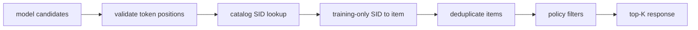

# Inference, export, and deployment boundaries

GenRec is an academic reproduction and research sandbox, not a production serving framework. It has no stable REST API, online feature store, model registry, rollout controller, or latency SLO. Checkpoint restoration is model-specific rather than a generic framework API.

## What “deployable” means here

When these docs describe generated recommendations as deployable, the narrow meaning is that a semantic ID has been resolved to one catalog item and duplicate items have been removed. It is not a claim about online reliability, security, or performance.

## Minimum offline inference bundle

An auditable batch-inference artifact should contain at least:

```text
bundle/
├── model checkpoint
├── resolved Gin configuration
├── item mapping and checksum
├── item-embedding / SID-catalog manifest
├── SID→item resolver policy and training-only counts
├── raw scores/SIDs plus resolved-item predictions
├── source commit or exact source-bundle hash
└── metrics and protocol metadata
```

Weights alone are insufficient: a changed item mapping or tokenizer makes the same integer output refer to a different item.

## Inference by family

| Family | Inference | Required assets | Main risk |
|---|---|---|---|
| SASRec / HSTU | full-catalog matrix scores | item mapping, weights | output-layer cost and seen-item policy |
| TIGER | ordinary beam SID generation | RQ-VAE, SID catalog, resolver | invalid SIDs, collisions, beam latency; current code has no Trie constraint |
| LCRec / OneRec | SID generation, with model-specific constraints | tokenizer, SID catalog, resolver | collision policy, KV cache, decoding latency |
| COBRA | sparse generation + dense BeamFusion | RQ-VAE, text encoder, catalog vectors | cross-branch version consistency and memory |
| RPG | parallel token heads → item scores; optional graph propagation | OPQ mapping, token embeddings, adjacency | graph-build memory and catalog updates |
| NoteLLM | query/catalog embedding dot product | base LLM/LoRA, catalog embedding index | catalog re-encoding and ANN/exact divergence |
| GRAM | constrained lexical-ID generation | lexical catalog, item passages, Trie | expensive passage encoding and specialized preprocessing |

RQ-VAE and RQ-KMeans are tokenizer components, not standalone serving recommenders.

## Required semantic-ID postprocessing



- Never silently map an invalid or out-of-catalog SID to a “nearest” item.
- The resolver must not use test or future online popularity.
- Define what happens if item deduplication leaves fewer than K candidates.
- Match history-item filtering to the offline evaluation policy.
- Switch tokenizer, catalog, resolver, and weights atomically.

## Checkpoint loading is model-specific

- SASRec, HSTU, and TIGER commonly save state dictionaries; reconstruct the model with the same configuration first.
- RQ-VAE saves a dictionary with `model_config`, optimizer, and scheduler state and supports `RqVae.from_pretrained`.
- OneRec / Hugging Face models may use `save_pretrained` directories.
- NoteLLM's best checkpoint stores trainable parameters only and must be paired with the same base model and PEFT structure.
- RPG and GRAM follow their trainer-specific save logic.

Do not build a universal `torch.load` endpoint and assume all formats are interchangeable.

## What production serving would still require

At minimum:

1. a versioned model/tokenizer/catalog registry;
2. input schemas, authentication, rate limits, timeouts, and audit logs;
3. dynamic batching and GPU-worker lifecycle management;
4. atomic catalog update and rollback;
5. ANN or efficient full-catalog scoring;
6. batched KV-cache / constrained decoding and candidate backfill where applicable;
7. online/offline feature parity;
8. shadow or canary rollout and monitoring;
9. privacy, copyright, and third-party model-license review;
10. a tested fallback to a stable baseline.

## Performance reporting

Report these separately:

- cold-start time for weights and catalog;
- warm single-query p50/p95 latency;
- throughput at a fixed batch size;
- peak GPU memory;
- catalog size, history length, beam width, and K;
- preprocessing, embedding, and index-build time;
- quality differences between exact and ANN/graph approximations.

Training steps/second or one warm batch is not an online latency benchmark.

## Recommended research interface

Before a production API exists, prefer a deterministic offline prediction dump. For every test user, store the target, raw top N, resolved top K, scores, model hash, and catalog hash. This supports generate-once/evaluate-many comparisons of resolver, deduplication, and policy without rerunning expensive inference.

Related documentation:

- [Evaluation system](architecture/evaluation-system.md)
- [Reproducibility and provenance](architecture/reproducibility.md)
- [Implementation status](reference/model-status.md)
- [179 reproduction runbook](179-reproduction-runbook.md)
