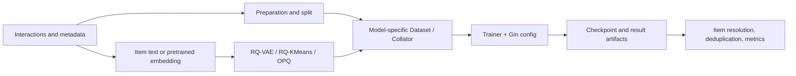

# GenRec

GenRec is a PyTorch and Gin-config research framework for **generative recommender systems**. It is built for paper reproduction, auditable comparisons, and experimentation—not for production serving.

!!! info "Documentation authority"

    The Chinese site is the canonical implementation documentation. English pages cover the main entry points; when an English page is missing, the i18n site falls back to Chinese. “Implemented,” “end-to-end verified,” and “paper result reproduced” are separate statuses; see [Implementation and reproduction status](reference/model-status.md).

## Start here

| Goal | Recommended path |
|---|---|
| Run the project | [Getting started](getting-started.md) → [Installation](installation.md) |
| Understand the code | [Architecture](architecture/index.md) → [Repository map](architecture/repository-map.md) |
| Choose an implemented model | [Model overview](models/overview.md) → model pages |
| Study methods not yet implemented | [GenRec landscape](landscape/index.md) → [model catalog](landscape/model-catalog.md) |
| Run comparable experiments | [Evaluation system](architecture/evaluation-system.md) → [reproducibility](architecture/reproducibility.md) |
| Extend the repository | [Extension guide](architecture/extension-guide.md) → [contributing](contributing.md) |

## What is implemented

The repository currently contains **9 recommenders** and **2 semantic-ID/tokenizer components**. A component is not counted as a recommender unless it performs the recommendation task after training.

| Family | Implementations | Representation / prediction |
|---|---|---|
| Discriminative sequential baselines | [SASRec](models/sasrec.md), [HSTU](models/hstu.md) | one item ID; full-catalog ranking |
| RQ semantic-ID recommenders | [TIGER](models/tiger.md), [LCRec](models/lcrec.md), [COBRA](models/cobra.md), [OneRec](models/onerec.md) | multi-level codes; OneRec includes SFT, alternative CLM, and GRPO paths |
| Other generative / LLM routes | [RPG](models/rpg.md), [NoteLLM](models/notellm.md), [GRAM](models/gram.md) | parallel code heads, dense text retrieval, or lexical IDs with multi-granularity fusion |
| Representation components | [RQ-VAE](models/rqvae.md), [RQ-KMeans](models/rqkmeans.md) | item embedding → discrete semantic ID; not recommenders by themselves |

The [model catalog](landscape/model-catalog.md) also documents major unimplemented directions—generative retrieval, LLM recommendation, discrete tokenizers, diffusion recommenders, hybrid systems, and recommendation reasoning/RL—with implementation status and primary references.

## How the system fits together



Models do not inherit from a common dataset, model, processor, or trainer hierarchy. Shared contracts come from CLI/Gin entry points, data fields, result artifacts, and evaluation protocol. See [Training system](architecture/training-system.md) and [Data pipeline](architecture/data-pipeline.md).

## Minimal run

```bash
python -m venv .venv
source .venv/bin/activate
python -m pip install -e .

python scripts/prepare_amazon2014.py \
  --splits beauty --kinds reviews meta

python genrec/trainers/sasrec_trainer.py \
  config/sasrec/amazon.gin --split beauty
```

Models that consume semantic IDs require a matching tokenizer checkpoint first. For TIGER:

```bash
python genrec/trainers/rqvae_trainer.py \
  config/tiger/amazon/rqvae.gin --split beauty

python genrec/trainers/tiger_trainer.py \
  config/tiger/amazon/tiger.gin --split beauty
```

See [Getting started](getting-started.md) for all pipelines and the [command index](reference/command-index.md) for verified entry points.

## Rules for reading results

- A generated SID tuple is not necessarily a unique item. Resolve collisions using **training-only** SID→item statistics, deduplicate items, then compute headline metrics.
- Recall/NDCG from different splits, candidate sets, negative-sampling schemes, decoding budgets, or evaluation levels are not directly comparable.
- A source implementation does not prove that its paper configuration or result has been reproduced. Check the checkpoint, log, data fingerprint, source provenance, and metric level.
- Historical TIGER, LCRec, and OneRec SID-tuple results may be collision-inflated. Public comparisons should use revalidated item-level artifacts.

The current snapshot and protocol notes live in [BENCHMARKS.md](https://github.com/phonism/genrec/blob/main/BENCHMARKS.md).

## Project boundary

GenRec does not promise the latency, security, multi-tenancy, online feature consistency, or rollout controls required for serving. See [Inference and deployment boundaries](deployment.md). The project is MIT licensed; contribution requirements are in the [contributing guide](contributing.md).
