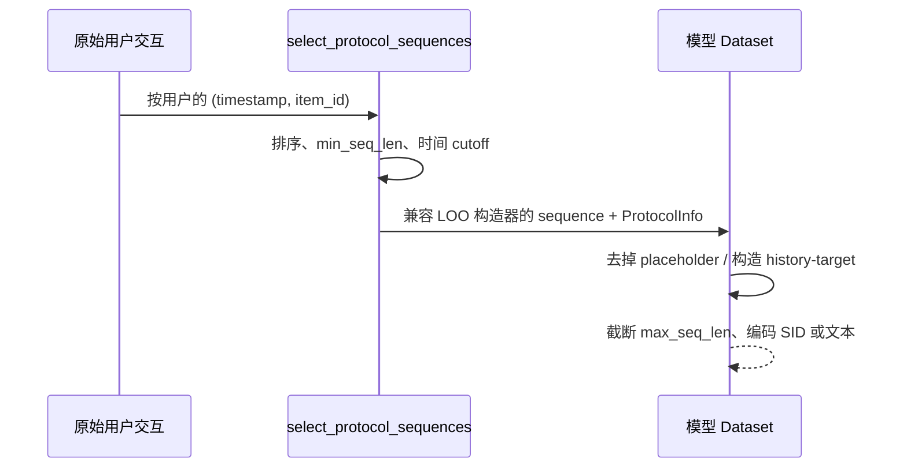

# 数据流水线、ID 与 batch 契约

## 数据从哪里来

### Amazon 2014 主路径

[`genrec/data/amazon.py`](https://github.com/phonism/genrec/blob/main/genrec/data/amazon.py) 的 `DATASET_CONFIGS` 给出类别到 gzip 文件名的映射。当前常用类别为 `beauty`、`sports`、`toys`、`clothing`、`home`，目录为：

```text
dataset/amazon/
├── raw/<split>/reviews_*.json.gz
├── raw/<split>/meta_*.json.gz
└── processed/<split>/
    ├── item_emb_<encoder-basename>.parquet
    ├── *.sem_ids.json
    └── 其他模型专用缓存
```

`AmazonItemDataset` 会在缺文件时从 Stanford SNAP 下载 Amazon 2014 文件。序列适配器本身通常假定原始文件已经存在。

### Amazon Reviews 2023

[`amazon2023.py`](https://github.com/phonism/genrec/blob/main/genrec/data/amazon2023.py) 提供 Hugging Face 数据下载、交互 k-core 和 gzip 输出。`prepare_amazon2023()` / `save_processed_data()` 将兼容 Amazon 风格的文件写入 `root/raw/<category>`，因此 `DATASET_CONFIGS` 中存在对应文件名时，LCRec/OneRec 等通用 Amazon 适配器可继续读取 `raw/<split>`。

同文件中的早期 `Amazon2023ItemDataset` 和 `Amazon2023SASRecDataset` 却读取 `root/processed/<split>`。这两个专用类与当前预处理输出目录并非直接对接；除非另有明确迁移步骤，不要把它们作为主路径。当前 `config/sasrec/amazon2023.gin`、`config/hstu/amazon2023.gin` 等应以实际绑定的通用适配器为准。

### 其他来源

- [`ml1m_hstu.py`](https://github.com/phonism/genrec/blob/main/genrec/data/ml1m_hstu.py) 下载 ML-1M，并迭代执行 user/item 5-core；输出 HSTU 相同的 batch schema。
- [`amazon_gram.py`](https://github.com/phonism/genrec/blob/main/genrec/data/amazon_gram.py) 不下载原始数据；它要求 `dataset/gram/<Split>/` 已有用户序列、item 文本、lexical ID 和相似 item 文件。
- [`p5_amazon.py`](https://github.com/phonism/genrec/blob/main/genrec/data/p5_amazon.py) 是基于 PyTorch Geometric/P5 资源的兼容路径，不是当前公平矩阵的公共数据入口。

## 交互划分协议

Amazon 主路径通过 [`select_protocol_sequences()`](https://github.com/phonism/genrec/blob/main/genrec/data/evaluation_protocol.py) 共享协议。输入是：

```python
Dict[str, List[Tuple[int, int]]]
# user_id -> [(unix_timestamp, item_id), ...]
```

函数先按用户内时间排序，再过滤 `len(sequence) < min_seq_len` 的用户。

### `leave_one_out`

每个用户的最后两个交互固定留作 validation/test：

```text
train prefix = seq[:-2]
valid target = seq[-2], history = seq[:-2]
test target  = seq[-1], history = seq[:-1]
```

具体训练样本是“每用户一条”“滑动窗口”还是“全位置监督”，由模型适配器决定。

### `global_temporal`

函数在完成最短序列过滤后，将所有剩余交互时间戳排序：

- `train_cutoff` 位于 `ceil(N * temporal_train_ratio) - 1`；
- `valid_cutoff` 位于 `ceil(N * (train_ratio + valid_ratio)) - 1`；
- 训练只见 `timestamp <= train_cutoff`；
- valid 使用验证时间窗内该用户的第一个可用 target；
- test 使用 `valid_cutoff` 之后该用户的第一个可用 target。

为复用原有 LOO 样本构造器，函数会在返回序列末尾复制已有交互作为**必定会被剥离的占位符**：train 末尾复制两次，valid 复制一次。占位符不应进入实际 history/target。



`global_temporal` 是**交互历史不见未来**，不是冷物品设置。item mapping、元数据、catalog embedding 一般仍由全目录建立，因此目录本身是 transductive 的。

`ProtocolInfo` 记录 `protocol`、两个 cutoff、过滤前/后用户数。新 Dataset 应把它保存为 `self.protocol_info`，并保存 `self.evaluation_protocol`，以便 trainer 写入 `results.json`。

## ID 空间：最容易出错的接口

| 路径 | item ID | padding / ignore | SID |
|---|---:|---|---|
| SASRec | `1..N` | item `0` | 无 |
| HSTU / ML-1M HSTU | `1..N` | item/timestamp `0` | 无 |
| NoteLLM | `1..N` | 不在 catalog 检索中使用 padding | 无 |
| RPG | `1..N` | item `0`，label `-100` | OPQ code 映射为 `code + c*K + 1` |
| TIGER | `0..N-1` | T5 token `0` 同时作为 pad/eos/start | RQ-VAE code，flatten 后 offset |
| LCRec / OneRec / COBRA | `0..N-1` | 由 HF tokenizer 或模型局部 mask 决定 | `<C{c}_{code}>` 或内部 offset |
| RQ-VAE / RQ-KMeans | embedding row `0..N-1` | 无 item padding | 输出 `[N,C]` code |
| GRAM | 原始字符串 item ID | target token padding 为 `-100` | 字符串 lexical ID |

不要在不同路径间直接复用整数 ID。即使两者都来自同一份 review gzip，`1-based` 与 `0-based` 已经相差一位。

### first-seen mapping 不变量

Amazon 适配器普遍按 review 文件中 ASIN 第一次出现的顺序建映射。对于 SID 路径，需要同时满足：

```text
review first-seen item index
    == AmazonItemDataset embedding row
    == tokenizer assignment row
    == downstream sem_ids_list index
```

`AmazonItemDataset` 先建立 1-based review mapping，再仅对找到 metadata 的 item 按 ID 排序并写 embedding row。若 catalog item 缺 metadata，当前实现会少生成一行，之后 row 与 review item index 可能错位。主数据通常依赖 metadata 完整这一事实，但这是必须验证的输入不变量，不是代码层自动保证。改变数据清洗、metadata 文件或映射规则后应重建 embedding/tokenizer，并检查：

```python
len(item_embeddings) == number_of_unique_review_items
len(sem_ids_list) == number_of_unique_review_items
```

## 物品 embedding 与缓存

`AmazonItemDataset` 用 `SentenceTransformer` 编码 title、price、sales rank、brand 和 categories，返回 `embeddings: np.ndarray[N,D]`。缓存路径只包含 encoder 路径的 basename：

```text
processed/<split>/item_emb_<basename>.parquet
```

生成受 `fcntl` 独占锁保护，并通过临时文件 + `os.replace` 原子写入。缓存键不包含模型权重 checksum、元数据 checksum 或文本模板版本；以下变化后应使用 `force_regenerate=True` 或移走精确缓存文件：

- 同 basename 下替换了 encoder 权重；
- 修改了 metadata 文本拼接；
- 替换/重排 review 或 metadata；
- 改变 embedding normalization 约定。

RQ-VAE 训练对物品 embedding 做固定种子 42 的 95%/5% item 随机划分；这只是 tokenizer 的重构验证，不是推荐的 user LOO split。

RPG 另有 `<encoder-basename>.sent_emb.npy`，OPQ SID 缓存名包含 encoder basename、factory、PCA 维度和 evaluation protocol。OPQ 只在协议训练交互中出现过的 item 上拟合，再为全目录编码。

NoteLLM 的 `notellm_item_texts.json` 同样使用文件锁和原子替换，但名字不包含文本构造版本。

## SID 生成与序列化

### RQ-VAE

`RqVae.get_semantic_ids(x)` 接受 `x: [N,D_in]`，核心输出 `sem_ids: [N,C]`，每列范围为 `[0,K)`。下游实例化的 `input_dim`、`embed_dim`、`hidden_dims`、`codebook_size=K` 和 `n_layers=C` 必须与 checkpoint 一致。

`AmazonSeqDataset` 还支持两种碰撞处理：

- `add_disambiguation=True`：为同一完整 SID bucket 的物品追加 collision 内序号，code 数从 `C` 变成 `C+1`；
- `dedup_sinkhorn=True`：重新分配最后一层 code，仍保持 `C` 个 code。

两者同时设为 true 时，代码选择 Sinkhorn，并忽略追加 suffix。下游 `sem_id_dim` 必须与最终 code 数一致。

### RQ-KMeans

`RqKmeans.fit(embeddings: [N,D])` 逐层在 residual 上拟合 sklearn K-Means；`assign()` 返回 `RqKmeansOutput.sem_ids: np.ndarray[N,C]`。checkpoint `rqkmeans.pt` 保存：

```python
{
    "n_layers": C,
    "codebook_size": K,
    "centroids": [np.ndarray[K,D], ...],
}
```

OneRec 数据集根据同一 encoder 重新加载 item embeddings，再用 centroid assignment 得到 SID。因此仅复制 `rqkmeans.pt` 而换 encoder/cache 会静默改变含义。

### token 表示

- TIGER：第 `c` 个 code 的 token 是 `code + c*K + 1`，`0` 保留；历史是按 item 展平的 `T*C` token。
- LCRec/OneRec：向 HF tokenizer 添加 `<C0_0>` … `<C{C-1}_{K-1}>`，然后 resize LM embedding；checkpoint 的 tokenizer 文件是模型 artifact 的一部分。
- OneRec CLM：每个 item 的 `C` 个 token 后加 `<|item_sep|>`，每个用户只有一个 flat stream 训练样本。
- RPG：`item_id2tokens[N+1,C]`，同样使用 `code + c*K + 1`，row 0 全为 padding。

## Dataset 与 batch shape

符号：`B` batch size，`T` 历史 item 数，`L` token 长度，`C` codebook 数，`K` codebook size，`P` passage 数，`D` hidden/embedding 维度。

### SASRec / HSTU

训练 Dataset 每用户一条，使用训练 prefix 的最后一个 item 作为显式 target；collator 将 `history + target` shift 成全位置监督：

| key | SASRec shape | HSTU shape | 说明 |
|---|---|---|---|
| `input_ids` | `[B,T]` | `[B,T]` | 左 padding，0 是 pad |
| `targets` | `[B,T]` | `[B,T]` | shift 后正样本，pad 位为 0 |
| `negatives` | `[B,T]`（仅 SASRec BCE） | — | 每个有效位置随机一个非正样本 |
| `timestamps` | — | `[B,T]` | 左 padding；训练显式 target 的时间用最后 history 时间占位 |

eval collator 返回同形 `input_ids`，但 `targets: [B]` 是单个相关 item。

### TIGER

`AmazonSeqDataset.__getitem__` 返回：

```python
SeqData(
    user_id: int,
    item_ids: List[int],      # 长度 T*C，未 offset 的历史 code
    target_ids: List[int],    # 长度 C
    target_item: int,         # 0-based catalog item
)
```

`t5_collate` 返回 `input_ids/attention_mask: [B,max_seq_len*C]`、`labels/raw_targets: [B,C]`、`target_items: [B]`。历史左 padding。

### LCRec / OneRec SFT / GRPO

Dataset 保留 Python 字符串和目标元信息：

```python
{
    "task": str,
    "prompt": str,
    "response": str,          # RL prompt-only 数据没有该训练目标
    "target_item": int,
    "target_sem_ids": List[int],  # [C]
}
```

trainer 的 collator 再用当前 HF tokenizer 形成 `input_ids`、`attention_mask`、`labels: [B,L]`。prompt 的 label 通常 mask 为 `-100`，只监督 response；具体截断和 prompt 模板属于对应 trainer，而非共享 schema。

任务样本差异：

- LCRec 定义 `seqrec`、`item2index`、`index2item`、`fusionseqrec`、`itemsearch`、`preferenceobtain` 六类；当前主配置只开启前三类。
- OneRec SFT 定义 `sidsft`、`title2sid`、`sid2title`、`fusionseqrec` 四类；评估只用 next-SID 的 `sidsft`。
- OneRec RL 定义 `sidsft`、`title2sid`、`title_seqrec`，只提供 prompt 和用于奖励的真值。
- OneRec CLM 训练返回一个用户的 `item_seq`，collator 构造全 token causal-LM loss；valid/test 额外返回单个 target 及 `[C]` SID。

### COBRA

一条 Dataset 样本为：

| key | shape / 类型 |
|---|---|
| `input_ids` | Python list，长度 `T*C` 的 flattened SID |
| `encoder_input_ids` | `[T,L_text]` |
| `target_sem_ids` | list `[C]` |
| `target_encoder_input_ids` | `[1,L_text]` |
| `target_item` | scalar 0-based item |

训练是每用户一条 teacher-forcing 样本，不是类 docstring 顶部所写的每个前缀滑动窗口。维护时应以 `_generate_samples()` 为准。

### RPG

训练 collator 返回 `input_ids/attention_mask/labels: [B,T]`、`seq_lens: [B]`。input 右 padding 为 0，label 右 padding为 `-100`。第一段窗口可做全位置监督；后续窗口的非末位 label 设为 `-100`，只监督新 target。eval `labels: [B,1]`。

### NoteLLM

NoteLLM 是 item-to-item 检索适配，不编码完整用户序列。训练从协议可见 prefix 产生相邻 `(query,target)`；valid/test 只取 target 前一个 item 作为 query。collator 保留两个 Python list，trainer 再从 `dataset.item_texts` 取文本。

### GRAM

`GRAMCollator` 返回：

| key | shape |
|---|---|
| `item_text_ids` | `[B,P,L_text]` |
| `item_text_masks` | `[B,P,L_text]`，bool/attention mask |
| `target_ids` | `[B,L_target]`，pad 改为 `-100` |
| `target_masks` | `[B,L_target]` |
| `user_ids` | Python string list |

passage 0 是 lexical history 的粗粒度用户 prompt，passage 1…P 是历史 item 文本和相似 item lexical ID。

## 数据泄露和一致性清单

运行前至少检查：

1. train/valid/test 三个 Dataset 使用相同 `evaluation_protocol` 和 cutoff 参数；
2. SID→item 的 popularity 只统计训练 prefix，不能包含最后两个 LOO target；
3. tokenizer 拟合数据范围有记录：RPG OPQ 已按 protocol 限制；RQ-VAE/RQ-KMeans 当前通常在全 catalog embedding 上拟合，是 transductive item representation；
4. item mapping、embedding rows、SID rows 数量和顺序一致；
5. `C`、`K`、encoder 和 checkpoint 来自同一配置族；
6. 变更 prompt/text 模板后清理对应缓存；
7. 不将 1-based ID 喂给 0-based `sem_ids_list`，也不把 padding 0 当真实 item；
8. `max_seq_len` 的单位明确：有些路径是 item 数，有些 model 输入是展平后的 `T*C` token 数。
