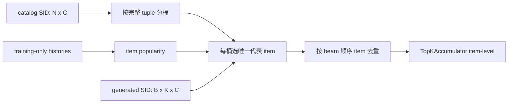

# 评估系统：从生成结果到公平 item 指标

## 评估对象

GenRec 的推荐任务采用每个样本一个相关 target 的 top-k 评估。可比较的 headline 是**item ID 排名**：

```text
actual item:       [B, 1]
predicted items:   [B, K, 1]
```

SID 模型的原始输出通常是：

```text
actual SID:        [B, C]
predicted SIDs:    [B, K, C]
```

完整 SID tuple 相等只能作为 tokenizer/生成诊断。若两个 item 共享一个 SID，直接把任意同 SID 输出判为 target 命中会把一条不可区分的 beam 同时记给多个物品，导致碰撞膨胀。

## Recall 与 NDCG

令真值第一次出现在候选列表的 1-based rank 为 `r`。单样本指标为：

```text
Recall@K = 1[r <= K]
NDCG@K   = 1[r <= K] / log2(r + 1)
```

最终结果是样本平均。因为每个样本只有一个相关 item，Hit@K 与 Recall@K 等价；GRAM 的 `hit@K` 会规范化为 `Recall@K`。

[`TopKAccumulator`](https://github.com/phonism/genrec/blob/main/genrec/modules/metrics.py) 支持 item scalar（包成长度 1 vector）或 SID vector，并对 vector 最后一维做全位置精确相等。它累计 raw hit/DCG counts，再 `reduce()` 除以总样本数。

一个重要边界：若预测只返回 `K_pred=5`，却请求 Recall@10，计算只使用 `effective_k=min(10,5)`；miss 使用 `match_found` 显式保护，不会因为 sentinel rank 恰好小于 10 而变成 hit。

## SID → item 的标准解析

[`SemanticIdItemMapper`](https://github.com/phonism/genrec/blob/main/genrec/modules/metrics.py) 将 catalog 的 `[N,C]` SID 分桶，并为每个完整 tuple 选择**唯一**代表 item：

1. 只用训练交互计算 item popularity；
2. bucket 内选择 popularity 最大者；
3. popularity 相同时选择较小 item ID；
4. 生成列表映射后删除重复 item；
5. 不存在的 SID 和重复项被跳过，不足 K 的位置填 `-1`。



`from_sequences(semantic_ids, sequences, train_holdout=2)` 对每个序列只统计 `sequence[:-2]`。这同时适配：

- LOO：剥离 valid/test；
- global-temporal：共享 protocol 已在 train sequence 后追加两个会被剥离的 placeholder。

解析策略写入 SID 模型的 `results.json`：

```json
{
  "extra": {
    "evaluation_level": "item",
    "sid_resolution": "most_popular_training_only",
    "sid_reference_metrics": {"Recall@10": 0.0}
  }
}
```

`sid_reference_metrics` 是解析前诊断，不能与 baseline item 指标放在同一排行榜中。

### 碰撞统计的不同含义

Mapper 的指标：

```text
collision_rate = (N - number_of_unique_full_SIDs) / N
```

[`report_sid_collisions.py`](https://github.com/phonism/genrec/blob/main/scripts/report_sid_collisions.py) 还报告：每个 prefix depth 的碰撞率、collision group histogram、最大组、碰撞涉及 item 比例、`unique / K^C` 容量利用率。

[`verify_codebook_health.py`](https://github.com/phonism/genrec/blob/main/scripts/verify_codebook_health.py) 按 layer 报告 used/dead code、usage、最大 code 频率和覆盖 50% item 所需 code 数；当前 collapse 告警规则是 `usage < 80%` 或 `max_freq > 10%`。codebook usage 与完整 tuple collision 是两个不同维度，都应保存。

## 各模型的评估路径

| 模型 | 候选生成 | headline | 额外诊断 / 限制 |
|---|---|---|---|
| SASRec | 最后位置对 `N+1` item logits top-k，排除 0 | 直接 item | 全目录 softmax |
| HSTU | 同上；可带 temporal bias | 直接 item | sampled-softmax 只影响训练，eval 仍全目录 |
| TIGER | T5 beam 输出 offset SID | mapper 后 item | 生成不使用 catalog PrefixTrie；非法 SID 会被丢弃 |
| LCRec | 自定义 KV-cache beam 或 HF fallback | mapper 后 item | evaluator 的位置 mask 保证每位 codebook 合法，但不保证完整 tuple 在 catalog |
| OneRec SFT/CLM | LCRec 共享 evaluator | mapper 后 item | 同时记录 per-code、exact、SID top-k |
| OneRec GRPO | 训练 rollout 用 catalog PrefixTrie；评估仍复用 LCRec evaluator | mapper 后 item | PrefixTrie 只改变训练采样，不改变 headline 解析规则 |
| COBRA | SID beam bucket + dense cosine BeamFusion | 直接返回 item | 另记 sparse SID 与 BeamFusion SID 诊断 |
| RPG | 对全 item 聚合并行 code log-prob；可选 graph refinement | 直接 item | direct 是 headline；graph 放 `extra.graph_metrics` |
| NoteLLM | 精确编码全 catalog，cosine/embedding 检索 | 直接 item | 显式排除 query item；不是 sampled candidates |
| GRAM | lexical-ID catalog Trie beam | 解码字符串命中 | 依赖 lexical ID 对 catalog item 的唯一性 |

### TIGER

`Tiger.generate()` 返回 `[B*beam,C+1]`，trainer 去掉 decoder start token，reshape 为 `[B,beam,C]`。预测 code 先减去各位置 offset，再送入 mapper。当前 local T5 generation 没有 catalog tuple trie，也没有显式 position mask；越界/不存在 tuple 无法解析，会减少有效候选数。

### LCRec / OneRec

[`lcrec_trainer.evaluate()`](https://github.com/phonism/genrec/blob/main/genrec/trainers/lcrec_trainer.py) 同时评估：

- `seqrec`：beam top-k，产生 item headline 与 SID diagnostic；
- `item2index`：greedy SID，记录各 code accuracy 和 exact；
- `index2item`：自由文本生成，使用目标文本是否出现在生成文本中的 match 诊断。

训练期通常只跑 `seqrec`/`item2index`，避免慢速 index-to-text。自定义 `generate_constrained_beam()` 一次 prefill 后复用 KV cache，接收 position mask 和 code map；约束的是第 c 位只能选 `<Cc_*>`。OneRec GRPO 的 `PrefixTrie` 更严格，只允许 catalog 中真实存在的完整路径，但当前公共 eval 仍靠 mapper 处理不存在 tuple 和碰撞。

FSDP eval 会在 beam 搜索阶段 `summon_full_params`。返回的 item/SID accumulator 先全局同步 raw counts，所有 rank 得到相同 valid 指标，之后才能安全做 best/test 分支。

### COBRA BeamFusion

每次 eval 重新用当前 encoder 计算全 catalog dense vectors。sparse beam 先产生 SID bucket，BeamFusion 在 bucket 内按预测 dense vector 与 item dense vector 的 cosine 相似度，结合 beam score (`tau`) 和 similarity (`psi`) 选 item，并对最终 item 排名去重。

保存到 `metrics` 的是 `generated.item_ids` 与 `target_item` 的比较。`generated.sem_ids`、直接 sparse generate 和逐 code accuracy只用于日志/消融。

### RPG

`RPGModel.generate(..., n_return=K)` 直接返回 item ID 排名。标准 direct decoding 聚合各 code head 的概率；可选 graph propagation 通过 item/token 相似邻接传播得分。当前 trainer 用 direct test 写 headline，把 graph test 放在 `extra`。图初始化/传播路径含随机初值时，复现应确认 eval 前 RNG 状态或显式固定。

### NoteLLM

[`evaluate_full_catalog()`](https://github.com/phonism/genrec/blob/main/genrec/trainers/notellm_trainer.py) 每次评估：

1. 编码 `1..N` 全目录 item 文本；
2. 编码所有 query item；
3. 用 `gather_for_metrics` 汇总各 rank query/target；
4. 计算 exact full-catalog 相似度排名；
5. 对每个 query 将同一个 item ID 从候选中排除。

实现要求 target 在 catalog 中、catalog item ID 唯一。结果记录 `candidate_set="exact_full_catalog_excluding_query_item"`，因此不能和 sampled-negative 指标混称。

### GRAM

所有合法 lexical ID 编码后构建 trie，beam 只能沿 catalog candidate 前缀生成。预测字符串按 sequence score 排序，与 target lexical string 精确相等。若 lexical ID 文件含重复 ID，多个物品仍无法区分；接入数据时应验证一 item 一 lexical ID 且反向唯一。

GRAM 的 metric parser 将 `hit@5` → `Recall@5`，`ndcg@10` → `NDCG@10`。当前 `results.json` 的 `extra` 只写 best metric/backbone，尚未写 `evaluation_level="item"`，所以它不满足严格 matrix validator 的 artifact 合同；加入公平矩阵前应补字段与相应测试。

## 分布式聚合

prepared eval DataLoader 会被 Accelerate 分片。正确顺序是：

```python
acc = TopKAccumulator(...)
for batch in dataloader:
    acc.accumulate(actual, predictions)
acc.sync_across_processes(accelerator)  # reduce raw total / hit / dcg
metrics = acc.reduce()                  # 最后才除以 total
```

不能先在每个 rank 求平均再简单平均 rank，因为最后一个 shard 大小可能不同。也不能只让 main rank进入含 collective 的 test eval。

SASRec/HSTU/RPG/GRAM 使用等价的 scalar count reduce；LCRec/OneRec/COBRA 用 accumulator。TIGER 是单进程，无跨 rank 汇总。

## 结果 artifact

[`save_run_results()`](https://github.com/phonism/genrec/blob/main/genrec/trainers/trainer_utils.py) 当前 schema：

```json
{
  "model": "onerec_sft",
  "split": "beauty",
  "seed": 42,
  "git_sha": "abc1234",
  "source_bundle": "genrec-src-....tar.gz",
  "source_bundle_sha256": "...64 hex...",
  "timestamp": "2026-08-30T00:00:00+00:00",
  "metrics": {
    "Recall@5": 0.0,
    "Recall@10": 0.0,
    "NDCG@10": 0.0
  },
  "config": {
    "evaluation_protocol": "leave_one_out"
  },
  "execution": {
    "cell_id": "...",
    "physical_gpus": "0,1"
  },
  "extra": {
    "evaluation_level": "item"
  }
}
```

`source_bundle*` 来自 `GENREC_SOURCE_BUNDLE_NAME/SHA256`，`execution` 来自锁 wrapper；`git_sha` 优先使用 `GENREC_SOURCE_GIT_SHA`，否则读取当前 Git HEAD。

## 验证与聚合

严格验证器 [`validate_matrix_results.py`](https://github.com/phonism/genrec/blob/main/scripts/validate_matrix_results.py) 检查：

- model/split/protocol/seed；
- `extra.evaluation_level == "item"`；
- TIGER、LCRec、OneRec 三路径的 `sid_resolution`；
- source bundle 名、SHA-256、具体 Git SHA；
- `Recall@5`、`Recall@10`、`NDCG@10` 为 `[0,1]` 内有限值；
- `Recall@5 <= Recall@10`；
- duplicate cell 与可选 expected matrix 的 missing cell。

聚合器 [`aggregate_results.py`](https://github.com/phonism/genrec/blob/main/scripts/aggregate_results.py) 只负责展示：按 `(model, split, evaluation_protocol, evaluation_level)` 分组，跨 seed 报均值和**总体标准差** `pstdev`。它会跳过坏 JSON，但不会代替严格验证。正确顺序是先 validate，再 aggregate。

## 发布前评估清单

1. `metrics` 是 item-level，而不是 SID tuple；
2. SID resolver 的 popularity 只用训练 prefix；
3. 映射后 item 去重，不存在 SID 不被当作某个默认真实 item；
4. catalog、protocol、`max_seq_len` 和 target 定义与对比模型一致；
5. 记录 candidate set 是 full catalog、beam 受约束还是 sampled；
6. 所有 rank 汇总 raw counts，并使用相同 best/test 分支；
7. test 只用于报告，不反复驱动超参选择；当前部分 trainer 会在每轮 valid 时同时打印 test，做正式实验时仍须以 valid 选择规则为准；
8. `results.json` 通过 validator，动态表格从聚合结果生成而不是手抄 SID 日志。
