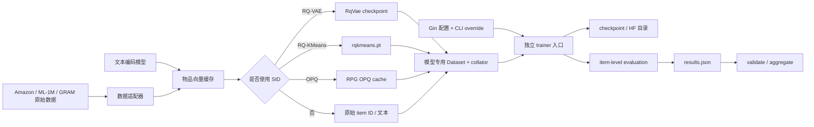

# GenRec 实现架构

本章说明仓库**现在实际如何工作**：数据怎样变成训练样本，Gin 怎样把配置注入脚本，模型和训练器之间有哪些真实接口，推荐结果如何从 semantic ID（SID）还原成 item，以及怎样产出可审计的 `results.json`。它不是对论文架构的替代；模型原理、论文差异和未实现模型见[模型总览](../models/overview.md)，本章聚焦工程实现与维护约定。

> GenRec 是研究代码库，不是统一训练框架。当前不存在公共的 `BaseDataset`、`BaseModel` 或 `BaseTrainer`。每个训练器都是独立入口，复用的是少量工具函数和评估组件。维护时应以对应训练器的调用链为准，不能假定一个训练器支持的能力会自动出现在其他训练器中。

## 一张图看完整链路



典型入口遵循同一外形，但并没有统一基类：

```text
__main__
  └─ parse_config()        # 解析位置参数、{split} 和 --gin
      └─ train_*()         # @gin.configurable 顶层函数
          ├─ Dataset / collate_fn / DataLoader
          ├─ model / optimizer / scheduler
          ├─ Accelerator.prepare(...)（TIGER、RQ-KMeans 例外）
          ├─ train → valid → checkpoint selection → test
          └─ save_run_results(...)
```

## 当前工程对象

下表只描述“代码中存在且有对应实现”的对象，不把量化器误算成推荐模型。

| 对象 | 数据表示 | 主入口 | 主要产物 | headline 评估层级 |
|---|---|---|---|---|
| SASRec | 1-based item ID，`0` padding | [`sasrec_trainer.py`](https://github.com/phonism/genrec/blob/main/genrec/trainers/sasrec_trainer.py) | 原始 `state_dict` | item |
| HSTU | item ID + timestamp | [`hstu_trainer.py`](https://github.com/phonism/genrec/blob/main/genrec/trainers/hstu_trainer.py) | 原始 `state_dict` | item |
| TIGER | RQ-VAE SID | [`tiger_trainer.py`](https://github.com/phonism/genrec/blob/main/genrec/trainers/tiger_trainer.py) | 原始 `state_dict` | SID 经训练集流行度解析后的 item |
| LCRec | 文本 prompt + RQ-VAE SID token | [`lcrec_trainer.py`](https://github.com/phonism/genrec/blob/main/genrec/trainers/lcrec_trainer.py) | Hugging Face 目录 | SID 经训练集流行度解析后的 item |
| OneRec SFT / CLM / GRPO | 文本或扁平序列 + RQ-KMeans SID token | 三个 [`onerec_*_trainer.py`](https://github.com/phonism/genrec/tree/main/genrec/trainers) | Hugging Face 目录 | SID 经训练集流行度解析后的 item |
| COBRA | SID token + dense item text vector | [`cobra_trainer.py`](https://github.com/phonism/genrec/blob/main/genrec/trainers/cobra_trainer.py) | 含优化器状态的 dict checkpoint | BeamFusion 输出 item |
| RPG | OPQ 的并行 code token | [`rpg_trainer.py`](https://github.com/phonism/genrec/blob/main/genrec/trainers/rpg_trainer.py) | 原始 `state_dict` | item |
| NoteLLM | item text → embedding | [`notellm_trainer.py`](https://github.com/phonism/genrec/blob/main/genrec/trainers/notellm_trainer.py) | 可训练参数 dict + tokenizer | 全目录 item 检索 |
| GRAM | 文本 passages + lexical ID | [`gram_trainer.py`](https://github.com/phonism/genrec/blob/main/genrec/trainers/gram_trainer.py) | 原始 `state_dict` | 受约束 lexical ID |
| RQ-VAE | item embedding | [`rqvae_trainer.py`](https://github.com/phonism/genrec/blob/main/genrec/trainers/rqvae_trainer.py) | 模型/优化器/调度器 dict | 重构、量化与碰撞诊断 |
| RQ-KMeans | item embedding | [`rqkmeans_trainer.py`](https://github.com/phonism/genrec/blob/main/genrec/trainers/rqkmeans_trainer.py) | `rqkmeans.pt` centroid dict | 碰撞诊断 |

RQ-VAE、RQ-KMeans 是 SID 生成阶段。它们为下游模型提供离散表征，但自身不根据用户历史生成推荐列表。

## 文档导航

- [仓库地图](repository-map.md)：目录职责、真实依赖方向、入口与遗留代码。
- [数据流水线](data-pipeline.md)：数据源、划分协议、ID 空间、样本/批次 shape 和各适配器差异。
- [训练系统](training-system.md)：启动调用链、Accelerate/W&B、优化循环、checkpoint 格式与多阶段依赖。
- [评估系统](evaluation-system.md)：Recall/NDCG、SID 碰撞解析、全目录检索、分布式归并与结果 schema。
- [配置系统](configuration.md)：Gin 解析顺序、`{split}`、宏/引用、配置清单和安全覆盖方法。
- [扩展指南](extension-guide.md)：增加模型、数据集、训练器、评估和矩阵注册的逐项清单。
- [可复现工作流](reproducibility.md)：单次运行、矩阵、provenance、代码本健康与 179 锁协议。

有关动态实验状态和最终数字，应查看根目录的 [`BENCHMARKS.md`](https://github.com/phonism/genrec/blob/main/BENCHMARKS.md)；有关 179 主机的执行顺序，应查看 [`179-reproduction-runbook.md`](../179-reproduction-runbook.md)。架构文档不复制会频繁变化的实验状态。

## 阅读和维护原则

1. **代码优先。** 参数、shape、checkpoint 内容以对应 commit 的实现为准；Gin 默认值只表示没有绑定时的回退值。
2. **区分 SID 与 item。** SID tuple 命中不等于可部署的 item 命中。只有解析、去重后的 item 指标可进入公平比较表。
3. **跨阶段参数必须成组一致。** 文本编码器、物品顺序、`num_codebooks`、`codebook_size`、RQ-VAE 几何或 RQ-KMeans centroid 必须来自同一条流水线。
4. **缓存不是自描述 artifact。** 部分缓存键只有 encoder basename；变更元数据构造、模型内容或 item 映射后应显式重建并记录来源。
5. **不要假定分布式一致。** 只有所有 rank 都参与 metric reduction、best 判定、保存和重新加载的训练器才可安全照搬到多 GPU。
6. **`results.json` 不是 checkpoint。** 它用于聚合与审计；恢复训练仍需模型及优化器状态，具体能力因训练器而异。

## 稳定接口与局部实现

相对稳定、可供新代码复用的接口是：

- [`parse_config()` / `get_run_split()`](https://github.com/phonism/genrec/blob/main/genrec/modules/utils.py)：CLI 与运行上下文；
- [`setup_accelerator()`、`set_seed()`、`save_run_results()`](https://github.com/phonism/genrec/blob/main/genrec/trainers/trainer_utils.py)：运行环境与结果记录；
- [`select_protocol_sequences()`](https://github.com/phonism/genrec/blob/main/genrec/data/evaluation_protocol.py)：共享的 leave-one-out / global-temporal 选择；
- [`SemanticIdItemMapper`、`TopKAccumulator`](https://github.com/phonism/genrec/blob/main/genrec/modules/metrics.py)：SID 解析和单相关 item 的 top-k 指标；
- [`SeqData` / `SeqBatch`](https://github.com/phonism/genrec/blob/main/genrec/data/schemas.py)：TIGER 路径使用的结构。

其余对象大多是模型局部契约。比如 `AmazonSASRecDataset` 返回 dict，LCRec/OneRec 返回 prompt/response，COBRA 同时返回离散 ID 和文本 token，不能强行套进 `SeqBatch`。
