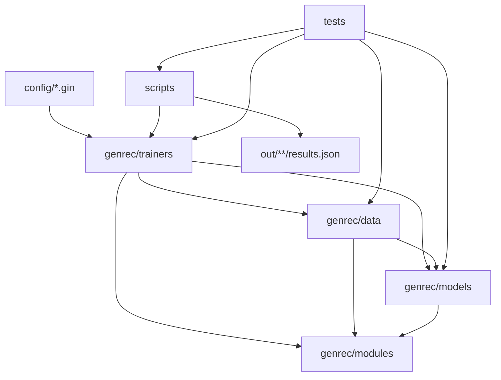

# 仓库地图与依赖边界

## 顶层目录

```text
genrec/
├── config/                 # Gin 配置；按模型/数据集划分
├── dataset/                # 运行时数据、下载和缓存（不应当进 Git）
├── docs/                   # MkDocs 中英文文档
├── genrec/
│   ├── data/               # 数据读取、协议、样本构造、collator
│   ├── models/             # 模型与量化器
│   ├── modules/            # 可复用网络层、指标、CLI 工具
│   ├── trainers/           # 独立可执行训练脚本
│   └── utils/              # 当前仅为占位包
├── scripts/                # 矩阵、诊断、provenance、179 执行工具
├── tests/                  # 单元、协议和 artifact 合同测试
├── reference/              # 上游论文代码，仅作 parity 参考
└── out/                    # checkpoint、日志与 results.json（运行时）
```

[`reference/`](https://github.com/phonism/genrec/tree/main/reference) 不在生产调用链中。修复 parity 问题时可以比较，但不要让训练入口 import 其中代码。

## 真实依赖方向



这里有两个容易误读的地方：

- 数据层有时加载模型：`AmazonSeqDataset`、LCRec、COBRA 会加载 RQ-VAE，OneRec 数据集会加载 RQ-KMeans/RQ-VAE，RPG 数据集会拟合或读取 OPQ。这是现有实现，不是纯粹的“data 只能依赖 schema”分层。
- 训练器之间通常不互相 import；多阶段关系通过磁盘 artifact 连接，例如 RQ-KMeans → OneRec SFT → OneRec GRPO。

## `genrec/data`

| 文件 | 当前职责 | 主要消费者 |
|---|---|---|
| [`amazon.py`](https://github.com/phonism/genrec/blob/main/genrec/data/amazon.py) | Amazon 2014 下载、元数据 embedding；通用 SID 序列数据 | RQ-VAE、TIGER 及若干复用者 |
| [`evaluation_protocol.py`](https://github.com/phonism/genrec/blob/main/genrec/data/evaluation_protocol.py) | leave-one-out / global-temporal 共享序列选择 | Amazon 主路径适配器 |
| [`schemas.py`](https://github.com/phonism/genrec/blob/main/genrec/data/schemas.py) | `SeqData`、`SeqBatch`、`TokenizedSeqBatch` | TIGER/旧 token 化路径 |
| [`amazon_sasrec.py`](https://github.com/phonism/genrec/blob/main/genrec/data/amazon_sasrec.py) | 1-based item 序列、SASRec collator | SASRec；NoteLLM 继承其映射/协议 |
| [`amazon_hstu.py`](https://github.com/phonism/genrec/blob/main/genrec/data/amazon_hstu.py) | item 序列 + Unix timestamp | HSTU |
| [`ml1m_hstu.py`](https://github.com/phonism/genrec/blob/main/genrec/data/ml1m_hstu.py) | ML-1M 下载、5-core、HSTU schema | HSTU `dataset_type="ml1m"` |
| [`amazon_lcrec.py`](https://github.com/phonism/genrec/blob/main/genrec/data/amazon_lcrec.py) | LCRec 六任务 prompt/response | LCRec |
| [`amazon_onerec.py`](https://github.com/phonism/genrec/blob/main/genrec/data/amazon_onerec.py) | OneRec SFT 四任务与 RL prompt | OneRec SFT / GRPO |
| [`amazon_onerec_clm.py`](https://github.com/phonism/genrec/blob/main/genrec/data/amazon_onerec_clm.py) | 每用户一个扁平 SID token 流 | OneRec CLM |
| [`amazon_cobra.py`](https://github.com/phonism/genrec/blob/main/genrec/data/amazon_cobra.py) | SID 与物品文本 token 的混合样本 | COBRA |
| [`amazon_rpg.py`](https://github.com/phonism/genrec/blob/main/genrec/data/amazon_rpg.py) | 文本 embedding、OPQ、并行 code labels | RPG |
| [`amazon_notellm.py`](https://github.com/phonism/genrec/blob/main/genrec/data/amazon_notellm.py) | item-to-item 文本对与 catalog 文本 | NoteLLM |
| [`amazon_gram.py`](https://github.com/phonism/genrec/blob/main/genrec/data/amazon_gram.py) | GRAM 预处理文件、FiD passages、lexical ID | GRAM |
| [`amazon2023.py`](https://github.com/phonism/genrec/blob/main/genrec/data/amazon2023.py) | Amazon Reviews 2023 下载/预处理及早期专用 Dataset | 下载工具、遗留路径 |
| [`p5_amazon.py`](https://github.com/phonism/genrec/blob/main/genrec/data/p5_amazon.py) | 基于 PyG/P5 数据的早期适配器 | 兼容/参考路径 |

Amazon 主路径的具体 shape 和 ID 约定见[数据流水线](data-pipeline.md)。

## `genrec/models`

| 文件 | 导出对象 | 工程角色 |
|---|---|---|
| [`sasrec.py`](https://github.com/phonism/genrec/blob/main/genrec/models/sasrec.py) | `SASRec` | softmax/BCE 序列推荐 |
| [`hstu.py`](https://github.com/phonism/genrec/blob/main/genrec/models/hstu.py) | `HSTU`、`HSTULayer`、RAB | SiLU attention、update gate、位置/时间 bias |
| [`rqvae.py`](https://github.com/phonism/genrec/blob/main/genrec/models/rqvae.py) | `RqVae`、`Quantize*` | 可学习 residual quantization |
| [`rqkmeans.py`](https://github.com/phonism/genrec/blob/main/genrec/models/rqkmeans.py) | `RqKmeans` | 无神经网络的 residual K-Means tokenizer |
| [`tiger.py`](https://github.com/phonism/genrec/blob/main/genrec/models/tiger.py) | `Tiger` | 仓库内纯 PyTorch T5 上的 SID seq2seq |
| [`lcrec.py`](https://github.com/phonism/genrec/blob/main/genrec/models/lcrec.py) | `LCRec` | HF causal LM + SID token + KV-cache beam |
| [`onerec.py`](https://github.com/phonism/genrec/blob/main/genrec/models/onerec.py) | `OneRec` | HF causal LM；SFT/CLM/GRPO 与受约束生成 |
| [`cobra.py`](https://github.com/phonism/genrec/blob/main/genrec/models/cobra.py) | `Cobra`、`BeamFusion` 相关输出 | sparse SID + dense vector 联合生成/解析 |
| [`rpg.py`](https://github.com/phonism/genrec/blob/main/genrec/models/rpg.py) | `RPGModel` | GPT-2 backbone + 多个并行 code head |
| [`notellm.py`](https://github.com/phonism/genrec/blob/main/genrec/models/notellm.py) | `Query2Embedding` | Qwen embedding pooling 与对比学习 |
| [`gram.py`](https://github.com/phonism/genrec/blob/main/genrec/models/gram.py) | `GRAM` | T5 FiD + lexical ID 受约束生成 |

模型论文语义和实现差异应由模型文档维护；本章只记录调用接口。

## `genrec/modules`

| 文件 | 应优先复用的能力 | 备注 |
|---|---|---|
| [`utils.py`](https://github.com/phonism/genrec/blob/main/genrec/modules/utils.py) | Gin CLI、logger、mode/cache 装饰器 | `parse_config` 只做字符串替换，不解析环境变量 |
| [`metrics.py`](https://github.com/phonism/genrec/blob/main/genrec/modules/metrics.py) | `SemanticIdItemMapper`、`TopKAccumulator` | 当前公平评估的核心 |
| [`t5.py`](https://github.com/phonism/genrec/blob/main/genrec/modules/t5.py) | 纯 PyTorch、可兼容 T5 权重的实现 | TIGER 使用；不是 HF `T5ForConditionalGeneration` |
| [`encoder.py`](https://github.com/phonism/genrec/blob/main/genrec/modules/encoder.py) | LightT5、SentenceT5、Ernie、BGE、MLP encoder | COBRA/RQ-VAE 等选择性使用 |
| [`transformer.py`](https://github.com/phonism/genrec/blob/main/genrec/modules/transformer.py) | 仓库早期自定义 Transformer/T5 组件 | 不应与 `t5.py` 混称 |
| [`loss.py`](https://github.com/phonism/genrec/blob/main/genrec/modules/loss.py) | reconstruction / contrastive 辅助损失 | 模型局部调用 |
| [`kmeans.py`](https://github.com/phonism/genrec/blob/main/genrec/modules/kmeans.py) | Torch K-Means 辅助 | 与 sklearn `RqKmeans` 是不同实现 |
| [`gumbel.py`](https://github.com/phonism/genrec/blob/main/genrec/modules/gumbel.py) | Gumbel quantization 辅助 | RQ-VAE 路径 |
| [`normalize.py`](https://github.com/phonism/genrec/blob/main/genrec/modules/normalize.py) | normalization 层 | 模型局部调用 |
| [`scheduler.py`](https://github.com/phonism/genrec/blob/main/genrec/modules/scheduler.py) | inverse-square-root scheduler | 不是所有 trainer 的默认 scheduler |
| [`embedding.py`](https://github.com/phonism/genrec/blob/main/genrec/modules/embedding.py) | 较早期 embedding 工具 | 先查调用方再改动 |

## `genrec/trainers`

入口函数并不统一命名：

| 脚本 | Gin 顶层函数 | 是否使用 Accelerate |
|---|---|---|
| `sasrec_trainer.py` | `train` | 是 |
| `hstu_trainer.py` | `train` | 是 |
| `tiger_trainer.py` | `train` | **否**，直接选择单个 device |
| `rqvae_trainer.py` | `train` | 是 |
| `rqkmeans_trainer.py` | `fit_rqkmeans` | 否，CPU/sklearn |
| `lcrec_trainer.py` | `train` | 是 |
| `onerec_sft_trainer.py` | `train_sft` | 是，包含 FSDP 保存分支 |
| `onerec_clm_trainer.py` | `train_clm` | 是 |
| `onerec_grpo_trainer.py` | `train_grpo` | 是 |
| `cobra_trainer.py` | `train` | 是 |
| `rpg_trainer.py` | `train_rpg` | 是 |
| `notellm_trainer.py` | `train` | 是 |
| `gram_trainer.py` | `train_gram` | 是 |

[`trainer_utils.py`](https://github.com/phonism/genrec/blob/main/genrec/trainers/trainer_utils.py) 提供 `set_seed`、`setup_accelerator`、`setup_wandb`、`save_run_results` 和通用 checkpoint helpers；其中 `TrainerConfig` 目前不是所有训练器采用的总配置对象，通用 `save_checkpoint`/`load_checkpoint` 也没有统一现有 checkpoint 格式。

## `scripts`：运行与审计工具

推荐的维护入口：

- [`run_matrix.py`](https://github.com/phonism/genrec/blob/main/scripts/run_matrix.py)：串行展开 model × split × seed，并注入协议、seed 与输出目录；不会训练缺失 tokenizer，也不会处理 GPU 锁。
- [`aggregate_results.py`](https://github.com/phonism/genrec/blob/main/scripts/aggregate_results.py)：递归收集 `results.json`，按模型、split、协议和评估层级聚合均值/总体标准差。
- [`validate_matrix_results.py`](https://github.com/phonism/genrec/blob/main/scripts/validate_matrix_results.py)：检查完整性、item-level、provenance、指标范围和 SID 解析策略。
- [`stamp_results_provenance.py`](https://github.com/phonism/genrec/blob/main/scripts/stamp_results_provenance.py)：对允许的旧结果原子补充来源字段，并拒绝覆盖冲突值。
- [`verify_codebook_health.py`](https://github.com/phonism/genrec/blob/main/scripts/verify_codebook_health.py)：逐层检查 usage、dead code、最大簇频率。
- [`report_sid_collisions.py`](https://github.com/phonism/genrec/blob/main/scripts/report_sid_collisions.py)：完整/前缀 SID 碰撞与容量统计。
- [`upload.sh`](https://github.com/phonism/genrec/blob/main/upload.sh)、[`apply-upload-179.sh`](https://github.com/phonism/genrec/blob/main/scripts/apply-upload-179.sh)、[`run-locked-179.sh`](https://github.com/phonism/genrec/blob/main/scripts/run-locked-179.sh)：179 的 source bundle 与并发锁协议。

仓库还有实验诊断、绘图和一次性编排脚本。修改它们前先用 `rg` 查调用方和文档；文件名存在不等于仍是推荐入口。

## 测试覆盖的合同

[`tests/`](https://github.com/phonism/genrec/tree/main/tests) 当前重点保护的是：

- 数据协议不泄露未来交互；
- SID tuple 指标与解析后 item 指标不能混用；
- `TopKAccumulator` 在候选数小于请求 K 时不会把 miss 算成 hit；
- NoteLLM 全目录评估排除 query item 且 item ID 唯一；
- RQ-VAE checkpoint 几何和加载安全；
- matrix 命令、结果聚合/验证、artifact provenance；
- 179 source/cell/GPU 锁脚本。

测试不是对所有模型数值 parity 的完整保证。增加新路径时，至少补充输入 shape、评估层级、checkpoint round-trip 和 `results.json` 合同测试。

## 遗留与兼容区

以下代码不能直接视为当前推荐主路径：

- `p5_amazon.py` 的 PyG/P5 下载与早期数据对象；
- `TokenizedSeqBatch` 及部分自定义 Transformer 工具；
- `amazon2023.py` 内的专用 `Amazon2023ItemDataset` / `Amazon2023SASRecDataset`；当前配置主要复用 Amazon 风格适配器，且专用类预期 `processed/<split>`，而下载预处理函数写入 `raw/<category>`，接入前必须核对目录迁移步骤；
- 各类 `diagnose_*`、历史 grid 和一次性修复脚本。

“遗留”不表示可以删除。应先确认配置、测试、已有 artifact 的反序列化路径以及外部实验脚本。
