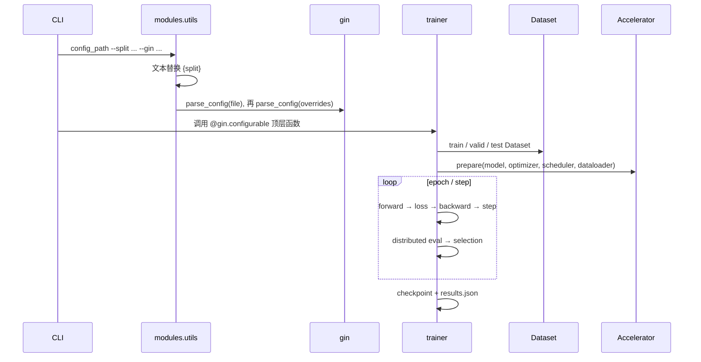

# 训练系统与 artifact

## 启动调用链

每个训练脚本都可直接运行；OneRec/RPG/GRAM 也常以 `python -m` 形式运行。共同外形是：

```python
if __name__ == "__main__":
    parse_config()
    train_or_fit()
```

顶层函数被 `@gin.configurable` 装饰，数据类同样常被装饰。一次运行的解析/实例化顺序是：



不要在 import trainer 模块时就调用 `gin.clear_config()` 或构造大模型；matrix runner 通过子进程隔离 Gin 全局状态。

## 共享运行工具

### 随机种子

[`set_seed(seed, deterministic=False)`](https://github.com/phonism/genrec/blob/main/genrec/trainers/trainer_utils.py) 设置 Python、NumPy、PyTorch CPU/CUDA RNG，并写 `PYTHONHASHSEED`。注意后者在进程启动后才写入，不能倒推改变已经产生的 Python hash；`AmazonSeqDataset` 还用 `hash(user_id) % 10000` 作为日志 user ID，因此需要位级复现时应在启动进程前设置 `PYTHONHASHSEED`。

数据构造中显式固定为 42 的部分（如 item 95/5 mask、部分 task 采样）不会随 trainer seed 变化；模型初始化、dropout、DataLoader shuffle 和运行期负采样会变化。

### Accelerate

[`setup_accelerator()`](https://github.com/phonism/genrec/blob/main/genrec/trainers/trainer_utils.py) 接受：

- `split_batches`；
- `gradient_accumulate_every`；
- `amp` 与 `mixed_precision_type`；
- 30 分钟 process-group timeout，用于大模型 checkpoint I/O 抖动。

`accelerator.prepare(...)` 后：

- 梯度必须通过 `accelerator.backward(loss)`；
- accumulation 路径应使用 `with accelerator.accumulate(model)`，只在 `sync_gradients` 时 clip/step；
- eval 的原始计数必须让所有 rank 参与 all-reduce；
- 保存 wrapped/FSDP 模型时不能默认只有 main rank 能完成完整 state gathering。

TIGER 不使用 Accelerate，只在 `cuda` 可用时选择一个 device；RQ-KMeans 是 CPU/sklearn。不要用 `accelerate launch` 假定这两者会自动变成正确的数据并行。

### logger 与 W&B

`setup_logger(save_dir, name)` 同时写 console 和 `<name>_YYYYmmdd_HHMMSS.log`。同一进程再次请求相同 logger name 会复用已有 handlers，所以一个进程内把不同输出目录复用同名 logger 可能仍写入第一个文件；推荐矩阵用独立子进程。

`setup_wandb()` 会执行 `wandb.login()` 和 `wandb.init()`，可定义 step metric。大多数 Accelerate trainer 只在 main process 初始化/记录/finish；TIGER 是单进程。开启 W&B 需要外网/凭据，但关闭它不影响本地 `results.json`。

## trainer 实际行为矩阵

| trainer | optimizer / schedule | 核心 loss | best 选择 | checkpoint / 恢复 |
|---|---|---|---|---|
| SASRec | Adam，默认无 scheduler | CE 或原始 BCE（一正一负） | valid Recall@10 | 原始 `state_dict`；无优化器恢复 |
| HSTU | Adam，默认无 scheduler | full CE 或 sampled softmax | valid Recall@10 | 原始 `state_dict`；无优化器恢复 |
| TIGER | Adam；可选 linear warmup + cosine | T5 teacher-forced CE | valid Recall@10 | `best_model.pt` 原始 `state_dict` |
| RQ-VAE | AdamW + linear warmup | reconstruction + commitment/quantization | 不做推荐 best selection | dict：model/config/optimizer/scheduler/epoch 或 iter |
| RQ-KMeans | sklearn KMeans/MiniBatchKMeans | residual clustering | 无 | `rqkmeans.pt` centroid dict |
| LCRec | AdamW + cosine warmup | causal LM CE | valid item Recall@10 | HF `checkpoint_best`/周期/最终目录；best 权重 one-shot test |
| OneRec SFT | AdamW + cosine warmup | response causal LM；可手工 label smoothing | valid Recall@10 + patience | HF `checkpoint_best`/epoch/final，FSDP-aware |
| OneRec CLM | AdamW + cosine warmup | flat stream causal LM | valid Recall@10 + patience | HF `checkpoint_best`/epoch/final，main-only 保存 |
| OneRec GRPO | AdamW + cosine warmup | PPO clipped policy + k3 KL | valid item Recall@10，初始 SFT 也参与选择；best_state 在内存保留并用于最终 test | HF epoch/final；不单独落盘 best，`best_epoch=-1` 表示回选 SFT |
| COBRA | AdamW + cosine warmup | weighted sparse cascade CE + dense InfoNCE | valid item Recall@10 | `best_model.pt` + 周期/最终 dict；best 权重 one-shot test |
| RPG | AdamW + cosine warmup | C 个 parallel head 的 token contrastive loss | valid **NDCG@10** | 原始 `state_dict` |
| NoteLLM | AdamW + cosine warmup | 对称 GCL + 可选 CSFT | valid Recall@10 + patience | trainable checkpoint + tokenizer + LoRA `adapter/` |
| GRAM | AdamW + linear warmup | T5 lexical-ID CE | valid Recall@10 | 原始 `state_dict` best/epoch/final |

表中的“恢复”只表示当前 trainer 有直接加载路径；原始 state dict 仍可人工恢复模型权重，但不会恢复 optimizer、scheduler 或 epoch。

## 各路径的训练契约

### SASRec

`model(input_ids, targets, negatives)` 接受 `[B,T]`。CE 模式计算完整 item vocab logits；BCE 模式只对正负 item embedding 打分。padding target 0 被 mask。`predict(input_ids, top_k)` 用最后一个有效位置的 hidden 与共享 item embedding 做全目录点积。

当前多 GPU 注意事项：指标会全局 reduce，但 early-stop `break` 在 main-only 分支，final best checkpoint 也只在 main rank reload，之后所有 rank 又共同 eval。这可能造成 rank 控制流不一致，或混合 best/last 权重。发布多 GPU SASRec 数字前应修复或使用确认的单进程运行。

### HSTU

输入为 `input_ids/timestamps: [B,T]`。`loss_type="ce"` 使用全 vocab；`sampled_softmax` 的 `local` 按每个正例独立从本地完整 item table 有放回采样，`in_batch` 是显式独立选项，`global` 保留旧的共享去重目录负例，并可启用 L2 normalize + temperature。`use_temporal_bias=False` 仅关闭时间 RAB，位置 bias 由独立参数控制。

HSTU 的 best/early-stop 变量在每个 rank 同步更新，保存后 barrier，final best 权重由每个 rank 加载，是当前 baseline 中更安全的分布式模板。

### TIGER

`t5_collate` 将每个 code offset 成 `code + c*K + 1`。`Tiger.forward` 接受 `input_ids/attention_mask/labels`；纯 PyTorch [`modules/t5.py`](https://github.com/phonism/genrec/blob/main/genrec/modules/t5.py) 内部完成 encoder-decoder CE。生成固定 `C` 个 code，0 也是 EOS/pad/start。

TIGER 的 DataLoader 固定 `num_workers=4`，trainer 不经 Accelerate，不支持自动多 GPU sharding。valid 改善时保存原始 state dict 并刷新 test cache。

### RQ-VAE

两种训练模式互斥：

- `epochs=N, iterations=None`；
- `epochs=None, iterations=N`。

首次训练且 `use_kmeans_init=True` 时，会累计约 20,000 条 embedding 触发量化器初始化。forward 返回总 loss、重构 loss、RQ loss、embedding norm 和 ID diversity。checkpoint 自带 `model_config`，`RqVae.from_pretrained()` 可从中恢复几何；下游常先按 Gin 构造，再 `load_pretrained()`。

当前碰撞统计在 `accelerator.prepare` 后的 train loader 上生成 Python set，未把各 rank 的 SID 全量 all-gather；分布式 RQ-VAE 的该诊断可能只代表局部分片。单进程 tokenizer 训练或独立全 catalog 诊断更可靠。

### LCRec 与 OneRec SFT/CLM

三者都给 HF causal LM 添加 SID special tokens并 resize embedding：

```text
prompt tokens | response SID/text tokens | EOS
label: -100...-100 | supervised tokens
```

可选 LoRA 由 PEFT 注入；完整参数模式直接更新 backbone。checkpoint 是可被 `from_pretrained` 读取的目录，通常含 config、tokenizer 和 safetensors。`OneRec.save_pretrained()` 特别处理 wrapper 前缀，避免保存后出现双重 `model.` key；加载也兼容旧 wrapper-prefixed shard。

LCRec 只缓存“valid 最优轮对应的 test 指标”，但周期目录仍按 epoch 保存，最后只写 `checkpoint_final`。如果需要最优权重，必须从 `best_epoch` 选择对应 `checkpoint_epoch_<best_epoch>`；不能把 final 自动称为 best。

OneRec SFT 的 `checkpoint_best` 是 GRPO 默认上游依赖。它把 best 初值设为 `-inf`，即使首轮 R@10 为 0 也会生成 best，并让所有 rank 参与 `get_state_dict`/`save_pretrained`，可用于 FSDP。

OneRec CLM 的 best/periodic/final 保存只在 main process 调用 `save_pretrained`，对普通 DDP/单进程可用，但不能直接宣称 FSDP-safe。

### OneRec GRPO

GRPO 的三段输入关系：

```text
RQ-KMeans centroid + item embeddings
    → catalog sem_ids_list
SFT checkpoint_best
    → policy 初值（LoRA 时 base model 也作为 reference）
catalog sem_ids_list
    → PrefixTrie（只允许真实 catalog SID 路径）
```

每个 prompt 生成 `G=num_generations` 条 completion。奖励：

- `exact`：完整 SID 相等为 1，否则 0；
- `hierarchical`：连续前缀匹配 1/10/100…；
- `rank`：有 exact hit 时为正确项加 1，并按生成 rank 给错误项归一化负惩罚；若组内无 hit，整组为 0，这是有意的 hard-sample skip。

组内优势为 `(reward - group_mean) / (group_std + 1e-4)`。policy loss 使用 rollout 时记录的 behavior log-prob：

```text
ratio = exp(log πθ - log πold)
Lpg = -min(ratio*A, clip(ratio, 1-ε, 1+ε)*A)
KL  = exp(log πref - log πθ) - (log πref - log πθ) - 1
L   = mean_sequence(mean_token(Lpg + β*KL))
```

`add_gt=True` 会把每组末项替换成真值并重算它的 old log-prob；该 off-policy 行参与 policy gradient，但从 KL 项排除，避免参考概率比爆炸。LoRA 模式禁用 adapter 得到 reference；全参模式创建独立冻结 reference model。梯度 forward 必须走 prepared wrapper，不能用 unwrapped module 绕过 DDP hook。

当前 GRPO 没有 early stop；它记录 best epoch/metric，但只保存周期和 final 目录。`best_epoch` 与 checkpoint 选择应一起记录。

### COBRA

模型把每个历史 item 的 `C` 个 sparse token embedding 与一个 dense text vector 交错成 `T*(C+1)` 个位置。训练 loss 是：

```text
total = sparse_loss_weight * sparse_loss
      + dense_loss_weight  * dense_contrastive_loss
```

`use_dense=False` 会将 dense 输入置零并关闭 InfoNCE；这种消融的主要可比较输出是 sparse-only 指标。trainer 没有 validation best selection，按配置频率记录 valid/test，`results.json` 使用最后一次已运行的 item-level test。checkpoint dict 支持 optimizer/scheduler/epoch 恢复。

### RPG

输入 item ID 经 `item_id2tokens` 取出 `C` 个 OPQ code embedding并平均，进入 GPT-2 backbone。每个位置的 hidden 分发给 `C` 个独立 ResBlock head，输出 `[B,T,C,D]`，而不是自回归生成 `C` 个 code。direct item score 聚合各 code 的 log-prob。

可选 graph propagation 只作为额外 test 指标；headline `metrics` 保留 direct decoding。trainer 实际用 valid `NDCG@10` 选择 best，变量名 `best_recall` 不应影响文档语义。它和 SASRec 一样存在 main-only early break / best reload 后共同分布式 eval 的风险。

### NoteLLM

当前训练器实现 Amazon item-to-item 的对称 GCL + CSFT LoRA adaptation。模型取 item 文本末尾 `[EMB]` 前一个 token 的 Qwen hidden 作为向量；GCL 会跨 rank 比较并按精确 catalog item ID 屏蔽重复物品伪负例，CSFT 生成辅助 metadata 文本。每轮 valid 做精确全 catalog 检索；best 同时保存内部训练 checkpoint、`adapter/` 与 tokenizer，恢复时仍须匹配同一 base model 与 tokenizer。论文 hard-negative 闭环尚未实现。

### GRAM

每条输入有多个 passage。FiD wrapper 将 `[B,P,L]` reshape 为 `[B*P,L]` 独立编码，再拼接 encoder states 给 T5 decoder。训练生成 lexical ID token；eval 用 catalog lexical IDs 构建 trie 约束 beam。best、epoch、final 都是原始 state dict，不含 optimizer。

## checkpoint 格式与兼容性

| 类型 | 文件例子 | 能否独立重建模型 | 是否含 optimizer/scheduler |
|---|---|---:|---:|
| 原始 state dict | `best_model.pt`、`checkpoint_best.pt` | 否，需要相同 constructor/Gin | 否 |
| 训练状态 dict | COBRA `checkpoint_final.pt` | 部分，需要 constructor | 是 |
| RQ-VAE dict | `checkpoint_epoch_*.pt` | 有 `model_config`，支持专用加载器 | 是 |
| RQ-KMeans dict | `rqkmeans.pt` | 是，含 C/K/centroids | 不适用 |
| HF directory | `checkpoint_best/` | 是，但仍需 SID/embedding artifact | 通常否 |
| NoteLLM trainable-only dict | `best_model.pt` | 否，需要 base + adapter 结构 | 否 |

文件名中的 epoch 是代码循环变量，通常 **0-based**。`checkpoint_epoch_4` 表示完成第 5 个 epoch。

跨阶段加载前核对：

1. item encoder 的确切模型和 embedding cache；
2. item first-seen 顺序；
3. `C`、`K`、SID token 字符串和 tokenizer vocabulary；
4. RQ-VAE input/hidden/embed geometry；
5. base LM revision、LoRA target modules 和 resize 后 vocab；
6. evaluation protocol；RPG 的 OPQ cache已经把 protocol 编入名字，其他 tokenizer artifact 应在实验 manifest 中另行记录。

## `results.json` 与 checkpoint 的分工

训练结束时 main process 调用 [`save_run_results()`](https://github.com/phonism/genrec/blob/main/genrec/trainers/trainer_utils.py)，写：model、split、seed、Git/source bundle、UTC timestamp、metrics、config、可选 execution/extra。它用于审计和聚合，既不保存权重也不保证可恢复。

只有结果通过[评估系统](evaluation-system.md)的 item-level 约束和[可复现流程](reproducibility.md)的 provenance 验证后，才应进入 benchmark 表。
