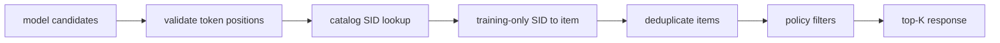

# 推理、导出与部署边界

GenRec 是学术复现与研究 sandbox，不是生产 serving framework。仓库没有稳定 REST API、在线 feature store、模型注册、灰度发布或延迟 SLO。旧文档中的 FastAPI 示例调用了不存在的 `load_from_checkpoint`，已移除。

## 这里“可部署”指什么

文档说生成结果“deployable”时，只表示 SID 已解析到唯一 catalog item，并对候选去重；不表示系统已经满足线上可靠性、安全性或性能要求。

## 离线推理的最小产物

一个可复核的 batch inference bundle 至少包含：

```text
bundle/
├── model checkpoint
├── resolved Gin config
├── item mapping + checksum
├── item embedding / SID catalog manifest
├── SID→item resolver policy and training-only counts
├── predictions with raw scores/SIDs and resolved items
├── source commit or exact source bundle hash
└── metrics + protocol metadata
```

只保存 model weights 不够：item mapping 或 tokenizer 变化会让相同整数输出代表完全不同的物品。

## 不同家族的推理状态

| 家族 | 推理方式 | 必要资产 | 主要风险 |
|---|---|---|---|
| SASRec/HSTU | full-catalog matrix score | item mapping、weights | catalog 增大时输出层成本；seen-item policy |
| TIGER/LCRec/OneRec | beam / constrained SID generation | tokenizer、SID catalog、resolver | 非法 SID、collision、KV-cache、beam latency |
| COBRA | sparse generation + dense BeamFusion | RQ-VAE、text encoder、catalog vectors | 两分支版本一致性、显存/延迟 |
| RPG | parallel token heads → item score；可选 graph propagation | OPQ mapping、token embeddings、adjacency | graph 构建内存、catalog 更新 |
| NoteLLM | query/catalog embedding dot product | LLM/LoRA、catalog embedding index | catalog 重编码成本、ANN 与 exact 指标差异 |
| GRAM | constrained lexical-ID generation | lexical catalog、item passages、Trie | 大量 passage 编码与预处理依赖 |

## 生成式推理必须保留的步骤



- 非法/目录外 SID 不能被强行映射到“最近 item”而不记录；
- resolver 不得使用 test/online future popularity；
- item 去重后候选不足时要有明确策略；
- 是否过滤历史 item 必须与离线评测 policy 对齐；
- catalog/tokenizer 更新应当原子切换，不能混用新 catalog 和旧 weights。

## checkpoint 加载

各模型格式不同：

- SASRec/HSTU/TIGER 常见 `state_dict` 文件，需要先按相同 config 构造 model；
- RQ-VAE 是带 `model_config/optimizer/scheduler` 的 dict，使用 `RqVae.from_pretrained`；
- OneRec/HF 模型可能是 `save_pretrained` 目录；
- NoteLLM 最佳 checkpoint 只保存 trainable parameters，必须与相同 base model/PEFT 结构合并；
- RPG/GRAM 以各 trainer 保存逻辑为准。

不要写一个通用 `torch.load` 服务而假设所有格式相同。

## 如果要做在线服务

这会超出仓库当前目标，至少还需实现：

1. versioned model/tokenizer/catalog registry；
2. 输入 schema、认证、限流、超时和审计；
3. dynamic batching 与 GPU worker 生命周期；
4. catalog 增量更新/回滚；
5. ANN 或高效 full-catalog scorer；
6. KV-cache、Trie batch decoding 与候选补齐；
7. 线上/离线 feature parity；
8. shadow/canary 与指标监控；
9. 隐私、版权和第三方模型许可证审查；
10. 故障降级到稳定 baseline。

## 性能测量

报告至少分开：

- cold start（加载 weights/catalog）；
- warm single-query p50/p95；
- fixed batch throughput；
- peak GPU memory；
- catalog size、history length、beam width、K；
- preprocessing/embedding/index build 时间；
- exact 与 ANN / graph approximation 的质量差。

不要用训练 step/s 或单个 warm batch 代表在线延迟。

## 推荐的研究用接口

在生产 API 出现前，优先实现确定性的离线 prediction dump：每个 test user 保存 target、原始 top-N、解析后 top-K、分数、model/catalog hash。这样可以 generate once、eval many，比较 resolver、去重与 policy 而无需重复昂贵推理。

相关文档：

- [评测系统](architecture/evaluation-system.md)
- [复现与 provenance](architecture/reproducibility.md)
- [实现与复现状态](reference/model-status.md)
- [179 运行手册](179-reproduction-runbook.md)
