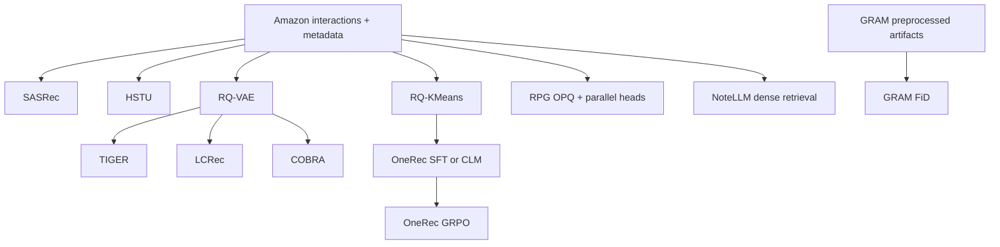

# 快速开始

这条最短路径先完成一个可核验的 SASRec run，再根据依赖图选择生成式 pipeline。命令默认从仓库根目录执行。

## 1. 安装

```bash
python -m venv .venv
source .venv/bin/activate
python -m pip install -e .
```

CUDA、可选依赖和本地模型镜像见[安装与环境](installation.md)。

## 2. 准备 Amazon 2014 Beauty

SASRec/HSTU 的 adapter 直接读取原始 gzip 文件，因此先显式准备数据：

```bash
python scripts/prepare_amazon2014.py \
  --splits beauty --kinds reviews meta
```

期望目录：

```text
dataset/amazon/raw/beauty/
├── reviews_Beauty_5.json.gz
└── meta_Beauty.json.gz
```

脚本会读完整 gzip 校验 CRC、计算 SHA-256，并用临时文件原子落盘。已有文件也会重新验证。

## 3. 跑一个判别式基线

```bash
python genrec/trainers/sasrec_trainer.py \
  config/sasrec/amazon.gin --split beauty \
  --gin 'train.wandb_logging=False'
```

默认配置会训练到最多 300 epochs，并按 valid Recall@10 早停。只做代码路径 smoke test 时，可以使用独立输出目录和短跑参数；短跑结果不得写入 benchmark：

```bash
python genrec/trainers/sasrec_trainer.py \
  config/sasrec/amazon.gin --split beauty \
  --gin 'train.epochs=1' \
  --gin 'train.patience=1' \
  --gin 'train.wandb_logging=False' \
  --gin 'train.save_dir_root="out/_smoke/sasrec/beauty"'
```

输出包含：

```text
out/sasrec/amazon/beauty/
├── best_model.pt
├── sasrec_<timestamp>.log
└── results.json
```

`results.json` 是矩阵聚合入口；不要只从 console 手抄最好数字。

## 4. 选择模型 pipeline



### SASRec / HSTU

```bash
python genrec/trainers/sasrec_trainer.py config/sasrec/amazon.gin --split beauty
python genrec/trainers/hstu_trainer.py config/hstu/amazon.gin --split beauty
python genrec/trainers/hstu_trainer.py config/hstu/amazon_ss.gin --split beauty
```

HSTU CE 与 sampled-softmax 是不同实验，输出目录和结果标签不能混用。

### RQ-VAE → TIGER / LCRec / COBRA

每个下游有自己的 RQ-VAE 几何，必须使用匹配 config：

```bash
# TIGER
python genrec/trainers/rqvae_trainer.py config/tiger/amazon/rqvae.gin --split beauty
python genrec/trainers/tiger_trainer.py config/tiger/amazon/tiger.gin --split beauty

# LCRec
python genrec/trainers/rqvae_trainer.py config/lcrec/amazon/rqvae.gin --split beauty
python genrec/trainers/lcrec_trainer.py config/lcrec/amazon/lcrec.gin --split beauty

# COBRA
python genrec/trainers/rqvae_trainer.py config/cobra/amazon/rqvae.gin --split beauty
python genrec/trainers/cobra_trainer.py config/cobra/amazon/cobra.gin --split beauty
```

先检查 `config/base.gin` 的 Sentence-T5 路径。不要把 TIGER 的 3×256 checkpoint 传给 COBRA 的 3×32 pipeline。

### RQ-KMeans → OneRec

```bash
# Stage 1：item embedding + 3×256 residual K-Means
python genrec/trainers/rqkmeans_trainer.py \
  config/onerec/amazon/rqkmeans.gin --split beauty

# Stage 2a：多任务 SFT
accelerate launch --config_file config/accelerate_4gpu.yaml \
  -m genrec.trainers.onerec_sft_trainer \
  config/onerec/amazon/sft.gin --split beauty

# Stage 2b：CLM 是替代训练范式，不是 SFT 之后的必经阶段
python -m genrec.trainers.onerec_clm_trainer \
  config/onerec/amazon/clm.gin --split beauty

# Stage 3：GRPO 依赖 SFT checkpoint
accelerate launch --config_file config/accelerate_4gpu.yaml \
  -m genrec.trainers.onerec_grpo_trainer \
  config/onerec/amazon/grpo.gin --split beauty
```

默认需要本地 `Qwen3-Embedding-8B` 与 `Qwen3-1.7B`。先读 [OneRec](models/onerec.md) 的 reward、collision 和 checkpoint 约束。

### RPG / NoteLLM / GRAM

```bash
python -m genrec.trainers.rpg_trainer \
  config/rpg/amazon.gin --split beauty

python -m genrec.trainers.notellm_trainer \
  config/notellm/amazon.gin --split beauty

python -m genrec.trainers.gram_trainer \
  config/gram/amazon/gram.gin --split Beauty
```

RPG 需要 FAISS；NoteLLM 默认 LoRA 需要 PEFT，配置已把 `{split}` 同时绑定到 trainer 与 dataset，因此标准 `--split` 足够。GRAM 读取 `dataset/gram` 下的论文式预处理产物，不会复用普通 Amazon adapter 自动生成所有 lexical index / similar-item 文件，运行前先看 [GRAM 文档](models/gram.md)。

## 5. Gin 覆盖规则

所有入口把第一个位置参数当 config，`--split` 会先替换 config 文本中的 `{split}`，多个 `--gin` 随后覆盖：

```bash
python genrec/trainers/hstu_trainer.py config/hstu/amazon.gin \
  --split sports \
  --gin 'train.seed=7' \
  --gin 'train.batch_size=64' \
  --gin 'train.wandb_logging=False'
```

可配置函数名并不总是 `train`：OneRec 使用 `train_sft` / `train_clm` / `train_grpo`，RPG 使用 `train_rpg`，GRAM 使用 `train_gram`。复制 override 前先看 config 左侧 binding。

## 6. 评测口径

默认 `leave_one_out`；支持该协议的 Amazon adapters 也可切换 `global_temporal`。不同 protocol、seed、metric level 必须写入不同目录。

生成式模型只把 item-level 指标作为 headline：

```text
beam SIDs
  → training-only most-popular SID→item
  → item deduplication
  → Recall@K / NDCG@K
```

SID-level exact tuple、NoteLLM in-batch recall 和 sampled-negative 数字只能作为诊断。详见[评测系统](architecture/evaluation-system.md)和[术语](reference/terminology.md)。

## 7. 运行矩阵前

不要手工复制多组命令。先 dry-run：

```bash
python scripts/run_matrix.py --help
python scripts/validate_matrix_results.py --help
python scripts/aggregate_results.py --help
```

正式 179 GPU 任务还必须遵守 [并发安全运行手册](179-reproduction-runbook.md)。

## 下一步

- 不知道选哪个模型：[模型总览](models/overview.md)
- 想理解仓库实现：[项目架构](architecture/index.md)
- 想看没实现的模型：[GenRec 领域全景](landscape/index.md)
- 想添加新模型：[扩展指南](architecture/extension-guide.md)
- 想确认结果能否比较：[实现与复现状态](reference/model-status.md)
