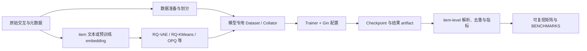

# GenRec

GenRec 是一个基于 PyTorch 与 Gin-config 的**生成式推荐研究框架**。它的目标不是提供线上推荐服务，而是把模型实现、数据协议、语义 ID、训练流水线与 item-level 评估放在同一套可审计的实验框架中，便于复现论文、进行公平比较和验证新想法。

!!! info "文档口径"

    中文站点是当前代码的规范文档。文档会明确区分“代码已存在”“端到端已验证”“论文结果已复现”和“仅列入研究全景”，避免把模型目录误当作复现成绩单。具体状态见[实现与复现状态](reference/model-status.md)。

## 从哪里开始

| 你的目标 | 建议入口 |
|---|---|
| 第一次运行项目 | [快速开始](getting-started.md) → [安装指南](installation.md) |
| 理解当前实现 | [实现架构](architecture/index.md) → [仓库地图](architecture/repository-map.md) |
| 选择或比较模型 | [模型总览](models/overview.md) → 各模型专页 |
| 了解尚未实现的方法 | [GenRec 研究全景](landscape/index.md) → [模型目录](landscape/model-catalog.md) |
| 做可比实验 | [评估系统](architecture/evaluation-system.md) → [复现工作流](architecture/reproducibility.md) |
| 扩展代码或维护文档 | [扩展指南](architecture/extension-guide.md) → [贡献指南](contributing.md) |

## 当前代码覆盖

当前仓库包含 **9 个推荐模型**，以及 **2 个语义 ID/tokenizer 组件**。这里按“训练后直接承担推荐任务”区分推荐器与 tokenizer。

| 家族 | 已实现内容 | 核心表示或生成方式 |
|---|---|---|
| 判别式序列基线 | [SASRec](models/sasrec.md)、[HSTU](models/hstu.md) | 单一 item ID，候选集全排序 |
| RQ 语义 ID 推荐 | [TIGER](models/tiger.md)、[LCRec](models/lcrec.md)、[COBRA](models/cobra.md)、[OneRec](models/onerec.md) | 多层离散 code；OneRec 另含 SFT/CLM/GRPO 路径 |
| 其他生成与 LLM 路线 | [RPG](models/rpg.md)、[NoteLLM](models/notellm.md)、[GRAM](models/gram.md) | 并行 code heads、文本编码检索、词法 ID 与多粒度融合 |
| 表示学习组件 | [RQ-VAE](models/rqvae.md)、[RQ-KMeans](models/rqkmeans.md) | 把 item embedding 转换成离散语义 ID；本身不是推荐器 |

尚未落地的代表性路线——例如生成式检索、LLM 推荐、离散 tokenizer、扩散式推荐、生成-判别混合系统和推荐推理/RL——统一收录在[模型目录](landscape/model-catalog.md)。当前目录共 68 个模型/组件条目，每一项均带实现状态与原始资料入口。

## 系统如何串起来



不同模型并不共享一个强行抽象的通用基类；统一性主要来自命令行/Gin 入口、数据字段契约、输出 artifact 与评估协议。具体边界见[训练系统](architecture/training-system.md)和[数据流水线](architecture/data-pipeline.md)。

## 最短可运行路径

安装开发环境后，可先用无外部 tokenizer 依赖的基线验证数据、训练和评估链路：

```bash
python -m venv .venv
source .venv/bin/activate
pip install -e .

python genrec/trainers/sasrec_trainer.py \
  config/sasrec/amazon.gin \
  --split beauty
```

需要语义 ID 的模型必须先准备匹配的 tokenizer checkpoint。例如 TIGER：

```bash
python genrec/trainers/rqvae_trainer.py \
  config/tiger/amazon/rqvae.gin \
  --split beauty

python genrec/trainers/tiger_trainer.py \
  config/tiger/amazon/tiger.gin \
  --split beauty
```

完整依赖、数据下载行为与模型 hub 约定见[安装指南](installation.md)；所有正式训练命令见[命令索引](reference/command-index.md)。

## 阅读结果时的底线

- 生成的 SID tuple 不等于唯一 item。存在碰撞时，必须先做训练集可见的 SID→item 解析，再进行 item 去重和指标计算。
- 不同数据划分、候选集合、负采样或解码预算下的 Recall/NDCG 不应直接横比。
- “仓库已实现”不自动意味着“论文配置和论文数字已复现”；应同时检查 checkpoint、日志、数据指纹和评估层级。
- 历史 TIGER、LCRec、OneRec SID-tuple 数字可能受碰撞放大；对外比较应优先使用重新验证过的 item-level 结果。

当前基准快照及协议注释见 [BENCHMARKS.md](https://github.com/phonism/genrec/blob/main/BENCHMARKS.md)。更完整的检查清单见[生成式推荐评测协议](landscape/evaluation.md)。

## 项目边界与贡献

GenRec 面向学术复现与研究原型，不承诺在线服务所需的低延迟检索、多租户、安全、灰度发布或实时特征一致性；相关边界见[部署说明](deployment.md)。新增模型时请同时提交模型说明、状态证据、命令与评估口径，具体规则见[文档维护规范](reference/documentation-policy.md)。

项目采用 [MIT License](https://github.com/phonism/genrec/blob/main/LICENSE)。欢迎通过 Issue 或 Pull Request 参与，参见[贡献指南](contributing.md)。
