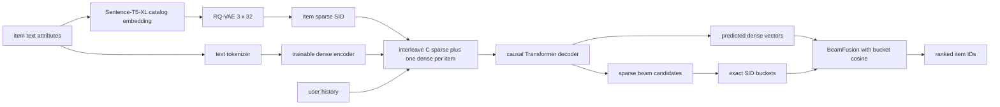

# COBRA：级联生成 sparse SID 与 dense vector

## 定位与状态

| 项目 | 本仓库当前实现 |
|---|---|
| 任务 | next-item coarse-to-fine generative retrieval |
| item 表示 | 3 个 RQ-VAE code + 1 个由文本 encoder 产生的 dense vector |
| backbone | causal `nn.TransformerDecoder`；cross-attention memory 为空 |
| 训练 | codebook CE + in-batch dense InfoNCE |
| 解码 | sparse beam → SID bucket → dense cosine → BeamFusion |
| 主评测 | `BeamFusionOutput.item_ids` 上的 item-level Recall/NDCG |
| checkpoint | model/optimizer/scheduler/epoch 的 PyTorch dict |
| 复现状态 | 模型、数据、训练和 item evaluator 均存在；当前验证矩阵尚无可发布 COBRA 完整行 |

COBRA 的原始工作是 [Sparse Meets Dense: Unified Generative Recommendations with Cascaded Sparse-Dense Representations](https://arxiv.org/abs/2503.02453)，NeurIPS 2025。论文把概率分解为“先生成粗粒度 sparse ID，再以该 ID 为条件生成细粒度 dense representation”，推理时用 BeamFusion 结合 beam 与近邻分数。本仓库实现了这一主干思路，但仓库中没有 vendored 官方 COBRA code 或逐层 parity test；应称为研究复现实现，而不是官方实现镜像。

## 端到端数据流



有两个 encoder 空间不能混淆：

1. **RQ-VAE 输入空间**：[`AmazonCobraDataset`](https://github.com/phonism/genrec/blob/main/genrec/data/amazon_cobra.py) 用 Sentence-T5-XL 生成 catalog embedding，并据此调用 3×32 RQ-VAE。必须与 RQ-VAE 训练时的 encoder 相同。
2. **COBRA dense 空间**：baseline 用 Sentence-T5-base；paper-aligned 配置用论文所述的一层随机 `LightT5Encoder` 与 `[CLS]` pooling，并端到端更新。

trainer 故意不把模型的 base encoder 名传给 dataset。若把 dataset 的 XL 改成 base，RQ-VAE 会在错误 embedding 空间量化，SID catalog 将失真。当前实现依赖 base/XL 使用兼容的 T5 tokenizer，但它们的 embedding 模型不是同一个。

## sparse-dense 交错表示

对序列中第 $t$ 个 item，表示为

\[
z_t=[e(s_{t,0}),e(s_{t,1}),\ldots,e(s_{t,C-1}),v_t].
\]

默认 $C=3,K=32,d=768$。历史序列展平后是：

```text
[s0_1, s1_1, s2_1, v_1, s0_2, s1_2, s2_2, v_2, ...]
```

[`CobraEmbedding`](https://github.com/phonism/genrec/blob/main/genrec/models/cobra.py) 用一个大小为 `C*K+1` 的 embedding table；第 $c$ 层原始 code $k$ 先偏移为 $k+cK$，`C*K` 保留给 padding。每个位置再加 absolute position embedding，以及 sparse/dense 二值 type embedding。dense vector 已经是 $d$ 维，直接插入 token 序列，没有额外 dense input projection。

`CobraDecoder` 是 `nn.TransformerDecoder`，但调用时 `memory=None` 会被替换成 `[B,0,d]` 空 Tensor。因此当前行为是带 causal self-attention 的 decoder-only 序列模型；模块仍包含没有实际信息输入的 cross-attention 子层。

## 级联预测与损失

给定 item $t$ 的完整表示，第一层 sparse head 从 $v_t$ 位置预测下一 item 的首个 code：

\[
p(s_{t+1,0}\mid z_{\le t}).
\]

后续第 $c>0$ 个 head 从同一目标 item 的前一 code hidden state 预测：

\[
p(s_{t+1,c}\mid z_{\le t},s_{t+1,<c}).
\]

每个 codebook 有独立 `Linear(d,K)` head。对 padding 外的所有 next-item transition，sparse loss 是各 codebook CE 的平均：

\[
\mathcal L_{\text{sparse}}
=\frac1C\sum_{c=0}^{C-1}
\operatorname{CE}(p_c,s_c).
\]

在最后一个 sparse code 的 hidden state 上不接额外 dense head，直接 L2 normalize 得到预测向量：

\[
\hat v_{t+1}=\operatorname{normalize}(h(s_{t+1,C-1})).
\]

同 batch 的有效 transition 展平为 $Q$ 个 query/positive pair。目标 dense vector `vec_gt` 被 detach。legacy `cross_sequence` 会屏蔽同用户的其他 transition；paper-aligned `all_batch` 保留所有非自身候选，但仍屏蔽同一 catalog item 的重复副本，避免同一商品同时充当正例和负例。对其余候选计算：

\[
\ell_{ij}=\frac{\hat v_i^\top v_j}{T},\qquad
\mathcal L_{\text{dense}}=
-\frac1Q\sum_i\log
\frac{e^{\ell_{ii}}}
{e^{\ell_{ii}}+\sum_{j\in\mathcal N(i)}e^{\ell_{ij}}}.
\]

主配置 $T=0.07$。trainer 最终优化：

\[
\mathcal L=
\lambda_s\mathcal L_{\text{sparse}}+
\lambda_d\mathcal L_{\text{dense}},
\]

默认两权重均为 1。`CobraOutput.loss` 只是未加权的两项和；正式 trainer 会重新按配置组合 component loss。cross-batch queue 是显式可选研究扩展；paper-aligned control 关闭它，因此 `queue_size` 不改变该实验的 negatives。

### `use_dense=False` 消融

设置 `use_dense=False` 时，history dense positions 用零向量替换，InfoNCE 返回 0，模型只训练 sparse CE。encoder 仍作为子模块存在，但 forward 不调用它，因此不会得到训练梯度。

这会影响评测解释：trainer 的 BeamFusion catalog table 仍直接调用该未训练 encoder。`cobra_sparse_only.gin` 的 `results.json.metrics` 仍来自 BeamFusion item IDs，不能自动当成纯 sparse 公平 headline；`extra.sparse_only_metrics` 又是解析前 SID-tuple 诊断。要得到诚实的 sparse-only item 指标，应另接 training-only SID resolver，而不是依赖未训练 dense reranker。

## 数据与 batch 契约

[`AmazonCobraDataset`](https://github.com/phonism/genrec/blob/main/genrec/data/amazon_cobra.py) 为每个 catalog item 缓存：

- `sem_ids_list[item]`：3 个原始 RQ-VAE codes；
- `item_token_ids[item]`：配置指定字段的 T5 token，默认 `[128]`；paper-aligned 使用 title、price、category、description；
- `item_embeddings[item]`：供 RQ-VAE 量化的 Sentence-T5-XL embedding。

`leave_one_out` 下，dataset 每个用户只返回一条训练 sample：排除最后两个 item 后，最后一个训练 item 作 sample target，其前缀作 history。collator 再把 target 追加回序列。模型 forward 会对完整 `history + target` 中的所有相邻 transition 做 teacher forcing，所以不是只监督最后一个 target。

| split | history | target |
|---|---|---|
| train | 训练前缀除最后一项 | 训练前缀最后一项；forward 监督全部相邻 transition |
| valid | 最后两个 held-out 之前的序列 | 倒数第二项 |
| test | 最后一项之前的序列 | 最后一项 |

history 在 `__getitem__` 中保留最近 `max_seq_len` 个 item。默认 `max_seq_len=100`，训练加 target 后最多 101 个 item，即 404 个交错位置，低于 `max_len=1024`。

collator 与模型的主要 shape：

| tensor | train | eval |
|---|---|---|
| `input_ids` | `[B,T*C]`，含追加 target | `[B,T*C]`，仅 history |
| `encoder_input_ids` | `[B,T,128]`，含 target text | `[B,T,128]`，仅 history text |
| `target_sem_ids` | `[B,C]`，仅记录 | `[B,C]`，用于 SID 诊断 |
| `target_item_ids` | `[B]` | `[B]`，item headline target |

padding raw ID 是 `C*K=96`，不是合法 code 0。`global_temporal` 可通过覆盖共享 dataset 参数启用；协议、seed 与 split 必须进入结果 provenance。

## generation 与 BeamFusion

`Cobra.generate()` 逐 codebook 做 beam search：

1. 从最后一个完整 history item 的 dense 位置产生 $s_0$；
2. 将 beam 的已生成 sparse codes 拼回输入，重新跑完整 decoder，再产生下一 code；
3. 最后一个 code 的 hidden state 归一化为该 beam 的 $\hat v$。

输出契约：

```text
CobraGenerationOutput
  sem_ids   [B, M, C]
  dense_vecs[B, M, d]
  scores    [B, M]      # 累积 log probabilities
```

它没有 catalog Trie，也没有 KV-cache；每个 code step 和 beam 都会重跑 decoder。生成的 SID 可不在 catalog，评测时间主要受该路径和 history text encoder 影响。

`beam_fusion()` 对每个 beam $m$ 找到完整 SID 相等的 item bucket $\mathcal C(s_m)$。设 beam log score 为 $\phi_m$，则候选 $a\in\mathcal C(s_m)$ 的融合分数为：

\[
w(m,a)=
\operatorname{softmax}_m(\tau\phi_m)
\cdot
\operatorname{softmax}_{a\in\mathcal C(s_m)}
\left(\psi\cos(\hat v_m,v_a)\right).
\]

同一 item 若重复出现保留最大融合分数，再在所有 bucket 候选中取 top-k。beam 数、`tau`、`psi` 与 catalog-prefix constraint 均可通过 Gin 配置；输出宽度固定为 benchmark 的 top 10。paper-aligned control 当前使用 `M=64`、`tau=1`、`psi=16`。`item_sem_ids` 只用于给最终 item IDs 附回 SID 诊断。

## item-level 评测

每次评测先用当前 dense encoder 重算整个 catalog 的归一化向量，然后同时记录三组指标：

1. **BeamFusion item-level**：`target_item_ids` 对 `generated.item_ids`；这是日志与 `results.json.metrics` 的 headline。
2. **BeamFusion SID pre-resolution**：target SID 对最终 item 对应 SID；只作 collision 诊断。
3. **sparse-only SID**：target SID 对 `generate().sem_ids`；同样不是 item headline。

训练进度中的 `train/acc` 是所有 code token 的 teacher-forced top-1 accuracy，`train/recall` 是所有 codebook 同时正确的 teacher-forced transition 比率；它们不是 full-catalog Recall@K。

当前 trainer 只用 item-level valid Recall@10 选择 `best_model.pt`，训练结束后所有 rank 装载同一快照，再运行一次 test。`eval_test_every_epoch` 仅为旧配置兼容保留，不再控制训练期 test。

BeamFusion 的不足候选以 item/SID `-1` 补齐，合法 item 0 不会再产生伪命中。dense InfoNCE 还会屏蔽 batch 内同一 catalog item 的非对角副本，避免把同一商品同时当正例和负例。

## 代码实现映射

| 层次 | 文件 / 符号 | 职责 |
|---|---|---|
| 模型 | [`Cobra`](https://github.com/phonism/genrec/blob/main/genrec/models/cobra.py) | dense encoder、交错 embedding、decoder、loss、generation |
| 输出 | `CobraOutput` / `CobraGenerationOutput` / `BeamFusionOutput` | 训练、beam 与最终 item shape |
| dense encoder | [`LightT5Encoder` / `SentenceT5Encoder`](https://github.com/phonism/genrec/blob/main/genrec/modules/encoder.py) | 随机轻量或预训练文本 encoder |
| 数据 | [`AmazonCobraDataset`](https://github.com/phonism/genrec/blob/main/genrec/data/amazon_cobra.py) | RQ-VAE SID、文本 token、protocol-aware samples |
| collator | [`cobra_collate_fn`](https://github.com/phonism/genrec/blob/main/genrec/trainers/cobra_trainer.py) | train target 追加、padding、item target |
| trainer | [`train`](https://github.com/phonism/genrec/blob/main/genrec/trainers/cobra_trainer.py) | Accelerate、AdamW、cosine、BeamFusion、checkpoint |
| baseline config | [`cobra.gin`](https://github.com/phonism/genrec/blob/main/config/cobra/amazon/cobra.gin) | 2-layer decoder + pretrained Sentence-T5-base |
| variants | [`cobra_v2.gin`](https://github.com/phonism/genrec/blob/main/config/cobra/amazon/cobra_v2.gin) / [`cobra_sparse_only.gin`](https://github.com/phonism/genrec/blob/main/config/cobra/amazon/cobra_sparse_only.gin) | deeper/light encoder 与 sparse-only 实验 |

直接 API 的最小接口如下；正式 item ranking 还需 catalog vectors 和 `sem_id_to_items`：

```python
from genrec.models.cobra import Cobra

model = Cobra(
    id_vocab_size=32,
    n_codebooks=3,
    d_model=768,
    decoder_n_layers=2,
    decoder_num_heads=6,
    encoder_type="pretrained",
    encoder_model_name="/path/to/sentence-t5-base",
)

out = model(
    input_ids=input_ids,                  # [B, T*3]
    encoder_input_ids=encoder_input_ids,  # [B, T, 128]
)
loss = out.loss_sparse + out.loss_dense

beam = model.generate(
    input_ids=history_ids,
    encoder_input_ids=history_text_ids,
    n_candidates=10,
)
```

## 可执行训练命令

```bash
# Stage 1：COBRA 专用 3×32 RQ-VAE，Sentence-T5-XL
python -m genrec.trainers.rqvae_trainer \
  config/cobra/amazon/rqvae.gin --split beauty

# Stage 2：baseline COBRA
python -m genrec.trainers.cobra_trainer \
  config/cobra/amazon/cobra.gin --split beauty

# 论文公共数据字段/一层 LightT5/[CLS] 对齐路径
python -m genrec.trainers.rqvae_trainer \
  config/cobra/amazon/rqvae_paper_attributes.gin --split beauty
python -m genrec.trainers.cobra_trainer \
  config/cobra/amazon/cobra_paper_aligned.gin --split beauty
```

Stage 2 固定依赖：

```text
out/cobra/amazon/<split>/rqvae/checkpoint_epoch_4999.pt
```

RQ-VAE config 是 5000 epochs、每 50 epoch 保存，所以上述 final epoch 文件会正常产生。不要使用 TIGER/LCRec 的 RQ-VAE：它们的 K、C、latent 和 hidden geometry 不同。

可选实验入口：

```bash
# 4-layer decoder + LightT5Encoder，50 epochs
python -m genrec.trainers.cobra_trainer \
  config/cobra/amazon/cobra_v2.gin --split beauty

# dense 关闭的机制消融；注意前述评测语义限制
python -m genrec.trainers.cobra_trainer \
  config/cobra/amazon/cobra_sparse_only.gin --split beauty
```

当前没有 COBRA Amazon 2023 Gin。三条命令都需要先检查 [`config/base.gin`](https://github.com/phonism/genrec/blob/main/config/base.gin) 的 Sentence-T5 本地路径。baseline 的 `amp=False`，所以虽然 `mixed_precision_type="bf16"` 留在 config 中，实际仍是全精度；代码注释记录 bf16 decoder attention 曾产生 NaN。

### baseline 配置快照

| 参数 | 值 |
|---|---:|
| epochs / batch / accumulation | 20 / 32 / 4 |
| lr / weight decay / warmup | `1e-4` / `0.01` / 500 optimizer steps |
| SID | 3 × 32，pad 96 |
| model width / decoder | 768 / 2 layers / 6 heads |
| dense encoder | pretrained Sentence-T5-base |
| RQ-VAE embedding encoder | Sentence-T5-XL |
| temperature / loss weights | 0.07 / 1 + 1 |
| history / item text | 100 items / 128 tokens |
| BeamFusion | 32 beams → 10 items；tau 1，psi 16 |
| eval / save | eval epoch 20；save epochs 9、19 和 final |
| W&B / precision | on / fp32 |

## checkpoint、resume 与 provenance

默认 `out/cobra/amazon/<split>/` 包含：

- `checkpoint_epoch_<zero-based epoch>.pt`；
- `checkpoint_final.pt`；
- 训练日志与可选 W&B；
- 发生过至少一次 eval 时的 `results.json`。

checkpoint dict 含 `epoch`、`model`、`optimizer`、`scheduler`，可在相同 constructor/Gin 下继续训练：

```bash
python -m genrec.trainers.cobra_trainer \
  config/cobra/amazon/cobra.gin --split beauty \
  --gin 'train.resume_from_checkpoint="out/cobra/amazon/beauty/checkpoint_epoch_9.pt"'
```

checkpoint 本身不保存 constructor config、数据 fingerprint 或 RNG/DataLoader 状态，所以不是独立 artifact，也不保证 bit-exact resume。必须一并保留 Gin、seed、源码 SHA、RQ-VAE checksum 和模型路径。trainer 当前没有 `eval_only` 入口；评测逻辑嵌在训练循环里。

当前 checkout 没有跟踪可核验的 `out/cobra/.../results.json`，而 [`BENCHMARKS.md`](https://github.com/phonism/genrec/blob/main/BENCHMARKS.md) 的正式数值表尚无完成的 COBRA 行。旧版页面中的单次 item/SID 数字和长篇根因结论没有绑定仓库内 artifact、源码 SHA、seed 与完整 config，已从本页 headline 删除。后续只应从通过 [`validate_matrix_results.py`](https://github.com/phonism/genrec/blob/main/scripts/validate_matrix_results.py) 的 item-level artifact 聚合正式结果；SID 数字必须保留 `pre-resolution diagnostic` 标签。

## 诊断脚本：可移植性边界

| 文件 | 当前性质 | 能否当通用命令 |
|---|---|---|
| `verify_cobra_emb.py`、`verify_cobra_positions.py`、`verify_cobra_hidden.py`、`verify_cobra_e2e.py` | 随机 LightT5 上的 shape/position/logit 打印探针 | 只能作实现联调；不是 pytest，也不验证真实 checkpoint 指标 |
| [`eval_cobra_itemlevel.py`](https://github.com/phonism/genrec/blob/main/scripts/eval_cobra_itemlevel.py) | 旧 Beauty 重评脚本 | **不能**：固定 `/root/workspace/models_hub`、CUDA、2-layer baseline；docstring 还声称 trainer 以 SID 为 headline，已与当前 trainer 不符 |
| `diag_cobra_loss.py`、`diag_cobra_dense.py` | 旧 Beauty checkpoint 机制探针 | **不能**：硬编码模型/RQ-VAE 路径、dataset、K/C 与 CUDA |
| `diag_cobra_gen.py`、`diag_cobra_final.py` | 旧 beam/exposure-bias 探针 | **不能**：除硬编码外还预分配约 34 GB fp16 CUDA 显存 |
| `diag_cobra_infoflow.py` | 旧 sparse-only Beauty 探针 | **不能**：固定数据、路径、架构与 CUDA |

这些 legacy 文件可作为调查思路参考，但运行前必须改造成 argparse/Gin 驱动、删除显存占位、从 checkpoint provenance 重建模型，并更新到当前 item evaluator。不要把它们的默认命令复制到复现指南，也不要把打印输出视为结果 artifact。当前尚无 COBRA 专属自动化测试覆盖 BeamFusion padding、C 泛化、resume 或 item metric。

## 与论文的实现差异

| 方面 | 论文框架 | 本仓库当前实现 | 影响 |
|---|---|---|---|
| 核心级联 | sparse ID 后条件生成 dense vector | 已实现 3-code cascade，最后 sparse hidden 直接作为 dense prediction | 主计算图一致于框架描述，未做官方 code parity |
| dense encoder | 一层 encoder；title、price、category、description | paper-aligned 为一层 LightT5 + `[CLS]`，字段一致；base checkpoint 仍是 title+brand | 结构/字段已对齐，权重初始化与 tokenizer 未做官方 code parity |
| sequence model | Transformer-based cascaded generator | PyTorch `TransformerDecoder` + empty memory | 具体层、attention 实现与参数化未证明一致 |
| dense negatives | dense contrastive objective | paper-aligned 使用所有 batch targets，并屏蔽同 item false negatives；queue 关闭 | negative pool 受 batch=32 限制 |
| BeamFusion | beam score + nearest-neighbor score | exact SID bucket 内 cosine；预算可配置，paper control 为 64/10/1/16 | 缺独立 ANN/index 实现 |
| 数据与规模 | 论文公共数据及工业实验 | Amazon Reviews 2014 四类配置 | 不能直接复用论文数字或工业结论 |
| 工程证据 | 论文实验协议 | 无 vendored official code/parity suite | 当前状态是未完成论文数字复现 |

## 已知限制与优先修复项

1. **只安全支持 C=3**：`CobraEmbedding` 构造时仍依赖默认三层；当前 configs 都是 C=3，改 C 前需补通用性测试。
2. **catalog constraint 是可选项**：可限制生成到真实 SID 前缀，但 Beauty valid pilot 中略降指标，paper-aligned control 默认关闭。
3. **无 KV-cache**：每个 code/beam 重跑完整 decoder，长 history eval 很慢。
4. **无 early stopping**：会保存 validation 最优模型，但仍训练完整 epoch 预算。
5. **memory queue 属于研究扩展**：实现已可用并会屏蔽同 item false negatives，但论文 control 默认关闭。
6. **sparse-only headline 不干净**：未训练 encoder 仍参与 BeamFusion；需实现 training-only SID→item resolver。
7. **重复初始化 catalog pipeline**：train/valid/test dataset 分别加载 SentenceTransformer、RQ-VAE 并生成 SID，启动与内存成本高；可安全共享只读 catalog artifact，但要带 fingerprint。
8. **自动化回归仍不完整**：已有 padding/item-0 与 duplicate-negative 测试，还需补 C 泛化、teacher-force vs generation、distributed metric 与 resume。

## 参考与相关文档

- [COBRA 论文（arXiv）](https://arxiv.org/abs/2503.02453)
- [COBRA 论文（OpenReview）](https://openreview.net/forum?id=zugMif2nm6)
- [RQ-VAE item tokenizer](rqvae.md)
- [统一训练系统](../architecture/training-system.md)
- [统一评测系统](../architecture/evaluation-system.md)
- [模型实现状态](../reference/model-status.md)
- [命令索引](../reference/command-index.md)
