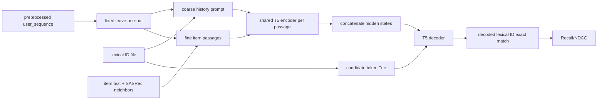

# GRAM：语义到词法 ID 与多粒度 late fusion

## 定位与状态

| 项目 | 本仓库实现 |
|---|---|
| 任务 | next-item recommendation |
| 家族 | T5 text-to-text generative retrieval |
| 目标表示 | 外部预处理的层次 lexical ID 字符串 |
| 输入 | 历史 lexical-ID 用户 prompt + 每个历史 item 的丰富文本 passage |
| 融合 | 各 passage 共享权重、独立编码；decoder 前拼接 hidden states |
| 解码 | catalog lexical-ID Trie 上的 constrained beam search |
| 数据协议 | 预处理序列上的固定 leave-one-out |
| 状态 | 实验性完整训练链路；semantic-to-lexical 预处理未在仓库闭环 |

GRAM 的 model/trainer 能训练和评测，但它不能直接读取 `dataset/amazon` 原始文件：必须先提供 GRAM 风格 lexical ID、item text 和 SASRec 相似 item artifact。当前论文级复现证据见[模型实现状态](../reference/model-status.md)，不应仅凭 trainer 可启动就标成完整复现。

## 原始工作

- 论文：[GRAM: Generative Recommendation via Semantic-aware Multi-granular Late Fusion](https://aclanthology.org/2025.acl-long.1596/)，ACL 2025 Long Papers，[DOI](https://doi.org/10.18653/v1/2025.acl-long.1596)。
- 官方代码：[skleee/GRAM](https://github.com/skleee/GRAM)。

论文提出两部分：

1. **semantic-to-lexical translation**：把层次语义/协同 item 关系翻译为 LLM 原生 vocabulary 中的 lexical ID；
2. **semantic-aware multi-granular late fusion**：分别编码粗粒度历史 ID prompt 和细粒度 item metadata，在 decoder 侧晚融合。

官方仓库提供预处理数据，但 README 仍注明 semantic-to-lexical translation preprocessing scripts 将后续发布。本仓库同样只消费生成好的 lexical-ID 文件，没有实现从 Amazon 原始 metadata/interaction 复建该翻译器。因此这里复现的是下游 FiD 式模型与 constrained generation，不是完整 tokenizer 生成流程。

## 问题定义

对用户历史 $i_1,\ldots,i_T$，每个 item 有外部 lexical ID 字符串 $\ell(i)$，以及文本 $m(i)$。默认把历史反转为最近 item 在前，构造：

- passage 0：`What would user purchase after <lex-id history> ?`；
- passage 1..$T$：每个历史 item 的 `similar items: <neighbor lex IDs>; <item text>`。

目标是下一个 item 的 lexical ID 字符串 $y=\ell(i_{T+1})$。T5 训练标准 teacher-forcing token CE：

$$
\mathcal L=-\sum_{u:y_u\ne\text{pad}}
\log p_\theta(y_u\mid y_{<u},P_0,\ldots,P_T).
$$

生成时候选不是开放文本，而是数据文件中所有 lexical ID 的 token 序列。leave-one-out 每个样本只有一个 target，所以 Hit@K 等价于 Recall@K，trainer 将键规范化为 `Recall@K`。

## FiD 式多粒度 late fusion

设 batch 有 $B$ 个样本、每个样本 $N$ 个 passage、每段 token 长 $L$。collator 输出：

```text
item_text_ids:   [B, N, L]
item_text_masks: [B, N, L]
target_ids:      [B, Y]
```

[`EncoderWrapper`](https://github.com/phonism/genrec/blob/main/genrec/models/gram.py) 先 reshape 为 `[B*N,L]`，让**同一个共享权重的 T5 encoder**分别处理每段，而不是实例化 $N$ 套 encoder。若启用位置 embedding，对第 $n$ 段所有 token hidden 加同一可学习向量 $p_n$：

$$
H_n=\operatorname{Enc}_\phi(P_n)+p_n.
$$

再沿 token 维拼接：

$$
H=[H_0;H_1;\ldots;H_{N-1}]\in\mathbb R^{B\times NL\times d}.
$$

T5 decoder 对完整 $H$ 做 cross-attention。`GRAM.generate()` 会先计算一次 encoder outputs，再传给 Hugging Face beam search，避免每条 beam 重复编码全部 passages。

位置 embedding 表大小是 `max_item_num+1`，多出的 1 对应用户 prompt。关闭它后，模型仍可从 passage 内容区分粒度，但相同 encoder 本身没有显式历史 passage 序号。

## 预处理数据契约

默认目录大小写敏感：

```text
dataset/gram/<Split>/
├── user_sequence.txt
├── item_plain_text.txt
├── similar_item_sasrec.txt
└── item_generative_indexing_hierarchy_v1_c128_l7_len32768_split.txt
```

| 文件 | 当前 parser 预期 | 用途 |
|---|---|---|
| `user_sequence.txt` | `user_id item_id1 item_id2 ...` | 已按时间排序的完整序列 |
| `item_plain_text.txt` | `item_id free text...` | 每个 item 的细粒度 passage |
| `similar_item_sasrec.txt` | 可选 header `anchor...`；之后 `item neighbor...` | 每个 item 最多取 10 个协同邻居 |
| `item_generative_indexing_...txt` | `item_id lexical id string...` | target、历史粗粒度 ID、Trie candidates |

parser 只按第一个空格拆 item 字典值，不验证 lexical ID 的层次结构、唯一性或覆盖率。缺 lexical ID 的历史 item 会产生空字符串；缺 target ID 也会成为空 target。数据准备阶段应 fail-fast 检查，而不能等模型训练后才从异常指标推断。

`item_prompt` 参数传进 dataset 但当前未影响 `item2input` 构造；`max_text_len` 只存为字段，真正的 passage token 截断由 trainer 创建的 `GRAMCollator(item_prompt_max_len=...)` 控制。

## 数据切分与样本



- 训练：`items[:-2]` 中每个位置作为 target，之前的 item 是 history；默认跳过空 history。
- 验证：`items[-2]` 为 target，history 是 `items[:-2]`。
- 测试：`items[-1]` 为 target，history 是 `items[:-1]`。
- history 最多保留最近 20 项，默认反转为最近优先。

GRAM 数据类没有 `evaluation_protocol`、global cutoff 或共享 Amazon splitter。若预处理文件的序列排序/过滤不同于其他模型，输出数字就不是同协议。比较前必须保存 preprocessing provenance，并单独确认 user/item universe 与 leave-one-out target。

## 代码实现映射

| 层次 | 文件 / 符号 | 职责 |
|---|---|---|
| 模型 | [`GRAM`](https://github.com/phonism/genrec/blob/main/genrec/models/gram.py) | T5 子类、encoder 包装、预训练权重加载、FiD generate |
| encoder | `EncoderWrapper` | passage 独立编码、位置向量与 hidden 拼接 |
| 数据 | [`AmazonGRAMDataset`](https://github.com/phonism/genrec/blob/main/genrec/data/amazon_gram.py) | 四类预处理文件、LOO 样本、多粒度字符串 |
| collator | `GRAMCollator` | `[B,N,L]` padding/truncation 与 target mask |
| trainer | [`train_gram`](https://github.com/phonism/genrec/blob/main/genrec/trainers/gram_trainer.py) | CE 训练、Trie beam、早停式 best 保存、eval-only |
| Trie | [`generation_trie.py`](https://github.com/phonism/genrec/blob/main/genrec/utils/generation_trie.py) | Hugging Face `prefix_allowed_tokens_fn` |
| 配置 | [`gram.gin`](https://github.com/phonism/genrec/blob/main/config/gram/amazon/gram.gin) | T5-small、20 history、50 beams |
| launcher | [`train_gram.sh`](https://github.com/phonism/genrec/blob/main/scripts/train_gram.sh) | 单卡/Accelerate 多卡入口 |

当前没有 GRAM 专属单元测试。尤其缺少对预处理数据完整性、lexical-ID 唯一性、Trie candidate 与 target 对齐、FiD reshape/position 的回归测试。

## 训练、评估与调试命令

数据就绪后：

```bash
# 单卡；Split 名与目录一致，默认使用 Beauty 而不是 beauty
python -m genrec.trainers.gram_trainer \
  config/gram/amazon/gram.gin --split Beauty

# 封装脚本：第二个参数是 GPU 数
./scripts/train_gram.sh Beauty 2

# 有 checkpoint 时只跑 valid/test
python -m genrec.trainers.gram_trainer \
  config/gram/amazon/gram.gin --split Beauty \
  --gin 'train_gram.eval_only=True' \
  --gin 'train_gram.checkpoint_path="out/gram/Beauty/checkpoint_best.pt"'

# 小样本连通性检查
python -m genrec.trainers.gram_trainer \
  config/gram/amazon/gram.gin --split Beauty \
  --gin 'train_gram.max_train_samples=64' \
  --gin 'train_gram.max_eval_samples=16' \
  --gin 'train_gram.epochs=1'
```

`t5-small` 需要本地 Hugging Face cache 或联网下载。为了复现，应将 `train_gram.backbone` 指向固定本地 snapshot 并记录 revision，而不是依赖浮动远端名称。

### 默认关键配置

| 配置 | 值 | 含义 |
|---|---:|---|
| backbone | `t5-small` | full-parameter T5 初始化 |
| `max_his` | 20 | 最多历史 item；实际 passages 上限为 21 |
| position embedding | true | 标记用户 prompt/历史 passage 位置 |
| passage / target max tokens | 128 / 50 | 每段与 lexical target 截断 |
| batch / accumulation | 32 / 2 | `drop_last=True` |
| epochs / learning rate | 30 / `1e-3` | linear warmup/decay，warmup ratio 5% |
| similar items | top 10 from SASRec | 拼入每个 fine passage |
| beams | 50 | 同时也是返回候选数下界 |
| eval batch | 4 | `split_batches=True` 时须可按进程数切分 |
| selection metric | validation Recall@10 | strict improvement 才保存 best |

`metrics` 字符串决定需要的最大 K；实际 `generate_num=max(maxK,num_beams)`。将 `num_beams` 设得比最大 K 更大仍会返回同样多的序列，显存/时延随之增长。

## Trie 解码与 item-level 语义

trainer 将每个 lexical-ID 字符串编码为：

```python
[0] + tokenizer.encode(candidate)
```

T5 的 decoder start token 为 0；Trie 据此限制每个 beam 的下一 token，只允许走向 catalog candidate。生成序列 decode 后，与 ground-truth lexical-ID 字符串做**精确字符串相等**，再按 sequence score 排序计算 relevance。

这套指标可以称 item-level 的前提是 $i\mapsto\ell(i)$ 一一映射。当前数据类没有验证唯一性：若两个 item 共用同一 lexical ID，模型无法区分它们，但字符串命中仍会计为正确。正式 benchmark 前应检查：

- `len(set(item2lexid.values())) == len(item2lexid)`；
- 每个 valid/test target 都在 mapping 与 Trie 中；
- tokenize→decode 对每个 candidate 可逆且无规范化碰撞；
- beam 输出去重后的 lexical ID 数满足各个 K。

与 TIGER/OneRec 的训练热门度 SID→item resolver 不同，GRAM 当前没有碰撞解析器。它依赖上游 lexical-ID artifact 唯一化。

## 输出与依赖

默认 `out/gram/<Split>/`：

- `checkpoint_best.pt`：validation Recall@10 严格提升时的 state dict；
- `checkpoint_epoch_<epoch>.pt`：每 5 epoch 保存；
- `checkpoint_final.pt`：最后训练状态，不保证是 best；
- `results.json`：最近一次 best/cached test metrics、best valid Recall@10、backbone 与配置；
- 日志和可选 W&B 记录。

checkpoint 是 GRAM state dict，不含 tokenizer、T5 base snapshot 或四个数据文件。重载时必须用相同 backbone、`max_his`、position 设置和 lexical-ID artifact 构造模型。

核心依赖为 PyTorch、Transformers、Accelerate、Gin 和 NumPy。与 RPG 不同，GRAM 本身不需要 FAISS；SASRec 相似 item 与 lexical IDs 已作为外部文件给定。

## 与论文/官方实现的差异

| 方面 | GRAM 论文/官方仓库 | 本仓库 | 影响 |
|---|---|---|---|
| semantic-to-lexical | 论文核心模块；官方提供预处理数据但脚本未完整发布 | 只读取 lexical-ID 文件 | 上游无法从原始 Amazon 自包含复建 |
| late fusion | multi-granular prompts，decoder-side fusion | 共享一个 T5 encoder 分别编码后 concat | 保留核心 FiD 形态，但需 parity 验证 |
| backbone/config | 官方实验配方 | 单一 `t5-small` 默认配置 | 参数与论文表不自动一致 |
| 数据集 | Amazon Beauty/Toys/Sports 与 Yelp | adapter 只写 GRAM 风格目录，未提供 Yelp 专用配置 | 覆盖范围较小 |
| 协议 | 官方预处理协议 | 文件内固定末两项留出 | 未接仓库统一 global-temporal |
| 完整性检查 | 上游 pipeline 应定义 ID | 无 uniqueness/coverage 验证 | 可能产生 collision-inflated 字符串指标 |
| 测试 | 官方实验代码 | 当前无模型专属单测 | 升级 Transformers/Trie 时风险高 |

## 已知限制与常见坑

1. **启动即 `FileNotFoundError`** → trainer 不会从 `dataset/amazon` 自动准备 GRAM 文件。按四文件契约放到 `dataset/gram/<Split>/`。
2. **`--split beauty` 找不到目录** → split 大小写不归一化；默认目录是 `Beauty`。参数必须与磁盘目录完全一致。
3. **改 `item_prompt` 结果不变** → 当前 dataset 没消费该参数。若要 prompt variant，需实现分支并把 variant 写入 cache/provenance。
4. **改 `AmazonGRAMDataset.max_text_len` 不影响截断** → 实际由 `train_gram.item_prompt_max_len` 创建 collator。
5. **指标异常高或多个 item 都命中** → 检查 lexical-ID 唯一性与 tokenizer decode collision；当前没有 SID→item resolver。
6. **target 为空字符串** → lexical-ID 文件漏 item。parser 用 `get(..., "")` 静默继续；训练前应运行 coverage validator。
7. **多 GPU eval batch 报 split 错误** → `split_batches=True`，batch size 应能被进程数整除。默认 4 适合 2/4 卡，不适合任意卡数。
8. **`checkpoint_best.pt` 不存在** → best 初始为 0 且使用严格 `>`；若 Recall@10 从未大于 0，只会有 periodic/final checkpoint。
9. **误用 `checkpoint_final.pt` 作最佳模型** → trainer 不在结尾自动 reload best；eval-only 显式指向 best。
10. **50-beam 评测成为训练瓶颈** → Trie 只缩小合法 token，不消除 beam expansion；减小 beams 时同时确认最大报告 K。
11. **声称支持 global-temporal** → GRAM adapter 没有该参数。必须重做预处理 cutoff 与 target，并新增 protocol metadata 后才能比较。

## 扩展点

- 增加 `validate_gram_artifacts.py`：检查四文件覆盖、唯一性、序列排序、candidate round-trip 和 train/valid/test target。
- 将 semantic-to-lexical preprocessing 纳入仓库时，明确 hierarchy/CF 信息的训练 cutoff，保存生成器配置与 artifact hash。
- 对齐官方代码的 prompt、T5 checkpoint、optimizer 与 preprocessing，补小样本 parity fixture，之后再宣称论文级 reproduction。
- 接统一 `evaluation_protocol` 时，不只重切序列，还要按 cutoff 重建 SASRec neighbors 与 lexical IDs，避免协同图泄漏。
- 为 `item_prompt` 建显式枚举（text-only、CF-only、all），并从未使用参数改成可验证的数据 variant。
- 测试 FiD：相同 passage 重排时 position embedding 生效、padding passage 不影响输出、generate 只编码一次、Trie 不产生 catalog 外字符串。

## 参考与相关文档

- [ACL Anthology 论文页](https://aclanthology.org/2025.acl-long.1596/)
- [GRAM 官方代码](https://github.com/skleee/GRAM)
- [模型总览与选型](overview.md)
- [生成式推荐模型全景](../landscape/model-catalog.md)
- [统一复现路线](../reproduction-roadmap.md)
