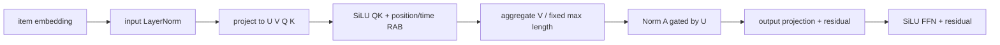

# HSTU

HSTU（Hierarchical Sequential Transduction Unit）用非归一化的 SiLU attention、更新门和相对注意力偏置建模序列。它在本仓库中是与 SASRec 成对出现的强判别式基线，而不是“用了 Transformer 就属于 SID 生成”的模型。

## 定位与状态

| 项目 | 内容 |
|---|---|
| 原论文 | [Actions Speak Louder than Words: Trillion-Parameter Sequential Transducers for Generative Recommendations](https://arxiv.org/abs/2402.17152)，ICML 2024 |
| 官方代码 | [facebookresearch/generative-recommenders](https://github.com/facebookresearch/generative-recommenders) |
| 任务 | next-item prediction |
| 表示 / 输出 | 唯一 item ID / full-catalog logits |
| 代码 | 完整链路；Amazon 与 MovieLens-1M adapter |
| 主评测 | item-level full catalog |
| 复现角色 | 小规模、dense tensor 的 HSTU-inspired 基线；不是 Meta 工业栈等价复刻 |
| 最近核验 | 2026-08-30 |

## 与 SASRec 的关键区别

| 组件 | SASRec | HSTU |
|---|---|---|
| attention 激活 | softmax 归一化 | SiLU，非归一化 |
| point-wise 投影 | Q、K、V | U、V、Q、K |
| 聚合输出 | `softmax(QK) @ V` | `SiLU(QK + RAB) / max_seq_len @ V` |
| 门控 | 无独立 U gate | `Norm(A) ⊙ U`，可选 `concat(U,A,U⊙A)` |
| 时间 | 位置 embedding | 相对位置 bias + 可选时间差 bias |
| 默认目标 | SASRec config 用 CE | HSTU config 用 CE；另有 sampled-softmax |

softmax 强制每行权重和为 1；SiLU 不做概率归一化，因此可保留聚合强度，但它也要求显式控制尺度。当前实现用固定 `max_seq_len` 而不是当前 batch 长度归一化，避免同一样本的表示随 batch 中最长序列变化。

## 单层计算

对输入 \(X\in\mathbb{R}^{B\times L\times d}\) 先做 pre-norm 和一次线性投影：

\[
[U,V,Q,K]=W\operatorname{LN}(X).
\]

每个 head 的空间聚合为：

\[
A=\frac{\operatorname{SiLU}(QK^\top+B_{pos}+B_{time}+M)}{L_{max}}V.
\]

默认 point-wise transformation：

\[
Y=X+W_o\left(U\odot\operatorname{LN}(A)\right),
\]

随后当前仓库再接一个 SiLU FFN 残差块。`concat_ua=True` 时，输出投影的输入改为 \([U,A,U\odot A]\)。



## 相对注意力偏置

`RelativePositionBias` 把 query–key 的相对位置放入小距离精确、大距离对数增长的 buckets。`TemporalBias` 对 Unix timestamp 的绝对差做以 2 为底的对数分桶，并为每个 head 学习 bias。

!!! important "时间戳 padding"
    padding timestamp 为 0，但 key padding 同时被 attention mask 屏蔽。关闭 `use_temporal_bias` 时 trainer 不向模型传 timestamp；只改 dataset 不会关闭模型中的时间分支。

论文中的 relative attention bias 和生产实现有更多 jagged/长序列优化；本仓库使用 dense `[B,H,L,L]` 矩阵，目标是学术规模公平对照。

## 两种损失

### Full-vocabulary CE

默认 `config/hstu/amazon.gin` 对所有 item 计算：

\[
s_{t,j}=h_t^\top E_j,\qquad
\mathcal L_{CE}=-\log\operatorname{softmax}(s_t)_{y_t}.
\]

### Sampled softmax

`config/hstu/amazon_ss.gin` 为每个正例建立 `[positive, sampled negatives]` 分类问题。当前 Meta-aligned 设置包括：

- `sampling_strategy="local"`：这里的 local 指 item embedding table 未分片；每个正例独立地从完整目录均匀有放回抽 128 个负例，并非 in-batch；
- `sampling_strategy="in_batch"`：另一个显式选项，从当前 batch 的唯一有效 targets 中为每个正例独立抽样；
- sampled negative 与当前 positive 相同则用 `-5e4` 屏蔽；
- query/item embedding L2 normalize；
- temperature 默认为 `0.05`；
- 评测复用相同的 L2-normalized、temperature-scaled score function。

`sampling_strategy="global"` 保留旧 GenRec 的“整 batch 共用一组、再去重”的均匀目录负例。它与 Meta local sampler 的逐正例 `[N,128]` 采样不同，历史结果不能与修复后的 local 结果混合。

## 张量与 API

`HSTU.forward(input_ids, timestamps=None, targets=None, sampled_softmax=False, ...)`：

| 张量 | shape | 说明 |
|---|---|---|
| `input_ids` | `[B,L]` | 左 padding item IDs，0 为 padding |
| `timestamps` | `[B,L]` | Unix timestamp；关闭 temporal bias 时可为 `None` |
| `targets` | `[B,L]` | shift 后的 next-item labels |
| `logits` | `[B,L,V+1]` 或 `None` | sampled-softmax 训练时为 `None` |
| `loss` | scalar / `None` | CE 或 sampled-softmax |

`score_l2_norm` 与 `score_temperature` 是 score function 的单一事实源；训练器会根据 sampled-softmax 配置构造它们。直接实例化模型时必须保持训练和评测一致。

## 数据与评测

Amazon adapter 与 SASRec 的 leave-one-out 结构相同，但同时保留每次行为的 timestamp。collate 左 padding 后创建多位置 target；目标位置使用历史最后一个 timestamp 作为占位时间。评测在最后有效位置对完整目录打分，只排除 padding 0，不屏蔽历史 item。

训练器还接受 `dataset_type="ml1m"`，此时使用 `MovieLens1MHSTUDataset`；样本 schema 相同，因此复用 HSTU collate。MovieLens 下载/5-core 行为应与 Amazon 结果分开记录。

## 代码映射

| 层次 | 文件 | 关键对象 | 职责 |
|---|---|---|---|
| 模型 | `genrec/models/hstu.py` | `HSTU` | 编码、统一 score、CE/SS dispatch |
| 核心层 | 同上 | `HSTULayer` | U/V/Q/K、SiLU 聚合、门控、FFN |
| bias | 同上 | `RelativePositionBias`, `TemporalBias` | 相对位置与时间分桶 |
| Amazon 数据 | `genrec/data/amazon_hstu.py` | `AmazonHSTUDataset` | 带时间戳序列与协议切分 |
| ML-1M 数据 | `genrec/data/ml1m_hstu.py` | `MovieLens1MHSTUDataset` | 下载、解析、5-core、LOO |
| 训练 | `genrec/trainers/hstu_trainer.py` | `train`, `evaluate` | CE/SS、Accelerate、早停、结果保存 |
| 配置 | `config/hstu/amazon.gin` | — | CE 基线 |
| 配置 | `config/hstu/amazon_ss.gin` | — | sampled-softmax 基线 |

## 运行

```bash
# full-vocabulary CE + temporal bias
python genrec/trainers/hstu_trainer.py \
  config/hstu/amazon.gin --split beauty

# sampled softmax（Meta local-table negatives，不是 in-batch）
python genrec/trainers/hstu_trainer.py \
  config/hstu/amazon_ss.gin --split beauty

# 时间偏置消融
python genrec/trainers/hstu_trainer.py \
  config/hstu/amazon.gin --split beauty \
  --gin 'train.use_temporal_bias=False'

# global temporal 协议必须使用独立输出目录
python genrec/trainers/hstu_trainer.py \
  config/hstu/amazon.gin --split beauty \
  --gin 'AmazonHSTUDataset.evaluation_protocol="global_temporal"' \
  --gin 'train.save_dir_root="out/hstu/amazon/beauty/global_temporal/s42"'
```

## 与论文/官方实现的差异

| 方面 | Meta 工作 | 本仓库 |
|---|---|---|
| 规模 | 工业长序列、可扩展至极大参数量 | 2 层、64-dim 等学术规模配置 |
| 张量 | jagged tensor 与专用 kernel | dense PyTorch attention |
| 特征 | 多种 action/feature 语义 | 单 item ID + timestamp |
| HSTU block | 论文/官方配方 | 保留额外 FFN；可选 position bias 与 concat gate |
| loss | sampled softmax 是重要设置 | 同时提供 CE 和近似对齐的 sampled softmax |
| evaluation | 工业任务与内部协议 | Amazon/ML-1M next-item full catalog |

因此页面使用 “HSTU-inspired implementation” 的复现边界：它适合验证 SiLU attention、U gate 和 temporal RAB 的小规模效果，不能代表 Meta 生产系统的吞吐或 scaling claim。

## 常见问题

- **sampled-softmax 训练正常、评测骤降**：确认评测没有绕过 `_compute_logits`；L2 normalize 与 temperature 必须一致。
- **多卡各自训练不同模型**：loss 必须经过 Accelerate 包装后的 `model(...)`；不要直接调用 unwrapped module 的 `forward_sampled_softmax`。
- **改变 eval batch size 后指标变化**：attention 必须除固定 `max_seq_len`，不能除当前 batch padding 长度。
- **关闭时间偏置仍有相对偏置**：`use_temporal_bias=False` 只关时间；若要同时关闭位置 RAB，设置 `train.use_position_bias=False`。
- **声称与 SASRec 公平但参数量不同**：同时记录 `embed_dim / heads / blocks / dropout / loss`；只对齐名称不够。
- **结果与历史 SS 数字冲突**：核对 `ss_sampling_strategy`。旧结果可能来自 global negative sampling。

## 参考

- [论文：Actions Speak Louder than Words](https://arxiv.org/abs/2402.17152)
- [Meta 官方 Generative Recommenders](https://github.com/facebookresearch/generative-recommenders)
- [本仓库基准与 provenance](https://github.com/phonism/genrec/blob/main/BENCHMARKS.md)
