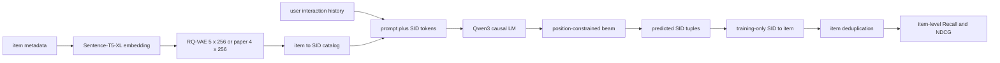

# LCRec：用协同语义 ID 适配 causal LLM

## 定位与状态

| 项目 | 本仓库当前实现 |
|---|---|
| 任务 | next-item generative retrieval；训练时另含 item-text/SID 对齐任务 |
| item 表示 | 主配置 5×256；论文对齐配置为 4×256 + uniform semantic mapping（USM） |
| backbone | Hugging Face causal LM；主配置为本地 **Qwen3-1.7B** |
| 训练 | response-only causal language modeling，默认全参数微调 |
| 解码 | 逐位置 codebook mask + KV-cache beam search |
| 主评测 | training-only SID→item 解析、item 去重后的 item-level Recall/NDCG |
| checkpoint | Hugging Face model/tokenizer 目录；不含 optimizer、scheduler 或 epoch |
| 复现状态 | Qwen3-4B + 四层 USM 的 Amazon 2014 适配已完成 18 格 item-level 矩阵；历史 SID-tuple 不作 headline |

[`LCRec`](https://github.com/phonism/genrec/blob/main/genrec/models/lcrec.py) 本身并没有把模型写死为某个 Qwen 类：它通过 `AutoModelForCausalLM` / `AutoTokenizer` 加载任意兼容目录。运行时应以 Gin 为准。当前 [`config/lcrec/amazon/lcrec.gin`](https://github.com/phonism/genrec/blob/main/config/lcrec/amazon/lcrec.gin) 和 Amazon 2023 配置都绑定 `MODEL_HUB_QWEN3_1_7B`；Python 函数签名里的 `Qwen/Qwen2.5-1.5B` 只是未使用 Gin 时的旧回退值，模型文件 docstring 中的 Qwen2 描述也不是当前实验版本。

## 原始工作

2026-10-22 矩阵验收采用 `lcrec_paper_recipe.gin`：Qwen3-4B、六任务、四层 USM、历史长度 20，
micro-batch 4 × accumulation 32 = 有效 batch 128，四个 epoch，beam 20，
eval batch 4。Beauty/Sports/Toys LOO 三种子 R@10 分别为 0.0729 ± 0.0004、
0.0399 ± 0.0005、0.0705 ± 0.0041；时间切分单列在
[BENCHMARKS.md](https://github.com/phonism/genrec/blob/main/BENCHMARKS.md)。
这与下文 legacy 默认配置不同，也不是原论文数据与 LLaMA-7B 的完整复现。
评测时 prompt 模板仍会随机选择，尚未实现跨评测的固定模板对照。

- 论文：[Adapting Large Language Models by Integrating Collaborative Semantics for Recommendation](https://arxiv.org/abs/2311.09049)，ICDE 2024。
- 仓库内保留的官方参考实现：[`reference/LC-Rec/`](https://github.com/phonism/genrec/blob/main/reference/LC-Rec/README.md)。

原工作用学习式 item index 弥合语言语义与协同语义，并用六类 instruction-tuning 任务对齐 LLM。官方参考 README 使用 LLaMA-7B、delta weights、六任务和 Instruments/Arts/Games 数据。本仓库是面向 GenRec Amazon pipeline 的独立适配，不是官方 checkpoint 的直接加载器。

## 两阶段数据流



Stage 1 只学习 item 内容 embedding 的量化器；Stage 2 才读取用户行为序列。论文配方还按官方 `index/run.sh` 使用首个 1024-item batch 做 K-Means 初始化、Xavier-normal MLP，并对 reconstruction 与逐层 VQ loss 取 mean。两阶段必须共享 item 顺序、Sentence-T5-XL embedding 空间和 RQ-VAE 几何。把其他模型的 RQ-VAE checkpoint 填进 LCRec 配置，即使文件能加载，也可能因 latent width、hidden dims、层数或码本大小不同而失败或产生错误 SID。

## SID 与 LLM 词表

对 item $i$，RQ-VAE 产生

\[
s(i)=(c_{i,0},c_{i,1},\ldots,c_{i,C-1}),
\qquad c_{i,j}\in\{0,\ldots,K-1\}.
\]

主配置 $C=5,K=256$；论文对齐配置 $C=4,K=256$。以主配置为例，`LCRec.add_codebook_tokens()` 向 tokenizer 加入 1280 个 special tokens：

```text
<C0_0> ... <C0_255>
<C1_0> ... <C1_255>
...
<C4_0> ... <C4_255>
```

一个 SID 被串联成 `<C0_a><C1_b><C2_c><C3_d><C4_e>`；历史 item 还会带 `1. `、`2. ` 等序号并以逗号分隔。添加 token 后模型会 resize input/output embedding，所以 tokenizer 文件是 checkpoint 的必要组成部分，不能用原始 Qwen tokenizer 单独替换。

RQ-VAE 细节见 [RQ-VAE 专页](rqvae.md)。legacy 配置使用 input 768、latent 64、hidden `[512,256,128]`、5 层 256 码；`rqvae_paper_recipe.gin` 使用官方 indexer 的 latent 32、hidden `[2048,1024,512,256,128,64]` 与 4 层 256 码。两者前层 STE、最后一层 Sinkhorn。`uniform_semantic_mapping=True` 会按官方流程对完整 SID 碰撞组反复执行最后一层 Sinkhorn 重分配；真实重复或固定点仍可能碰撞，adapter 会打印最终唯一率。

## 训练任务与样本

[`AmazonLCRecDataset`](https://github.com/phonism/genrec/blob/main/genrec/data/amazon_lcrec.py) 定义六类任务，但“代码支持”和“当前主配置启用”要分开看：

| task | 输入 → 输出 | 样本构造 | 主配置 |
|---|---|---|---|
| `seqrec` | 历史 SID → 下一 item SID | 训练前缀上的 sliding windows | 启用 |
| `item2index` | title/description/combined → SID | 每个 item 三个 subtype | 启用 |
| `index2item` | SID → title/description/combined | 每个 item 三个 subtype | 启用 |
| `fusionseqrec` | 历史 SID → item 文本 | 按权重抽样 | 关闭 |
| `itemsearch` | 合成 query + 历史 SID → SID | 按权重抽样 | 关闭 |
| `preferenceobtain` | 历史 SID → 类目偏好文本 | 每用户按权重抽样 | 关闭 |

legacy Amazon Gin 显式设置：

```gin
AmazonLCRecDataset.enabled_tasks = ["seqrec", "item2index", "index2item"]
```

`lcrec_paper_recipe.gin` 开启全部六任务。`task_sample_weights` 只影响三个可选的抽样任务，不会下采样 `seqrec/item2index/index2item`。`fusionseqrec` 的若干 prompt 要求“index and title”，但实现 response 只返回 title；`itemsearch` query 和 `preferenceobtain` response 也是基于 metadata 的本地启发式合成。因此六个任务名已对齐，不代表 Amazon 样本生成与论文数据逐条等价。

### 序列切分

`leave_one_out` 下：

- train 排除每个用户最后两个 item，并对剩余前缀构造 `seqrec` sliding windows；
- valid 用倒数第二个 item 作 target；
- test 用最后一个 item 作 target；
- 历史只保留最近 `max_seq_len` 个 item。

`global_temporal` 使用共享的全局时间 cutoff，并通过同一 dataset builder 生成相同 schema。二者不可汇总为同一行结果。valid/test dataset **只生成 `seqrec`**；训练器虽然保留 `item2index`、`index2item` evaluator 分支，常规验证不会触发它们。

## response-only causal LM 目标

collator 拼接：

```text
SFT prompt + response + EOS
```

训练 batch 的 `input_ids`、`attention_mask`、`labels` 均为 `[B,L]`。prompt 和 padding 对应的 label 被置为 `-100`，所以损失只覆盖 response 与 EOS：

\[
\mathcal L_{\mathrm{CLM}}
=-\sum_{t\in\text{response+EOS}}
\log p_\theta(x_t\mid x_{<t}).
\]

评测只 tokenize prompt，并为 decoder-only generation 临时使用 left padding。`train.max_length=512` 是真正控制 prompt/response token 截断的参数；dataset 的 `max_text_len` 当前只被保存，没有参与 LCRec 文本截断。

## 代码与 tensor 契约

| 层次 | 文件 / 符号 | 关键契约 |
|---|---|---|
| 模型 wrapper | [`LCRec`](https://github.com/phonism/genrec/blob/main/genrec/models/lcrec.py) | `forward([B,L])` 返回 HF causal LM output |
| 自定义生成 | `LCRec.generate_constrained_beam` | 输入 `[B,L]`；返回 SID `[B,K,C]`、log score `[B,K]` |
| 备用生成 | `LCRec.generate_topk` | 较早的逐样本 top-k beam；正式 trainer 不走此路径 |
| 数据 | [`AmazonLCRecDataset`](https://github.com/phonism/genrec/blob/main/genrec/data/amazon_lcrec.py) | dict：task/prompt/response/target item/target SID |
| collator | [`lcrec_collate_fn`](https://github.com/phonism/genrec/blob/main/genrec/trainers/lcrec_trainer.py) | response label mask；eval left padding |
| 约束表 | `ConstrainedDecodingHelper` | `position_mask [C+1,V]`、`code_map [C,V]` |
| SID resolver | [`SemanticIdItemMapper`](https://github.com/phonism/genrec/blob/main/genrec/modules/metrics.py) | `[B,K,C]` → 去重后的 item IDs `[B,K]` |
| trainer | [`train`](https://github.com/phonism/genrec/blob/main/genrec/trainers/lcrec_trainer.py) | Accelerate、AdamW、cosine warmup、W&B、周期保存 |

封装类没有 `LCRec.generate()`。如果需要直接调用，必须显式构造约束表：

```python
from genrec.models.lcrec import LCRec
from genrec.trainers.lcrec_trainer import ConstrainedDecodingHelper

model = LCRec(pretrained_path="/path/to/Qwen3-1.7B")
model.add_codebook_tokens(num_codebooks=5, codebook_size=256)
helper = ConstrainedDecodingHelper(5, 256, model.tokenizer).to(device)

sem_ids, scores = model.generate_constrained_beam(
    input_ids=input_ids,                 # [B, L], left padded
    attention_mask=attention_mask,       # [B, L]
    position_mask=helper.position_mask,  # [6, vocab]
    code_map=helper.code_map,            # [5, vocab]
    num_codebooks=5,
    beam_width=10,
    topk=10,
)
```

已有 checkpoint 应先用 `load_pretrained(checkpoint_dir)` 载入其中的 model/tokenizer，再基于载入后的 tokenizer 创建 helper。

## 解码与 item-level 评测

自定义 beam 先对完整 prompt 做一次 KV-cache prefill，随后生成 5 个 code token 和 EOS。第 $j$ 步只能选择 `<Cj_*>`，最后一步只能选择 EOS。这保证 token 的**位置类型合法**，但不是 catalog PrefixTrie：组合后的 5-tuple 可能不属于任何 item。

SID 还可能碰撞。训练器用训练交互前缀统计 popularity，并为每个 SID 固定选择一个代表 item：

\[
g(s)=\arg\max_{i:\operatorname{SID}(i)=s}
\operatorname{pop}_{train}(i),
\]

同票时取较小 item ID。每个生成 SID 只解析为 $g(s)$，catalog 外 tuple 被丢弃，重复 item 只保留第一次，不足位置填 `-1`。headline 指标再以真实 `target_item` 计算单目标 Recall/NDCG@1/5/10。

训练器同时记录：

- `seqrec` top-1 的逐 code accuracy 与完整 SID exact match；
- 解析前 SID-tuple Recall/NDCG（日志和 `results.json.extra.sid_reference_metrics`）；
- 解析后的 item-level Recall/NDCG（model selection 与主结果）。

SID 指标受碰撞影响，只是诊断，不可与 item-level 主表混用。trainer 只用 validation item Recall@10 选择并保存 `checkpoint_best`；训练结束后所有 rank 重载同一 best state，再运行一次 test，测试集不参与选 epoch。

## 可执行训练命令

先确认 [`config/base.gin`](https://github.com/phonism/genrec/blob/main/config/base.gin) 的 Qwen3 与 Sentence-T5 路径在本机存在，或从 CLI 覆盖 Gin 常量。

```bash
# Stage 1：训练 LCRec 专用 5×256 RQ-VAE
python -m genrec.trainers.rqvae_trainer \
  config/lcrec/amazon/rqvae.gin --split beauty

# Stage 2：Qwen3-1.7B LCRec
python -m genrec.trainers.lcrec_trainer \
  config/lcrec/amazon/lcrec.gin --split beauty

# 论文结构对齐：4-code indexer、USM、六任务、history 20、beam 20；
# Qwen3-4B 是本地可用的 LLaMA-7B 替代，仍属于 Amazon adaptation。
python -m genrec.trainers.rqvae_trainer \
  config/lcrec/amazon/rqvae_paper_recipe.gin --split beauty
python -m genrec.trainers.lcrec_trainer \
  config/lcrec/amazon/lcrec_paper_recipe.gin --split beauty
```

Stage 2 当前固定读取：

```text
out/lcrec/amazon/<split>/rqvae/checkpoint_epoch_1999.pt
```

RQ-VAE config 默认训练 5000 epochs、每 50 epoch 保存一次；`checkpoint_epoch_1999.pt` 在完成第 2000 个 epoch 后存在，训练随后仍会继续到 epoch 4999。若改用其他 epoch，必须显式覆盖下游路径并记录 artifact。

Amazon Reviews 2023 已有 `books` 等预处理类目的对应配置：

```bash
python -m genrec.trainers.rqvae_trainer \
  config/lcrec/amazon2023/rqvae.gin --split books
python -m genrec.trainers.lcrec_trainer \
  config/lcrec/amazon2023/lcrec.gin --split books
```

快速联调没有单独的 `lcrec_debug.gin`。在上游 RQ-VAE 和真实 LLM 已就绪时，可用现有参数缩小样本；这仍会加载完整 item catalog，不是轻量单元测试：

```bash
python -m genrec.trainers.lcrec_trainer \
  config/lcrec/amazon/lcrec.gin --split beauty \
  --gin 'train.epochs=1' \
  --gin 'train.max_train_samples=32' \
  --gin 'train.do_eval=False' \
  --gin 'train.wandb_logging=False'
```

### 当前 Amazon 2014 主配置

| 参数 | 值 |
|---|---:|
| Qwen | Qwen3-1.7B |
| epochs / batch / accumulation | 10 / 16 / 4 |
| lr / weight decay | `2e-5` / `0.01` |
| warmup | 总 optimizer steps 的 1% |
| history / LM length | 50 items / 512 tokens |
| RQ-VAE | 5 × 256，latent 64 |
| LoRA | false；默认全参数 |
| eval batch / beam | 16 / 10 |
| precision | Accelerate bf16 |
| save / eval | 每个 epoch |
| W&B | 默认开启 |

设置 `train.use_lora=True` 时，adapter target 包含 attention 与 MLP projection。若 `peft` 未安装，当前代码只 warning 并继续不带 LoRA 的训练，可能导致显存与实验语义骤变；启动后必须核对 trainable parameter 日志。

## checkpoint、eval-only 与结果 provenance

默认输出目录是 `out/lcrec/amazon/<split>/`：

- `checkpoint_epoch_<zero-based epoch>/`：HF model/tokenizer 目录；当前每轮保存；
- `checkpoint_best/`：只由 validation item Recall@10 选择；
- `checkpoint_final/`：最后一轮，不保证是 validation 最优；
- `results.json`：保存 best-valid 权重的一次性 test item metrics、`best_epoch`、SID resolver 与 SID 诊断；
- 日志与可选 W&B run。

最优权重可直接取 `checkpoint_best/`；`results.json.extra.best_epoch` 同时记录其来源 epoch。checkpoint 不保存 optimizer、scheduler、global step 或随机状态，`checkpoint_path` 是 weights-only 加载，不是精确 resume。

```bash
# 当前 eval-only 只评 validation，且不会写新的 results.json
python -m genrec.trainers.lcrec_trainer \
  config/lcrec/amazon/lcrec.gin --split beauty \
  --gin 'train.eval_only=True' \
  --gin 'train.checkpoint_path="out/lcrec/amazon/beauty/checkpoint_epoch_5"' \
  --gin 'train.wandb_logging=False'
```

当前 checkout 不跟踪 `out/` 中的 LCRec run artifact，[`BENCHMARKS.md`](https://github.com/phonism/genrec/blob/main/BENCHMARKS.md) 也尚无完成的 LCRec item-level 多 seed 行。因此旧版页面中的 Beauty/Toys/Sports/Home epoch 表已移除：它们是解析前 SID-tuple 历史记录，且页面没有绑定可校验的 `results.json`、源码 SHA、seed 与协议 artifact，不能作为当前 headline。最新可发布数字只应来自 `BENCHMARKS.md` 的已验证行。

## 与论文/官方参考实现的差异

| 方面 | 官方参考实现 | 本仓库当前路径 | 影响 |
|---|---|---|---|
| LLM | LLaMA-7B + delta weights | Qwen3-1.7B，默认全参数 | tokenizer、容量与优化不可直接对齐 |
| 数据 | Instruments/Arts/Games 处理集 | Amazon 2014 四类；另有 Amazon 2023 adapter | 样本、item mapping 与文本来源不同 |
| tuning tasks | 六任务 | paper recipe 开启六任务；legacy 主配置开三任务 | 任务名对齐，Amazon 样本合成仍是本地适配 |
| item index | 学习式 uniform semantic mapping | 4-code paper RQ-VAE + collision-group Sinkhorn USM | 流程已对齐，输入 embedding 仍是 Sentence-T5-XL 替代 |
| beam | 官方 README 示例 20 | paper recipe 20；legacy 默认 10 | paper control 的计算预算已对齐 |
| validity | 官方 index/data pipeline | 位置合法，但无 catalog Trie | 可生成目录外 tuple |
| 评测 | 官方处理集与 prompt sweep | 固定 seqrec、training-only resolver 后 item metric | 不能复用论文数值作本仓库基线 |
| distributed | DeepSpeed 配置 | Accelerate；评测计数 all-reduce | checkpoint 与启动方式不同 |

## 已知限制与常见坑

1. **把 `LCRec.generate()` 写进调用代码**：该方法不存在；使用 `generate_constrained_beam()`，或直接调用内部 `model.generate()` 并自行保证约束与解析。
2. **生成候选不足**：位置 mask 不保证 tuple 属于 catalog，mapper 会丢弃非法 tuple 和重复 item。统计 catalog 命中率与有效候选数。
3. **SID Recall 高于 item Recall**：SID collision 使解析前命中偏乐观；主结果只看 item-level。
4. **换 backbone 后 label 错位**：collator 用 `add_special_tokens=False` 计算 prompt 长度，默认 Qwen 不自动加 BOS。换 tokenizer 时必须验证 special-token 行为与 response mask。
5. **误以为 `max_text_len` 生效**：LCRec dataset 当前不使用它截断 metadata；调整 `train.max_length` 并检查 SID response 是否被截断。
6. **LoRA 悄悄退化**：缺 `peft` 时不会 fail fast。把依赖、trainable 参数数和 variant 写入结果 provenance。
7. **把 final 当 best**：最终目录只表示最后一轮；正式选择使用 `checkpoint_best/`。
8. **eval-only 当正式重评**：当前只跑 valid，也不写结果 artifact。完整 benchmark 使用训练器的 validation selection + one-shot test 路径。
9. **RQ-VAE checkpoint 几何不匹配**：同时核对 encoder、input/latent dims、hidden dims、K 与 C；文件名相似不代表兼容。
10. **现有验证脚本被当成通用测试**：[`verify_lcrec_collate.py`](https://github.com/phonism/genrec/blob/main/scripts/verify_lcrec_collate.py) 固定 `/root/workspace/...` 模型路径并加载真实大模型/数据，只是遗留环境探针，不是可移植 pytest。当前没有 LCRec 专属自动化单测覆盖 checkpoint reload 与 beam。

## 参考与相关文档

- [LC-Rec 论文](https://arxiv.org/abs/2311.09049)
- [仓库内官方参考 README](https://github.com/phonism/genrec/blob/main/reference/LC-Rec/README.md)
- [RQ-VAE item tokenizer](rqvae.md)
- [统一评测系统](../architecture/evaluation-system.md)
- [模型实现状态](../reference/model-status.md)
- [命令索引](../reference/command-index.md)
