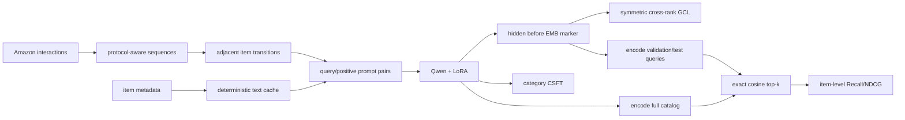

# NoteLLM：把 causal LLM 变成可检索的内容编码器

## 定位与状态

| 项目 | 本仓库实现 |
|---|---|
| 任务 | item-to-item（I2I）next-item retrieval |
| 家族 | retrievable LLM / dense full-catalog retrieval |
| 输入 | 单个 query item 的 title、brand、description 文本；category 仅作 CSFT target |
| 输出 | `[EMB]` 前一个 token 位置的归一化 hidden state |
| 训练 | 相邻 item 对的双向 GCL + category CSFT；分布式时跨 rank negatives |
| 默认主干 | Qwen3-1.7B + LoRA |
| 主评测 | 排除 query item 后的 exact item-level full-catalog cosine top-k |
| 复现范围 | GCL+CSFT Amazon 适配；数据、backbone 与论文仍不同 |

NoteLLM 不生成 semantic ID，也不把用户完整历史编码成一个序列表示。当前适配用“最后一个历史 item → 下一个 item”定义查询，所以与 SASRec/HSTU 的多行为序列建模不完全同任务。可信实验完成度见[模型实现状态](../reference/model-status.md)和 [BENCHMARKS.md](https://github.com/phonism/genrec/blob/main/BENCHMARKS.md)；未完成要求的多 seed 单元不应提前进入正式数字主表。

## 原始工作

- 论文：[NoteLLM: A Retrievable Large Language Model for Note Recommendation](https://arxiv.org/abs/2403.01744)，The Web Conference 2024 Companion，170--179。
- 官方代码：[Applied-Machine-Learning-Lab/NoteLLM](https://github.com/Applied-Machine-Learning-Lab/NoteLLM)。

论文面向小红书 note recommendation，核心包含：抽取 compression token 前一位置的表示、generative contrastive learning（GCL），以及通过 hashtag/category generation 做 compressed semantic fine-tuning（CSFT）。本仓库将数据换成 Amazon item 文本，默认 trainer 同时训练双向 GCL 与 category CSFT；hard-negative mask 仍仅保留为诊断接口，未改变论文式 GCL 正样本定义。

## 核心表示与目标

每个 item 文本被格式化为：

```text
Represent this catalog item for retrieval: <metadata text> [EMB]
```

tokenizer 新增特殊 token `[EMB]`。若它扩展了词表，初始化时从 EOS embedding 复制输入/输出权重，避免在默认 LoRA 冻结 base embedding 后留下永久随机的新 token。tokenizer 使用左截断，保证位于末尾的 marker 与最近文本保留；若任一样本截断后找不到 marker，立即抛错。

设 causal LM 在 marker 前一位置的 hidden state 为 $h(x)$，输出向量为

$$
e(x)=\frac{h(x)}{\|h(x)\|_2}.
$$

batch 按 `(q_0,p_0,q_1,p_1,...)` 交替排列。令 $s_{ij}=e_i^\top e_j$。每个成员都作为 anchor，配对成员是正例，其余本 rank 与其他 rank 的非自身 item 都是负例；同一 catalog item 在其他 row 的重复副本会被屏蔽，避免矛盾的 false negative。默认 GCL 是双向 InfoNCE：

$$
\mathcal L_{\mathrm{GCL}}
=-\frac1{2B}\sum_i\log
\frac{\exp(e^{\tau}s_{i,\,i\oplus1})}
{\sum_{j\ne i}\exp(e^{\tau}s_{ij})}.
$$

代码中的 `tau` 是可训练标量，初始化 3，实际 logit scale 为 `tau.exp()`，不是除以温度 3。DDP 下每个 rank 只对本地 anchors 求均值，但候选由 all-gather 汇集，保留本 rank embedding 的梯度。

### CSFT 联合目标

默认 dataset 将 Amazon category path 单独保存为 target，不把 category 放进输入文本，避免模型直接复制答案。trainer 显式构造 response-only labels，模型用 LM head 计算 category generation loss，并组合：

$$
\mathcal L=\frac{\mathcal L_{\mathrm{GCL}}+alpha\mathcal L_{\mathrm{gen}}}{1+\alpha},
\qquad \alpha=0.01.
$$

Qwen 常把 EOS 同时用作 padding；collator 因此按真实长度构造 attention mask，避免把有效 EOS target 错当 padding。`score` 仍可产生 hard-negative mask，但当前 trainer 不传 score，结果只能标为 GCL+CSFT，不能标为 hard-negative 实验。

## Amazon I2I 数据流



[`AmazonNoteLLMDataset`](https://github.com/phonism/genrec/blob/main/genrec/data/amazon_notellm.py) 继承统一 Amazon/SASRec 的 item 映射和 leave-one-out/global-temporal splitter，但覆盖样本构造：

- 训练：对 `full_seq[:-2]` 中每个相邻 item 建一个 query-positive pair；
- 验证：倒数第三项查询倒数第二项；
- 测试：倒数第二项查询最后一项。

这意味着 `max_seq_len=50` 不会让 NoteLLM 看见 50 个历史 item；每个 query 始终只是紧邻 target 的一个 item。若研究问题是完整 session 表示，应另建 history prompt/encoder，而不是把当前结果解释为 sequence-aware LLM。

item 输入文本按 title、brand、description 的固定顺序展开，最长先截到 4000 字符，再由 tokenizer 截到默认 256 token；category path 单独作为 CSFT response。cache 为 `processed/<split>/notellm_item_texts_csft_v2.json` 与 `notellm_item_categories.json`，有文件锁与原子替换。

## 代码实现映射

| 层次 | 文件 / 符号 | 职责 |
|---|---|---|
| 模型 | [`Query2Embedding`](https://github.com/phonism/genrec/blob/main/genrec/models/notellm.py) | tokenizer 扩展、marker hidden 抽取、GCL/可选 CSFT |
| cache | `DynamicCache` | 为模型原生 generation API 迁移 past KV；当前 retrieval trainer 不使用 |
| 诊断指标 | `compute_metrics` | **仅 batch 内**候选的 recall，禁止作主 benchmark |
| 正式指标 | `compute_full_catalog_metrics` | 唯一 item ID 校验、query 排除、exact cosine top-k |
| 数据 | [`AmazonNoteLLMDataset`](https://github.com/phonism/genrec/blob/main/genrec/data/amazon_notellm.py) | protocol-aware I2I 转移与 item 文本 |
| trainer | [`train`](https://github.com/phonism/genrec/blob/main/genrec/trainers/notellm_trainer.py) | LoRA、全库验证、早停、紧凑 checkpoint |
| 配置 | [`config/notellm/amazon.gin`](https://github.com/phonism/genrec/blob/main/config/notellm/amazon.gin) | Qwen3-1.7B Amazon 配方 |
| 单测 | [`test_notellm_full_catalog.py`](https://github.com/phonism/genrec/blob/main/tests/test_notellm_full_catalog.py) | exact item ID、排除规则、重复 ID、样本构造 |
| 真模型 smoke | [`smoke_notellm.py`](https://github.com/phonism/genrec/blob/main/scripts/smoke_notellm.py) | CUDA+LoRA 前反向与 metric 边界检查 |

模型还提供 `generate()` 和 KV-cache wrapper，但正式 trainer 从不调用文本 generation；这些 API 不能作为“当前实现生成推荐解释”的证据。

## 训练与验证命令

```bash
# 默认 Beauty，Qwen3-1.7B LoRA，双向 GCL + category CSFT
python -m genrec.trainers.notellm_trainer \
  config/notellm/amazon.gin --split beauty

# global-temporal 例子；catalog/metadata 仍是 transductive
python -m genrec.trainers.notellm_trainer \
  config/notellm/amazon.gin --split beauty \
  --gin 'AmazonNoteLLMDataset.evaluation_protocol="global_temporal"'

# 有本地真模型和 CUDA 时做有限 smoke
python scripts/smoke_notellm.py \
  --pretrained-path ./models_hub/Qwen3-1.7B \
  --dataset-root dataset/amazon \
  --split beauty
```

config 同时把 `{split}` 绑定到 `train.split` 与 `AmazonNoteLLMDataset.split`，因此标准 `--split sports` 会一致地选择数据和输出目录。启动日志中的 split、item 数和用户数应与目标数据集一致。

CPU 单元测试：

```bash
pytest -q tests/test_notellm_full_catalog.py
```

### 默认配置

| 配置 | 值 | 含义 |
|---|---:|---|
| `pretrained_path` | `MODEL_HUB_QWEN3_1_7B` | 本地 Qwen3-1.7B |
| `use_lora` | true | 不静默退化为 full-parameter；缺 `peft` 会报错 |
| LoRA `r/alpha/dropout` | 16 / 32 / 0.05 | attention 与 MLP projection 都注入 adapter |
| batch / accumulation | 16 / 2 | effective batch 仍为 32；每个 dataset sample 会展开成两条文本 |
| learning rate / weight decay | `2e-5` / `0.01` | AdamW |
| epochs / patience | 1 / 2 | 官方训练脚本为 1 epoch；仍用 validation 记录选择点 |
| `max_text_length` | 140 | 对齐官方 `model_max_length`；tokenizer 左截断 |
| eval / catalog batch | 32 / 64 | query loader 与 embedding/scoring chunk |
| precision | bf16 | 由 Accelerator 管理 |

`freeze_lm=True` 会冻结 backbone，且 trainer 只在 `not freeze_lm` 时启用 LoRA；此时主要可训练状态是 wrapper 中的温度等仍标记为 trainable 的参数。做 frozen-encoder 对照时应打印并记录 trainable parameter names，而不只是数量。

## 正式评测口径

每轮验证和最终测试都会：

1. 编码 catalog 中每个 1-based item ID 一次；
2. 编码当前 split 的所有 query item；
3. 对向量 L2 normalize 后计算 exact cosine matrix（按 query batch 分块）；
4. 将每个 query item 自身的分数设为 $-\infty$；
5. 在完整剩余 catalog 取 top-k；
6. 以精确 target item ID 计算单目标 Recall@K 与 NDCG@K。

metric 实现拒绝重复 catalog ID、catalog 外 target、catalog 外 exclusion，以及“target 同时被排除”。这些 fail-fast 检查避免把向量行号误当 item ID。

`Query2Embedding.compute_metrics()` 是早期/通用的 in-batch 诊断：每个 query 只和同 batch positives 排名。其输出键明确叫 `diagnostic_in_batch_recall@K`，候选集合随 batch 改变，绝不能与 full-catalog Recall/NDCG 并列。

评测复杂度约为 $O(QND)$；每个 epoch 都重新编码完整 catalog，并且没有跨 epoch embedding cache，因为 LoRA 参数在变化。多 GPU 时每个 rank 会重复 catalog encoding，只有 query 结果被 gather，扩展效率有限。

## 输出与依赖

默认 `out/notellm/amazon/<split>/` 包含：

- `best_model.pt`：只保存当时所有 `requires_grad=True` 参数、best epoch 与 valid Recall@10；
- `adapter/`：标准 PEFT LoRA adapter 配置与权重；
- `tokenizer/`：含新增 `[EMB]` 的 tokenizer；
- `results.json`：best-valid 权重的一次性 test item metrics、协议和明确的 `gcl_csft_category_amazon_adaptation` 标记；
- 训练日志和可选 W&B 记录。

该 checkpoint 不是自包含模型：它不含 base Qwen 权重。`adapter/` 可恢复标准 LoRA 层，但 wrapper 的 `tau` 与新增 marker 初始化仍以 `best_model.pt` 为准；完整重载还需相同 base 与 tokenizer。当前 trainer 没有 `--eval-only` 或 resume 入口，正式复现需保留 Gin 和 base model provenance。

运行依赖 Transformers、Accelerate、PyTorch、Gin；默认 LoRA 强依赖 `peft`。item metadata 与 Amazon 2014 interaction 由共享数据适配器准备。

## 与论文/官方实现的差异

| 方面 | NoteLLM 论文 | 本仓库 | 影响 |
|---|---|---|---|
| 数据 | 小红书 note 与行为/类别信号 | Amazon 商品 metadata + 相邻购买/评论序列 | 域、文本长度与行为语义不同 |
| backbone | 原论文指定的 LLM/compression 设置 | 本地 Qwen3-1.7B | 参数与 tokenizer 不可直接对齐 |
| 训练任务 | GCL + CSFT topic/category generation | 双向 GCL + Amazon category CSFT | 目标结构已对齐，target 语义仍因数据域而异 |
| negatives | batch/设备间其他 notes | 本 rank 与跨 rank 的所有非自身 rows，屏蔽同 item 副本；hardneg 未接 trainer | 单卡 batch=16 时每个 anchor 有 31 个其他 rows；仍少于官方 8 卡规模 |
| query | note/I2I 任务定义 | 紧邻 target 的单 item 文本 | 不是完整用户历史推荐 |
| 微调 | 论文配方 | LoRA r=16 的 Amazon 适配 | 容量与更新范围不同 |
| 评测 | 论文数据集候选/指标 | 排除 query 的 exact Amazon full catalog | 数字不能直接横向复用 |

## 已知限制与常见坑

1. **输入报缺少 `[EMB]`** → marker 被手工 prompt 删除，或最大长度/截断方式改变。保持 marker 为最后 token；不要改成右截断。
2. **category 泄漏进输入** → 必须使用 v2 文本 cache；category 只作为 response-only CSFT target。
3. **把 `max_seq_len` 当历史长度** → 当前 I2I 样本只输入一个 item。该参数主要来自共享 adapter 接口，不构造多 item prompt。
4. **in-batch recall 很高、full catalog 很低** → 候选规模不同，是预期现象；主表只用 `evaluate_full_catalog`。
5. **LoRA 启动时报依赖错误** → 默认不会静默改成 full fine-tuning。安装 `peft` 或明确覆盖 `train.use_lora=False` 并重新评估显存。
6. **加载 `best_model.pt` 后结果不对** → 它是 wrapper 增量状态，不能直接传给 `AutoModel.from_pretrained`；需先加载 base、tokenizer 与 `adapter/`。
7. **评测很慢** → 每轮重编码 catalog 并精确 $Q\times N$ 打分。只有在模型冻结后才能安全缓存 catalog embedding；训练中缓存会过期。
8. **global-temporal 被称为 cold-item** → interaction cutoff 并没有隐藏完整 catalog metadata，仍是 transductive。
9. **文本修改没生效** → v2 cache 仍不含原始 metadata fingerprint。确认具体 cache 后定点重建。
10. **用 gradient accumulation 冒充对比学习大 batch** → 有效 negatives 只来自同一次 forward/all-gather；默认已按官方每卡 microbatch 设为 16，继续扩大 effective batch 并不会扩大相似度矩阵。

## 扩展点

- **更强 CSFT**：在 Amazon category 之外构造不泄漏的 topic/hashtag target，并增加 generation-side validation metric。
- **更大负样本池**：跨 rank all-gather 已实现；进一步加 memory bank 时要处理重复 item false negatives，gradient accumulation 本身不够。
- **序列查询**：定义多 item prompt、时间/顺序编码与 query exclusion 规则，并与当前 last-item I2I 作为独立 variant。
- **ANN serving**：训练完成后导出 catalog embedding 与 item ID mapping；先用 exact evaluator 测 ANN recall loss，再报告 latency。
- **自包含 checkpoint**：保存 base model identifier/revision、PEFT config、tokenizer、wrapper state 与数据 fingerprint，并增加独立 eval-only reload 测试。
- **测试扩展**：增加 marker 左截断、LoRA reload、GCL 手算、CSFT label mask、global-temporal 样本边界与 distributed catalog 一致性。

## 参考与相关文档

- [NoteLLM 论文](https://arxiv.org/abs/2403.01744)
- [NoteLLM 官方代码](https://github.com/Applied-Machine-Learning-Lab/NoteLLM)
- [模型总览与选型](overview.md)
- [统一复现路线](../reproduction-roadmap.md)
