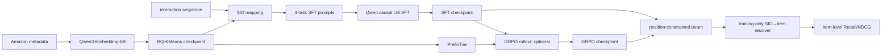

# OneRec：RQ-KMeans 语义 ID、指令微调与 GRPO

## 定位与状态

| 项目 | 本仓库实现 |
|---|---|
| 任务 | next-item recommendation；另含 item text ↔ semantic ID 对齐任务 |
| 家族 | decoder-only LLM 上的自回归 semantic-ID 生成 |
| 物品表示 | 默认 3 层、每层 256 类的 RQ-KMeans code |
| 训练阶段 | RQ-KMeans → instruction SFT → 可选 GRPO；另有实验性 CLM 路径 |
| 主干 | 本地 Qwen3-1.7B 配置，代码兼容 Hugging Face causal LM |
| 主评测 | constrained beam 后解析到 item，报告 item-level Recall/NDCG |
| 实现判断 | 独立研究适配，不是快手工业 OneRec/OpenOneRec 的完整复现 |

实现完成度和可信 benchmark 以[模型实现状态](../reference/model-status.md)与根目录 [BENCHMARKS.md](https://github.com/phonism/genrec/blob/main/BENCHMARKS.md)为准。历史日志中的 SID-tuple 指标可能受碰撞影响，不应直接放进与 item-ID 模型的主对比表。

## 原始工作与本仓库范围

- OneRec 论文：[OneRec: Unifying Retrieve and Rank with Generative Recommender and Iterative Preference Alignment](https://arxiv.org/abs/2506.13695)。
- OpenOneRec 技术报告：[OpenOneRec Technical Report](https://arxiv.org/abs/2512.24762)；[官方仓库](https://github.com/Kuaishou-OneRec/OpenOneRec)。
- MiniOneRec 论文：[MiniOneRec: An Open-Source Framework for Scaling Generative Recommendation](https://arxiv.org/abs/2510.24431)；[官方仓库](https://github.com/AkaliKong/MiniOneRec)。

本仓库把这些工作的几个公开思想组合为一条可审计的 Amazon 学术管线：用残差 K-Means 构造 SID，用 Qwen 做多任务 SFT，再用 group-relative policy optimization 对候选组进行偏好优化。这里没有实现工业 OneRec/OpenOneRec 的完整预训练、蒸馏、多域数据系统、在线 serving 或全部 preference-alignment 组件；“OneRec”在本文中始终指本仓库适配。

## 问题定义与 token 空间

设物品嵌入为 $x_i$，RQ-KMeans 将物品 $i$ 编为

$$
s_i=(c_{i,1},\ldots,c_{i,C}),\qquad c_{i,j}\in\{0,\ldots,K-1\}.
$$

默认 $C=3,K=256$。模型为每一层建立互不共享的 token 集合 `<Cj_k>`，因此 code token 总数为 $CK$，同一个整数在不同层不是同一 token。序列推荐输入是历史物品的 SID 文本，目标是下一个物品的 $C$ 个 code 及 EOS。

SFT 的基本目标是只在 response 区域做 causal cross-entropy：

$$
\mathcal L_{\mathrm{SFT}}
=-\sum_{t\in\text{response}}\log \pi_\theta(y_t\mid p,y_{<t}).
$$

prompt 与 padding 对应的 label 都被设为 `-100`。CLM 变体不构造 instruction/response mask，而是在每位用户的一条扁平 SID 流上对所有非 padding token 计算语言模型损失。

### 四个 instruction-SFT 任务

| 数据集任务名 | 输入 | 输出 | 用途 |
|---|---|---|---|
| `sidsft` | 历史 SID | 目标 SID | 核心序列推荐任务；也是验证/测试任务 |
| `title2sid` | item title | item SID | 文本到离散索引 |
| `sid2title` | item SID | item title | 离散索引到文本 |
| `fusionseqrec` | 历史 SID | 目标 title | 序列偏好与文本语义对齐 |

每类任务在数据适配器中有五个 prompt 模板。训练时 `sidsft` 与 `fusionseqrec` 对训练前缀做滑窗；item 级任务遍历 catalog。验证/测试只构造 `sidsft`，所以主指标衡量的是 next-item SID 生成，而不是文本重构。

### GRPO 目标

对同一 prompt 采样或搜索 $G$ 个 completion，奖励为 $r_g$。组内标准化得到

$$
A_g=\frac{r_g-\bar r}{\operatorname{std}(r)+10^{-4}}.
$$

训练器缓存 rollout policy 的 token log-probability，更新时使用 PPO 式 clipped ratio，并加相对 SFT reference 的 KL：

$$
\mathcal L_{\mathrm{GRPO}}
=-\mathbb E_g\!\left[
\min(\rho_gA_g,\operatorname{clip}(\rho_g,1-\epsilon,1+\epsilon)A_g)
\right]+\beta\,D_{\mathrm{KL}}(\pi_\theta\Vert\pi_{\mathrm{ref}}).
$$

代码的 KL 采用非负 k3 estimator：令 $x=\log\pi_{\rm ref}-\log\pi_\theta$，逐 token 计算 $e^x-x-1$。默认 `clip_eps=0.2`、`beta=0.001`、组大小 8。

可选奖励如下：

- `exact`：完整 SID 相等为 1，否则为 0。
- `hierarchical`：匹配前缀长 $m>0$ 时给 $10^{m-1}$；默认三层下为 1、10、100，完全无前缀为 0。
- `rank`：精确命中为 1；同组错误候选按名次给归一化负惩罚。若组内没有任何精确命中，整组返回 0。

`add_gt=True` 会用 ground truth 替换组内最后一个 completion，以消除全零组；该注入样本仍参与 policy-gradient 项，但训练器把它从 KL 均值中排除。

## 端到端数据流



RQ-KMeans 使用 catalog 物品文本嵌入；详见 [RQ-KMeans](rqkmeans.md)。Amazon leave-one-out 下，训练交互是每位用户除最后两项以外的前缀，倒数第二项和最后一项分别用于验证与测试。`global_temporal` 配置也可用，但 tokenizer 仍看见完整 catalog 及其 metadata，属于 transductive catalog 设置。

RL 数据默认由三类 prompt 组成：`sidsft`、`title2sid` 和 title-history sequence recommendation。与 SFT 的滑窗不同，RL 序列任务只取每位用户训练前缀的最后一个转移；跨模态样本受 `max_cross_modal` 限制。

## 代码实现映射

| 层次 | 文件 / 符号 | 职责 |
|---|---|---|
| 模型 | [`OneRec`](https://github.com/phonism/genrec/blob/main/genrec/models/onerec.py) | 扩展 code token；封装 HF causal LM；checkpoint 兼容加载 |
| 模型 | `generate_constrained_beam` | KV-cache beam；按 codebook 位置限制 token 范围 |
| 模型 | `generate_for_grpo` / `compute_log_probs` | trie-constrained rollout 与可微 log-prob 重算 |
| SFT 数据 | [`AmazonOneRecSFTDataset`](https://github.com/phonism/genrec/blob/main/genrec/data/amazon_onerec.py) | 四任务 prompt、滑窗与评测样本 |
| RL 数据 | `AmazonOneRecRLDataset` | 三类 RL prompt 与 completion ground truth |
| CLM 数据 | [`AmazonOneRecCLMDataset`](https://github.com/phonism/genrec/blob/main/genrec/data/amazon_onerec_clm.py) | 每用户一条 `<code...><item_sep>` 扁平 token 流 |
| tokenizer | [`RqKmeans`](https://github.com/phonism/genrec/blob/main/genrec/models/rqkmeans.py) | 非神经 residual K-Means SID |
| SFT trainer | [`train_sft`](https://github.com/phonism/genrec/blob/main/genrec/trainers/onerec_sft_trainer.py) | full/LoRA 微调、验证、早停、保存 |
| GRPO trainer | [`train_grpo`](https://github.com/phonism/genrec/blob/main/genrec/trainers/onerec_grpo_trainer.py) | PrefixTrie、奖励、rollout、clipped 更新 |
| CLM trainer | [`train_clm`](https://github.com/phonism/genrec/blob/main/genrec/trainers/onerec_clm_trainer.py) | 实验性扁平 causal-LM 路径 |
| item 解析 | [`SemanticIdItemMapper`](https://github.com/phonism/genrec/blob/main/genrec/modules/metrics.py) | 训练交互热门度消歧、item 去重 |
| 配置 | [`config/onerec/amazon/`](https://github.com/phonism/genrec/tree/main/config/onerec/amazon) | RQ-KMeans、SFT、GRPO、CLM 默认实验 |

`OneRec` 保存时调用 Hugging Face `save_pretrained`。加载器还能识别旧版 wrapper-prefixed safetensors，并对单文件或分片权重做前缀迁移；这只是历史 checkpoint 兼容层，不会修复 tokenizer 或 codebook 不匹配。

## 训练与评估命令

从仓库根目录依次执行：

```bash
# 1. 拟合 3×256 RQ-KMeans tokenizer
python genrec/trainers/rqkmeans_trainer.py \
  config/onerec/amazon/rqkmeans.gin --split beauty

# 2. 默认四任务 instruction SFT
python genrec/trainers/onerec_sft_trainer.py \
  config/onerec/amazon/sft.gin --split beauty

# 3. 可选：在 SFT best checkpoint 上做 GRPO
python genrec/trainers/onerec_grpo_trainer.py \
  config/onerec/amazon/grpo.gin --split beauty

# 替代第 2 步的实验性 flat-stream CLM；它不是 GRPO 默认上游
python genrec/trainers/onerec_clm_trainer.py \
  config/onerec/amazon/clm.gin --split beauty
```

Gin 可在命令行覆盖，例如：

```bash
python genrec/trainers/onerec_sft_trainer.py \
  config/onerec/amazon/sft.gin --split sports \
  --gin 'train_sft.batch_size=8' \
  --gin 'train_sft.gradient_accumulate_every=8'
```

若要改变 SFT 任务集合，应绑定数据集参数，而不是同名的 trainer 参数：

```bash
--gin 'AmazonOneRecSFTDataset.enabled_tasks=["sidsft","title2sid"]'
```

当前 `train_sft.enabled_tasks` 虽出现在函数签名中，却没有传入 dataset；覆盖它不会改变样本组成。

### 默认关键配置

| 配置 | SFT 默认 | GRPO 默认 | 语义 |
|---|---:|---:|---|
| `num_codebooks` / `codebook_size` | 3 / 256 | 3 / 256 | 必须与 RQ-KMeans 和 tokenizer 完全一致 |
| backbone | Qwen3-1.7B | SFT checkpoint | `config/base.gin` 中的本地模型路径 |
| `use_lora` | false | false | full-parameter；GRPO 因此还需单独 frozen reference |
| batch / grad accumulation | 16 / 4 | 4 / 32 | 有效 batch 还乘进程数 |
| learning rate | `8e-5` | `1e-5` | 分阶段优化率 |
| weight decay | `0.05` | `0.01` | SFT 使用更强正则 |
| attention dropout | `0.1` | 继承 checkpoint | SFT 构造 backbone 时覆盖配置 |
| label smoothing | `0.0` | — | 只用于 SFT response CE |
| max length | 512 | 512 | token 长度，不是历史 item 数 |
| eval beam width | 10 | 10 | 位置约束 beam 的宽度 |
| reward / group size | — | hierarchical / 8 | RL 探索与奖励密度 |

项目实验发现，小 catalog 使用 $K=8192$ 时浅层 residual 容易出现高频 super-cluster；当前 Amazon 配置固定 $K=256$ 并启用 dead-cluster reinitialization。此结论是本仓库实验观察，不是 OneRec 论文的一般定理；迁移数据集时应重新检查 code usage 和 collision。

## 推理、SID 消歧与指标

### 两类约束并不相同

SFT/CLM 的常规 evaluator 调用 `generate_constrained_beam`：第 $j$ 位只允许第 $j$ 个 codebook 的 token，之后允许 EOS。它保证输出形状合法，但**不保证生成的 code tuple 在 catalog 中存在**。

GRPO rollout 额外构建 `PrefixTrie`，trie 叶子来自 catalog 全部 SID，因此 rollout 只生成现存 SID。trainer 启动时若发现 SID token 超出模型配置会输出显式警告；这通常意味着 checkpoint、codebook 或 token 数不一致。

### SID 到 item

多个 item 可能拥有同一 SID。主评测使用确定性解析：

1. 只统计训练交互中的 item 热门度；leave-one-out 时不使用最后两个 target。
2. 每个 SID 选训练中最热门的 item；同频时选较小 item ID。
3. beam 结果先解析为 item，再按排名去重。
4. 对解析后的 item 列表计算 Recall@K 和 NDCG@K。

这避免用验证/测试 target 为碰撞消歧，但也意味着从未出现在训练交互中的碰撞 item 通常无法被该 SID 选中。应同时报告 SID collision 统计，不能把 SID 命中当作 item 命中。

## 输出、依赖与资源

| 阶段 | 默认输出 | 内容 |
|---|---|---|
| RQ-KMeans | `out/onerec/amazon/<split>/rqkmeans/rqkmeans.pt` | 三层 centroids |
| SFT | `.../sft/checkpoint_best/` | HF 模型、tokenizer、最佳 item-level checkpoint |
| SFT | `.../sft/checkpoint_epoch_N/`, `final/`, `results.json` | 周期/最终权重和指标 |
| GRPO | `.../grpo/checkpoint_epoch_N/`, `final/`, `results.json` | RL 权重与 best-valid 对应测试记录 |
| CLM | `.../clm/checkpoint_best/`, epoch/final | 实验性 CLM checkpoint |

GRPO 当前不另存名为 `checkpoint_best` 的目录；它保存周期 checkpoint 与 `final`。不要在后续脚本里无条件假设三种 trainer 的目录结构相同。

运行需要 `transformers`、`accelerate`、Gin、PyTorch 和物品 encoder；LoRA 路径另需 `peft`。full-parameter GRPO 会同时持有 trainable policy 和独立 frozen reference，显存明显高于 SFT；启用 LoRA 时 reference 通过暂时关闭 adapter 获得。

## 与论文/官方框架的差异

| 方面 | 原始 OneRec / OpenOneRec / MiniOneRec | 本仓库 | 影响 |
|---|---|---|---|
| 系统范围 | 面向更完整的生成式推荐训练与工业流程 | Amazon 单域研究适配 | 不应据此声称完整复现工业系统 |
| SID 构造 | 公开工作包含 RQ-VAE 等方案 | 默认 Qwen embedding + 3×256 RQ-KMeans | 码分布、碰撞率与论文不可直接对齐 |
| SFT | 官方框架有各自的数据/预训练配方 | 四个显式 instruction 任务 | 样本权重与任务比例不同 |
| CLM | OpenOneRec 提供更完整训练范式 | 一用户一样本的 flat-stream 实验路径 | 只复现形式，不复现整个 recipe |
| 偏好优化 | 论文/框架含更丰富 alignment 设计 | 三种手写 reward + PPO-clipped GRPO | 奖励尺度和稀疏性主导结果 |
| 约束 | 官方实现依系统而异 | SFT eval 为位置约束；GRPO rollout 为 catalog trie | train/eval 可行集合并非完全一致 |
| 评测 | 原工作各有协议 | 训练热门度 SID→item 的诚实 item-level 口径 | 数字不可脱离协议横向引用 |

## 已知限制与常见坑

1. **启动时就出现 token/SID 范围警告** → RQ-KMeans、`num_codebooks`、`codebook_size` 或 checkpoint 不一致。不要截断或忽略 code；重新生成匹配资产。
2. **调 `train_sft.enabled_tasks` 没有效果** → trainer 参数未传给 dataset。覆盖 `AmazonOneRecSFTDataset.enabled_tasks`。
3. **设置 `task_sample_weights` 后任务比例不变** → 数据类保存了该字段，但当前样本构造没有消费它；这是尚未接线的扩展位。
4. **GRPO 大量 step loss/advantage 为零** → 组内 reward 全相同，常见于 exact reward 或弱 SFT。可实验 `add_gt`、增大组或用 hierarchical reward；不要把全零组误判成代码崩溃。
5. **hierarchical reward 被少数样本主导** → 1/10/100 是刻意的指数尺度。若要稳定尺度，应改奖励并重新验证，不能只调学习率掩盖。
6. **SFT beam 生成不存在的 SID tuple** → 位置约束不是 catalog trie。若需要 strict valid-only eval，应把 `PrefixTrie` 接到 evaluator，并添加 item-level 回归测试。
7. **训练指标很好、诚实 item 指标下降** → 检查 collision 与热门度解析，不要用 SID tuple metric 替代 item metric。
8. **full-parameter GRPO OOM** → policy 与 frozen reference 同驻显存。降低 batch/length/group size，或评估 LoRA；group size 还会成倍增加 rollout 成本。
9. **CLM 没有 `checkpoint_best`** → 最优值初始为 0；若所有验证 Recall 都为 0，严格 `>` 比较不会保存 best。周期和 final checkpoint 仍在。
10. **复现实验数与旧 README 不同** → 先检查 [BENCHMARKS.md](https://github.com/phonism/genrec/blob/main/BENCHMARKS.md) 的协议、seed 和 provenance；历史 SID 结果不能与当前 item-level 结果混用。

## 扩展点与验证要求

- **替换 tokenizer**：数据类已支持 `tokenizer_type="rqvae"`，但必须同步 code token 数、SID artifact、checkpoint 和 resolver；至少测试每个 item SID 的长度/范围及 collision。
- **统一 strict trie 推理**：可把 GRPO 的 `PrefixTrie` 抽到共享 decoder，使 SFT、CLM、RL 用同一候选集合；测试应覆盖 EOS、batch beam 和不存在前缀。
- **任务重加权**：真正消费 `task_sample_weights` 时要在分布式采样前确定样本分布，并把实际计数写入日志。
- **更密集的 reward**：新增 reward 必须说明是否依赖 candidate rank、catalog metadata 或 ground truth 注入，并分别记录 reward mean/std、nonzero-group ratio。
- **LoRA/量化训练**：保留新增 code token 与 `[item_sep]` 的 embedding 可训练性，并验证 `save_pretrained` 后能独立重载。
- **协议扩展**：若做 inductive/cold-item 评测，RQ-KMeans 拟合范围、metadata 可见范围和 SID→item resolver 都要按 cutoff 重建；只切 interaction 不够。

## 参考与相关文档

- [RQ-KMeans 实现说明](rqkmeans.md)
- [模型总览与选型](overview.md)
- [生成式推荐模型全景](../landscape/model-catalog.md)
- [统一复现路线](../reproduction-roadmap.md)
- [OneRec 论文](https://arxiv.org/abs/2506.13695)
- [OpenOneRec 官方仓库](https://github.com/Kuaishou-OneRec/OpenOneRec)
- [MiniOneRec 官方仓库](https://github.com/AkaliKong/MiniOneRec)
