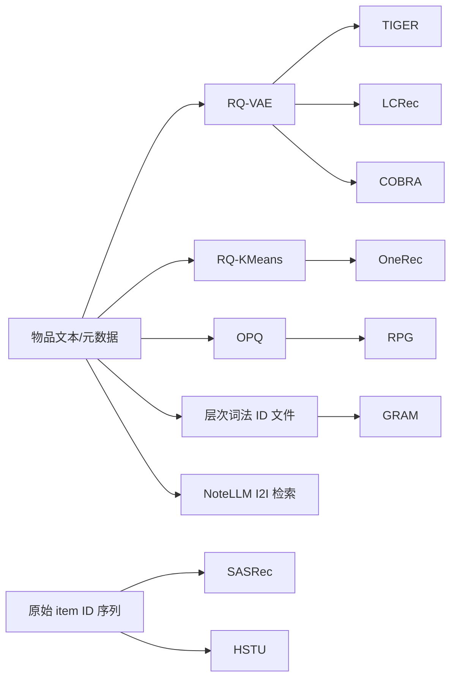

# 模型总览与选型

本页回答两个问题：仓库里的模型彼此是什么关系，以及做实验时该选哪一条路径。逐项“是否已经实现、是否完成复现、是否有可信多 seed 结果”的权威状态请看[模型实现状态](../reference/model-status.md)；仓库尚未实现的 GenRec 工作请看[生成式推荐模型全景](../landscape/model-catalog.md)。这里不重复维护容易过期的巨型状态表。

## 先区分推荐器与物品分词器

当前代码提供九条会直接输出推荐结果的模型路径：SASRec、HSTU、TIGER、LCRec、COBRA、OneRec、RPG、NoteLLM 和 GRAM。RQVAE 与 RQ-KMeans 是上游物品分词器（semantic-ID tokenizer），不会根据用户历史独立完成推荐，因此不应出现在推荐效果排行榜里。



这张图表达的是仓库默认数据流，不是理论上的唯一组合。例如 OneRec 数据适配器也能读取 RQ-VAE，但当前 Amazon 配置使用 RQ-KMeans；RPG 的 OPQ 在数据适配器内部拟合，并没有独立 trainer。

## 三个模型家族

### 判别式全库排序

- [SASRec](sasrec.md) 是最稳妥的序列推荐基线。Transformer 编码历史，直接为完整物品表打分。
- [HSTU](hstu.md) 用 SiLU attention、更新门和可选时间相对偏置替代标准自注意力，用来研究强序列骨干而不是 semantic ID。

二者都以原始 item ID 为监督，不需要量化器，也没有 SID 碰撞与 beam search 误差。需要判断“生成式收益究竟来自模型还是评测口径”时，应首先跑它们。

### 离散 ID 生成

- [TIGER](tiger.md)：RQVAE 语义 ID + T5 encoder-decoder + 普通自回归 beam search；当前实现没有硬 Trie。
- [LCRec](lcrec.md)：RQVAE 语义 ID + decoder-only LLM + SID/文本多任务对齐。
- [COBRA](cobra.md)：RQVAE 稀疏码与连续向量交错建模，输出稀疏和稠密两路预测。
- [OneRec](onerec.md)：RQ-KMeans ID + Qwen causal LM；提供 instruction-SFT、GRPO 与实验性 CLM 三条训练路径。
- [GRAM](gram.md)：生成外部预处理的层次词法 ID；T5 以 FiD 式多粒度 late fusion 编码历史文本。

这组模型的共同难点不是只有语言模型训练。物品分词、合法 ID 约束、SID 碰撞解析和 item-level 评测都会改变最终结果。TIGER、LCRec 与 OneRec 的当前 evaluator 以“训练交互中最热门 item”将每个 SID 确定性解析为一个 item，并在算 Recall/NDCG 前去重；GRAM 则依赖上游 lexical ID 一一映射，必须另做唯一性检查。原始 SID-tuple 指标只保留作诊断。

### 非自回归或向量检索

- [RPG](rpg.md) 用 OPQ 产生 16--64 位分区长 SID，以多个预测头一次并行预测所有 code 位置；仓库同时支持全库直接打分和图传播近似解码。
- [NoteLLM](notellm.md) 不生成 item token。它把物品文本压缩到 `[EMB]` 前一个 token 的 LLM hidden state，再以余弦相似度做精确全库 I2I 检索。

RPG 仍属于 semantic-ID 推荐，但没有逐位自回归；NoteLLM 则是可检索 LLM。把二者与 TIGER 的“生成步数”直接比较会混淆计算路径。

## 快速选型

| 研究问题 | 首选 | 对照 | 原因 |
|---|---|---|---|
| 建立可信的 item-level 下界 | SASRec | HSTU | 数据流最短，无量化与生成误差 |
| 研究 RQ 码本与自回归检索 | TIGER | RQVAE、SASRec | 组件边界清楚，T5 路径已有完整代码与历史实验 |
| 研究 LLM 与 SID/文本对齐 | LCRec | OneRec-SFT | 都是 decoder-only LLM，但任务数和 tokenizer 不同 |
| 研究推荐强化学习 | OneRec-SFT → GRPO | 同一 SFT checkpoint | 只有同 checkpoint 的前后差值能隔离 RL 增益 |
| 研究长 SID 与并行解码 | RPG | TIGER | OPQ 分区码、一次前向预测全部 code 位置 |
| 研究稀疏/稠密混合 | COBRA | COBRA sparse-only、TIGER | 需要先验证稀疏骨干，再判断 dense 分支收益 |
| 研究丰富 item 文本的 late fusion | GRAM | TIGER/LCRec | 每个历史 item 独立编码，再在 decoder 融合 |
| 研究 LLM 内容向量检索 | NoteLLM | SASRec 或普通 text encoder | 当前适配是 I2I，不是完整历史序列 encoder |

## 表示、训练与解码对照

| 路径 | 历史中的 item 表示 | 主干 | 训练目标 | 推理候选生成 |
|---|---|---|---|---|
| SASRec | 单一 item ID | causal Transformer | CE 或 BCE | 全库点积排序 |
| HSTU | 单一 item ID | HSTU blocks | CE 或 sampled softmax | 全库点积排序 |
| TIGER | 3--4 个 RQ code | T5 | code token CE | 当前为普通 beam，目录外 SID 后过滤 |
| LCRec | 默认 5 个 RQ code | Qwen causal LM | 多任务 response CE | code 位置约束 beam |
| COBRA | RQ codes + dense vector | decoder-only Transformer | sparse CE + dense loss | beam + dense fusion |
| OneRec | 默认 3 个 RQ-KMeans code | Qwen causal LM | SFT CE；可选 GRPO | KV-cache beam；RL rollout 用 PrefixTrie |
| RPG | 16/32 个 OPQ code | GPT-2 | 多头对比 CE | 全库打分或图传播 |
| NoteLLM | item 文本 | Qwen causal LM | in-batch 对比学习 | 全库 cosine top-k |
| GRAM | 层次词法 ID + item 文本 | T5-FiD | 词法 ID token CE | candidate Trie beam |

“全库”表示候选数会进入打分复杂度；“beam”表示只搜索模型定义的 token 空间。两者的延迟和召回上限不同，不能只按参数量比较。

## 公平评测的最低要求

1. **统一切分。** Amazon 适配器默认 leave-one-out；多数模型也支持 `global_temporal`。GRAM 当前读取预处理文件并固定使用末两项留出，尚未接入统一 temporal splitter。
2. **统一候选宇宙。** 判别式模型与 NoteLLM 进行精确全库排序；自回归模型用 beam 近似 top-k，但约束强度不同：TIGER 当前无硬约束，LCRec/OneRec SFT 主要是 code 位置约束，GRAM 与 OneRec GRPO rollout 使用 catalog Trie。RPG 的 direct 路径仍枚举全库，graph 路径是近似搜索。
3. **只把 item-level 指标放进主表。** SID tuple 可能碰撞。碰撞前的 Recall/NDCG 不能与原始 item-ID 模型比较。
4. **分开报告协议。** leave-one-out 与 global-temporal 不得取平均；后者仍对 catalog 和 item metadata 采用 transductive 设置，不等于冷物品评测。
5. **验证上游资产。** 下游 checkpoint 必须连同 encoder、tokenizer、codebook 层数/大小、SID artifact 和协议保存。相同形状不代表相同语义空间。

最新的完成矩阵与 provenance 在项目根目录的 [BENCHMARKS.md](https://github.com/phonism/genrec/blob/main/BENCHMARKS.md)。历史单次运行数字只应用于排查，不应覆盖已验证多 seed 结果。

## 训练入口与依赖

```bash
# 原始 item-ID 基线
python genrec/trainers/sasrec_trainer.py config/sasrec/amazon.gin --split beauty
python genrec/trainers/hstu_trainer.py config/hstu/amazon.gin --split beauty

# RQVAE → 自回归/混合模型（每个下游必须使用自己的匹配配置）
python genrec/trainers/rqvae_trainer.py config/tiger/amazon/rqvae.gin --split beauty
python genrec/trainers/tiger_trainer.py config/tiger/amazon/tiger.gin --split beauty

# OneRec：RQ-KMeans → SFT → 可选 GRPO
python genrec/trainers/rqkmeans_trainer.py config/onerec/amazon/rqkmeans.gin --split beauty
python -m genrec.trainers.onerec_sft_trainer config/onerec/amazon/sft.gin --split beauty
python -m genrec.trainers.onerec_grpo_trainer config/onerec/amazon/grpo.gin --split beauty

# 独立 tokenizer/数据路径
python -m genrec.trainers.rpg_trainer config/rpg/amazon.gin --split beauty
python -m genrec.trainers.notellm_trainer config/notellm/amazon.gin --split beauty
python -m genrec.trainers.gram_trainer config/gram/amazon/gram.gin --split Beauty
```

额外依赖与资产：

- RPG 的 OPQ 需要 `pip install -e ".[rpg]"` 所提供的 FAISS。
- OneRec/LCRec/NoteLLM 的 LoRA 分支需要 `peft`；OneRec 当前最佳 SFT 配置是 full-parameter，不依赖 LoRA。
- Qwen、Sentence-T5 与 Qwen embedding 模型路径由 `config/base.gin` 常量提供。
- GRAM 的 `t5-small` 可从 Hugging Face 获取，但它还要求 `dataset/gram/<Split>/` 下已有官方风格的预处理文件；trainer 不会从 Amazon 原始数据生成这些文件。

## 如何增加一条模型路径

仓库惯例是把边界分为四层：

1. `genrec/models/<name>.py` 只负责张量计算、loss 与生成 API。
2. `genrec/data/<dataset>_<name>.py` 负责协议切分、item 映射与 collate schema。
3. `genrec/trainers/<name>_trainer.py` 负责 Accelerator、优化器、评测、checkpoint 和 `results.json`。
4. `config/<name>/<dataset>/*.gin` 固化可复现实验，而不是把论文默认值藏在代码中。

新增 semantic-ID 模型时，还必须补充 SID collision/usage 检查、item-level resolver 或唯一化策略、无泄漏 tokenizer 拟合范围，以及至少一个验证“碰撞 item 不会误记为命中”的单元测试。只实现网络的 `forward()` 还不构成可比较的 GenRec 实验。

## 延伸阅读

- [RQVAE：可学习残差量化](rqvae.md)
- [RQ-KMeans：非神经残差量化](rqkmeans.md)
- [统一复现路线与诚实评测](../reproduction-roadmap.md)
- [未实现模型目录](../landscape/model-catalog.md)
