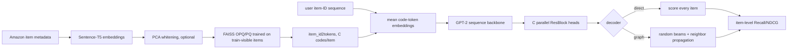

# RPG：长语义 ID 的并行生成

## 定位与状态

| 项目 | 本仓库实现 |
|---|---|
| 任务 | next-item recommendation |
| 家族 | 长 semantic ID 的非自回归、并行多头预测 |
| 物品表示 | Sentence-T5 item embedding 经 FAISS OPQ/PQ 得到 16 或 32 位 code |
| 序列主干 | 从零训练的轻量 GPT-2 |
| 训练目标 | 所有 codebook head 的平均 cross-entropy |
| 主评测 | direct full-catalog item scoring；可选 graph propagation |
| 状态 | 模型、数据、trainer、配置完整；图解码是附加近似路径 |

RPG 解决的是“长 SID 自回归要生成很多步”的瓶颈：多个 code 在给定同一序列 hidden state 后条件独立、一次前向同时预测。最新复现单元、协议与 seed 状态见[模型实现状态](../reference/model-status.md)和 [BENCHMARKS.md](https://github.com/phonism/genrec/blob/main/BENCHMARKS.md)。

## 原始工作

- 论文：[Generating Long Semantic IDs in Parallel for Recommendation](https://arxiv.org/abs/2506.05781)，KDD 2025，[DOI](https://doi.org/10.1145/3711896.3736979)。
- 官方实现：[facebookresearch/RPG_KDD2025](https://github.com/facebookresearch/RPG_KDD2025)。

论文把 OPQ 各子空间得到的 code 集合称为 **unordered long SID**，以 multi-token prediction（MTP）并行预测，并结合 graph-based decoding；长度在 4/8/16/32/64 中按数据集选择，而非全局默认 32。这里的 “unordered” 指不采用自回归前缀顺序，并不表示实现中的位置可以任意互换：每个 OPQ 子空间仍对应固定 codebook 和独立预测 head。本仓库重建了 OPQ → GPT-2 → parallel heads → direct/graph decoding 链路，但数据 encoder、默认位数、图构建方式和 benchmark 协议以本页代码为准。

## 表示与核心公式

设物品 $i$ 的 OPQ code 为

$$
z_i=(z_{i,1},\ldots,z_{i,C}),\qquad z_{i,c}\in\{0,\ldots,K-1\}.
$$

数据类把每个 codebook 放入独立的全局 token 分区：

$$
t_{i,c}=1+cK+z_{i,c},
$$

其中 token 0 留给 padding，词表末尾另留一个 EOS。模型不把一个 item 展开为 $C$ 个序列位置；它查询 $C$ 个 token embedding 后取平均：

$$
e_i=\frac1C\sum_{c=1}^{C}E[t_{i,c}].
$$

历史 item embedding 序列进入 GPT-2，得到位置 hidden state $h_t$。每个 codebook 有独立的残差头：

$$
q_{t,c}=h_t+\operatorname{SiLU}(W_ch_t+b_c).
$$

实现把 $W_c$ 零初始化，但 `nn.Linear` 的 bias 保留框架默认初始化。因此初始 head 并非严格恒等映射；“zero-initialized ResBlock”精确地只指 weight。

预测向量与本 codebook 分区的归一化 token embedding 做温度缩放点积：

$$
p(z_{t+1,c}=k\mid h_t)
=\operatorname{softmax}_k\left(
\frac{\hat q_{t,c}^{\top}\hat E_{c,k}}{\tau}
\right).
$$

训练 loss 是有监督位置上 $C$ 个 head 的 CE 均值：

$$
\mathcal L=\frac1C\sum_{c=1}^{C}
-\log p(z_{t+1,c}\mid h_t).
$$

所有 head 共享 $h_t$，但在输出层条件独立；这正是“一次并行生成全部 code”的含义，不是 $C$ 个独立序列模型。

## OPQ semantic ID

[`AmazonRPGDataset`](https://github.com/phonism/genrec/blob/main/genrec/data/amazon_rpg.py) 把 title、price、brand、feature、categories 和 description 拼成 item 文本，用 SentenceTransformer 编码。可选 `sent_emb_pca>0` 先在完整 catalog embedding 上做 whitening PCA，然后创建 FAISS factory：

```text
OPQ<C>,IVF1,PQ<C>x<log2(K)>
```

`codebook_size` 必须是 2 的幂。FAISS index 只用协议训练交互中出现的 item 拟合 OPQ/PQ，但随后把完整 catalog 加入 index 并导出 code。PCA 若启用则在 train-mask 之前对完整 catalog `fit_transform`；因此 global-temporal 仍是可见完整 catalog metadata 的 transductive 设置，而不是 inductive cold-item tokenizer。

SID cache 名包含 encoder basename、FAISS factory、PCA 维度和 evaluation protocol，因此 leave-one-out 与 global-temporal 不会共享 OPQ code。原始 sentence embedding cache 只包含 encoder basename，不包含 metadata 文件指纹或 encoder revision。

## 端到端数据流



leave-one-out 下训练序列去掉最后两个 target。每位用户的第一个窗口对所有相邻位置监督；超过 `max_seq_len+1` 的后续滑窗只监督最后一位，避免大量重复 label。验证历史截止倒数第三项、目标为倒数第二项；测试历史多包含验证 item，目标为最后一项。

## 代码实现映射

| 层次 | 文件 / 符号 | 职责 |
|---|---|---|
| 模型 | [`RPGModel`](https://github.com/phonism/genrec/blob/main/genrec/models/rpg.py) | item code embedding、GPT-2、并行头、loss 与两种 decoder |
| head | `ResBlock` | `x + SiLU(linear(x))` |
| 数据 | [`AmazonRPGDataset`](https://github.com/phonism/genrec/blob/main/genrec/data/amazon_rpg.py) | 序列协议、metadata embedding、OPQ cache、训练样本 |
| collate | `rpg_train_collate_fn` / `rpg_eval_collate_fn` | 右 padding、左截断、label mask |
| trainer | [`train_rpg`](https://github.com/phonism/genrec/blob/main/genrec/trainers/rpg_trainer.py) | 优化、验证早停、direct/graph 测试与保存 |
| evaluator | `evaluate` | 精确 item ID membership 的 Recall/NDCG |
| graph 工具 | [`eval_rpg_graph.py`](https://github.com/phonism/genrec/blob/main/scripts/eval_rpg_graph.py) | 从 best checkpoint 独立比较 direct 与 graph |
| 配置 | [`config/rpg/`](https://github.com/phonism/genrec/tree/main/config/rpg) | Beauty、Sports、Toys 的数据集特定超参 |

当前没有 RPG 专属单元测试。现有可信度主要来自可运行 pipeline、结果 artifact 验证和多 seed 复现；扩展 decoder 或数据协议时应补充小 catalog 的可手算测试。

## 训练命令与配置

先安装带 FAISS 的可选依赖，然后从仓库根目录运行：

```bash
pip install -e '.[rpg]'

# Beauty：32 位 SID
python -m genrec.trainers.rpg_trainer \
  config/rpg/amazon.gin --split beauty

# 数据集特定配方
python -m genrec.trainers.rpg_trainer \
  config/rpg/amazon_sports.gin --split sports
python -m genrec.trainers.rpg_trainer \
  config/rpg/amazon_toys.gin --split toys
```

训练器通过 `train_rpg.eval_with_graph=True` 在最终测试阶段同时写入 direct 与 graph 指标，这是当前可复现入口。`scripts/eval_rpg_graph.py` 虽可独立加载 checkpoint，但它使用单独的 `eval_rpg_graph.*` Gin 命名空间；现有 `config/rpg/*.gin` 只绑定 `train_rpg.*`，因此直接把训练 config 传给它**不会继承** temperature、codebook 数、beam、图预算、encoder 路径等关键值。未逐项补齐同名绑定前，只把该脚本视为开发诊断工具，不用它产出正式结果。

Beauty 默认关键值：

| 配置 | 值 | 含义 |
|---|---:|---|
| `n_codebook`, `codebook_size` | 32, 256 | 32 位 OPQ SID，每位 8 bit |
| `sent_emb_pca` | 512 | Sentence-T5 embedding 的 whitening PCA |
| `n_embd`, `n_layer`, `n_head` | 448, 2, 4 | 小型 GPT-2 |
| `n_inner` | 1024 | FFN 宽度 |
| `temperature` | 0.03 | code-token contrastive logits 温度 |
| embedding / attention dropout | 0.5 / 0.5 | 强正则 |
| batch / epochs | 256 / 150 | 无 gradient accumulation |
| learning rate / warmup | 0.01 / 10000 steps | cosine schedule |
| graph beams / edges / steps | 20 / 200 / 3 | 近似图传播搜索预算 |
| `eval_with_graph` | true | 训练结束后额外评测 graph |

Sports/Toys 配置使用 16 个 codebook，并有不同学习率、PCA 与图预算。不要只覆盖 `--split` 却继续用 Beauty 的 `amazon.gin`，除非实验明确要做统一超参对照。

## 两种推理路径

### Direct full-catalog scoring

每个 head 先对 $K$ 个 code token 做 `log_softmax`。物品 $i$ 的分数是它在所有 codebook 中对应 token log-probability 的均值：

$$
S(i)=\frac1C\sum_{c=1}^{C}\log p(z_{i,c}\mid h).
$$

实现对 catalog 每个 item gather 该分数并精确 `topk`。输出本来就是 1-based item ID，不需要 SID→item 碰撞解析；即使两个 item 的 OPQ code 完全相同，它们也会得到相同分数，`topk` 的 tie 行为仍应在 collision 报告中说明。`results.json` 的主 metrics 来自这条 direct 路径。

### Graph propagation

模型先用 learned token embedding 构建 item-item 相似度：每个 codebook 内算 cosine，将 $[-1,1]$ 映射到 $[0,1]$，再对 codebook 求均值。对每个 item 保留 `n_edges` 个最高相似邻居。推理时：

1. 为每个样本在 catalog 中随机抽 `num_beams` 个起点；
2. 展开当前节点的邻居；
3. 用同一 $S(i)$ 给邻居打分，保留下一轮 beams；
4. 重复 `propagation_steps`，返回最后一轮 top nodes。

它是近似且随机的：代码会统计访问节点数，但 evaluator 丢弃该统计；最终只按最后一轮 beam 排名，不会把全部 visited node 做全局重排。应给 graph eval 固定 seed 并单独报告，不可用它无标注地覆盖 direct 结果。

## 输出与资源复杂度

默认 `out/rpg/amazon/<split>/` 包含：

- `best_model.pt`：按 validation NDCG@10 选择的 state dict；
- `checkpoint_epoch_<epoch>.pt`：按间隔保存；
- `results.json`：direct 测试指标、best validation NDCG@10 与配置；
- 若启用 graph：`results.json` 的 `graph_metrics` 额外字段；
- 日志和可选 Weights & Biases 记录。

Direct 路径每批需要给 $N$ 个 item gather $C$ 个分数，时间约 $O(BNC)$。图初始化虽然分块填充，但仍分配一个 dense `[N,N]` float matrix，显存约 $4N^2$ bytes，随后才取 top neighbors；这会在大 catalog 上先因内存失败。trainer 因而把 graph test batch 固定为 32，但减小 batch 并不能降低该 $N^2$ adjacency 构建峰值。

## 与论文/官方实现的差异

| 方面 | RPG 论文/官方方向 | 本仓库 | 影响 |
|---|---|---|---|
| item encoder | 论文实验采用其指定的语义 embedding 管线 | 本地 Sentence-T5-XL；Beauty 另做 PCA-512 | OPQ code 不可直接对齐 |
| SID 长度 | 论文研究最长 64 位 | Beauty 32；Sports/Toys 16 | 容量、并行头数与训练难度不同 |
| 主 decoder | 强调 graph-based efficient decoding | 主 artifact 是 exact direct；graph 存 extra | headline 速度/效果应按 direct 理解 |
| 图存储 | 面向大 catalog 的图检索思想 | 先物化 dense $N\times N$ similarity | 当前实现不具备大规模内存优势 |
| 初始化 | graph 搜索设计依官方实现 | 随机起始 beams | 单次 graph 指标有随机性 |
| 协议 | 论文数据/切分 | Amazon 2014 LOO 或统一 global temporal | 不能横抄论文表格作复现分数 |

模型源码顶部残留的 `arxiv.org/abs/2501.12489` 不是本文采用的 RPG 论文链接；应以上面的 KDD 2025 论文和官方仓库为准。

## 已知限制与常见坑

1. **FAISS 报 code size 错误** → `codebook_size` 必须是 2 的幂；代码用 `int(log2 K)` 并显式 assert。
2. **换协议却复用了旧 SID** → cache 名含 protocol，正常不会复用；若手工复制/改名会破坏 train-mask 语义。
3. **换 metadata 后 embedding 没更新** → sentence cache 不含文件 fingerprint。删除明确的 split/encoder cache 后重建，并记录数据版本；不要递归清空整个 processed 目录。
4. **graph 初始化 OOM** → 根因是 dense $N^2$ matrix，不是 test batch。需改成 streaming top-k/kNN index，而不仅是减 batch。
5. **graph 指标每次不同** → 初始节点用 `torch.randint`。固定 seed，并报告多次方差或改为确定性入口。
6. **把 graph metrics 当主 metrics** → trainer 的 `metrics`/`results.json` 主字段是 direct；graph 在 `extra.graph_metrics`。
7. **多 GPU 早停或最终 best eval 异常** → 当前 `break` 与 best checkpoint reload 只在 main process 分支执行，其他 rank 不同步，可能造成控制流或最终权重不一致。训练/最终复现优先单卡；修复时需广播 stop flag 并在所有 rank 同步 load。
8. **`best_model.pt` 不存在** → best 值从 0 开始且使用严格 `>`；若所有 validation NDCG@10 都为 0，不会保存 best。
9. **direct 的相同 SID item 顺序不稳定** → 完整 code collision 会得到相同 item score。运行 SID collision 报告并定义 tie policy。
10. **比较 AR 生成步数时声称 RPG 是“一个 token”** → 它是一次 backbone 前向加 $C$ 个 head，再加全库或图检索；应分别报告模型计算与 candidate search。

## 扩展点

- 用 sparse/ANN kNN 替换 dense graph 构建；小 catalog 上应逐项验证 adjacency 与 direct score，并记录 visited recall。
- 将 random beam 改为可复现的高质量 seed（如各 head mode 组合、轻量 ANN 入口），保留随机版本作消融。
- 支持 64 位时必须同时调整 OPQ、词表、head 数、cache identity、内存和配置；不能只改 `n_codebook`。
- 为 OPQ/PCA artifact 保存 encoder revision、metadata fingerprint、train-item mask hash 和 FAISS 版本。
- 补充测试：并行 head label offset、direct 手算 top-k、collision tie、graph 访问集合、LOO/global-temporal cache 隔离。
- 修复分布式 early stopping 与 best reload 后，再把多 GPU 结果列为正式复现路径。

## 参考与相关文档

- [RPG 论文](https://arxiv.org/abs/2506.05781)
- [RPG 官方代码](https://github.com/facebookresearch/RPG_KDD2025)
- [模型总览与选型](overview.md)
- [SID collision 诊断](https://github.com/phonism/genrec/blob/main/scripts/report_sid_collisions.py)
- [统一复现路线](../reproduction-roadmap.md)
