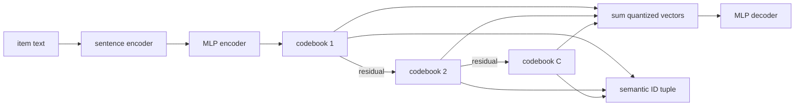

# RQ-VAE

RQ-VAE（Residual-Quantized Variational Autoencoder）在 GenRec 中是 **item tokenizer**：它把连续文本 embedding 压缩成多层离散 Semantic ID（SID），供 TIGER、LCRec 和 COBRA 使用。它不读取用户历史，也不应作为独立 recommender 报 Recall@K。

## 定位与状态

| 项目 | 内容 |
|---|---|
| 角色 | 可学习 SID tokenizer / quantizer |
| 输入 | item semantic embedding `[B,input_dim]` |
| 输出 | 重构向量、逐层 code、残差与量化损失 |
| 下游 | TIGER、LCRec、COBRA；不同下游使用不同几何配置 |
| 代码 | 完整训练与 checkpoint 恢复 |
| 主诊断 | reconstruction loss、quantization loss、逐层 usage/perplexity、完整 SID collision |
| 最近核验 | 2026-08-30 |

## 为什么需要离散 item token

自回归推荐器需要有限词表。直接为每个 item 分配唯一 token 无法利用内容结构，也不利于新 item 表示。RQ-VAE 先用 MLP 把 item 文本向量映射到低维空间，再用多个 codebook 依次拟合残差：

\[
z=E(x), \qquad r_1=z,
\]

\[
k_\ell=\arg\min_k d(r_\ell,e_{\ell,k}),\quad
q_\ell=e_{\ell,k_\ell},\quad
r_{\ell+1}=r_\ell-q_\ell.
\]

完整 SID 是 \((k_1,\ldots,k_C)\)，重构使用量化向量之和：

\[
\hat x=D\!\left(\sum_{\ell=1}^{C}q_\ell\right).
\]

相邻 code 不是自然语言 token；codebook 层号是表示的一部分，`code=7` 在第 0 层和第 1 层不是同一个 token。



## 损失

连续特征默认使用逐样本平方误差；decoder 输出在比较前做 L2 normalize：

\[
\mathcal L_{rec}=\lVert \hat x-x\rVert_2^2.
\]

每层量化损失由 codebook loss 与 commitment loss 组成：

\[
\mathcal L_{q}^{(\ell)}=
\lVert \operatorname{sg}(r_\ell)-q_\ell\rVert_2^2+
\beta\lVert r_\ell-\operatorname{sg}(q_\ell)\rVert_2^2.
\]

总损失为：

\[
\mathcal L=\operatorname{mean}\left(
\mathcal L_{rec}+\sum_{\ell=1}^C\mathcal L_q^{(\ell)}
\right).
\]

若 `n_cat_features > 0`，最后若干维使用 BCE-with-logits，其余维仍用重构误差；当前推荐 pipeline 的文本 embedding 配置把它设为 0。

## 四种量化前向模式

| 模式 | 训练时行为 | 适用说明 |
|---|---|---|
| `GUMBEL_SOFTMAX` | 对负距离做带温度 Gumbel-softmax，按软权重合成 code vector | 可微软分配 |
| `STE` | 最近邻硬分配，`x + (q-x).detach()` 直通梯度 | TIGER/LCRec/COBRA 前几层默认 |
| `ROTATION_TRICK` | 最近邻前向，用 rotation trick 改善 encoder 梯度方向 | 实验消融 |
| `SINKHORN` | batch 内平衡 optimal-transport assignment，再做硬分配与 STE | 下游配置的最后一层默认 |

训练/评测的最近邻距离当前为 L2。`codebook_normalize=True` 时只对第 0 层 codebook 输出和 encoder 输出做 L2 normalize；`sim_vq=True` 会在 codebook 后加共享线性投影。两者不是所有层自动生效的全局开关。

## 输出张量

`RqVae.get_semantic_ids(x)` 返回 `RqVaeOutput`：

| 字段 | shape | 说明 |
|---|---|---|
| `embeddings` | `[B,D,C]` | 各层量化向量，最后一维为层 |
| `residuals` | `[B,D,C]` | 每层量化前的残差 |
| `sem_ids` | `[B,C]` | 每个 item 的完整 SID |
| `quantize_loss` | `[B]`（逐层累计） | codebook + commitment loss |

`RqVae.forward(batch,gumbel_t)` 返回总损失、重构损失、RQ loss，以及仅用于调试的 embedding norm 和 batch 内 unique 比例。正式全目录碰撞率不能用单个 batch 的 `p_unique_ids` 替代。

## 三套下游几何

当前配置不能共享 checkpoint：

| 下游 | input | latent | hidden dims | codebook | 层数 | 典型 SID |
|---|---:|---:|---|---:|---:|---|
| TIGER | 768 | 32 | 512,256,128,64 | 256 | 3 | `256³` 空间 |
| LCRec | 768 | 64 | 512,256,128 | 256 | 5 | `256⁵` 空间 |
| COBRA | 768 | 32 | 512,256,128,64 | 32 | 3 | `32³` 空间 |

三者默认都以 `sentence-t5-xl` item embedding 为输入、前层 STE、最后层 Sinkhorn。文件名相同不代表几何兼容；下游 dataset 中的 `rqvae_*` 参数必须与 checkpoint 的 `model_config` 一致。

## 数据与缓存

`AmazonItemDataset` 从 review 首次出现顺序建立 item mapping，把 metadata 拼成文本，经 SentenceTransformer 编码后保存：

```text
dataset/amazon/processed/<split>/item_emb_<encoder-short-name>.parquet
```

缓存文件名包含 encoder 短名，并用文件锁与原子替换保护并发生成。RQ-VAE 使用固定 seed 把 item embedding 做 95% train / 5% eval 随机切分；这只用于 tokenizer 重构监控，不是用户序列的 valid/test 协议。

## 训练

```bash
# TIGER tokenizer
python genrec/trainers/rqvae_trainer.py \
  config/tiger/amazon/rqvae.gin --split beauty

# LCRec tokenizer（5 层、64-dim latent）
python genrec/trainers/rqvae_trainer.py \
  config/lcrec/amazon/rqvae.gin --split beauty

# COBRA tokenizer（3 × 32）
python genrec/trainers/rqvae_trainer.py \
  config/cobra/amazon/rqvae.gin --split beauty
```

trainer 支持互斥的 epoch 模式和 iteration 模式。当前下游配置使用 5000 epochs、前 50 epochs linear warmup、batch 1024。首次训练会聚合最多约 20,000 个样本做 codebook K-Means bootstrap；恢复 checkpoint 时不能再次初始化。

checkpoint 保存：

```python
{
    "epoch" or "iter": ...,
    "model": model.state_dict(),
    "model_config": model.config,
    "optimizer": ...,
    "scheduler": ...,
}
```

推理推荐使用：

```python
from genrec.models.rqvae import RqVae

rqvae = RqVae.from_pretrained(checkpoint, map_location="cpu")
rqvae.eval()
sem_ids = rqvae.get_semantic_ids(item_embeddings).sem_ids  # [N, C]
```

`from_pretrained` 会从 `model_config` 重建几何，并在第一次前向前禁用 K-Means bootstrap。手动构造后调用 `load_pretrained` 也会设置每层的初始化标志。不要使用旧文档曾出现的 `load_from_checkpoint`；代码中没有这个 API。

## 碰撞、去重与 codebook health

必须区分：

- **layer usage**：某层用了多少 code；
- **dead code**：某层未使用的 prototype；
- **full-SID collision**：多个 item 的完整 code tuple 相同；
- **max collision group**：一个 SID 桶最多包含多少 item。

每层 100% usage 仍可能有大量完整 SID collision。下游 headline 必须解析到 item；仅比较 SID tuple 会把同一碰撞桶里的错误 item 计作命中。

诊断命令：

```bash
python scripts/verify_codebook_health.py \
  --kind rqvae \
  --checkpoint out/tiger/amazon/beauty/rqvae/checkpoint_epoch_4999.pt \
  --dataset-folder dataset/amazon --split beauty \
  --encoder ./models_hub/sentence-t5-xl
```

具体参数以脚本 `--help` 为准。也可用 `scripts/dump_sem_ids.py` 和 `scripts/report_sid_collisions.py` 生成跨 tokenizer 对照。

`get_semantic_ids_dedup` 提供 LC-Rec 风格的后处理：固定前 `C-1` 层，对碰撞组的最后一层残差做 Sinkhorn 重分配。它可能仍无法拆开真正相同的 embedding，也可能制造与原唯一 item 的新碰撞，因此函数会检查并告警；不能把它描述为绝对唯一保证。

## 代码映射

| 层次 | 文件 | 对象 | 职责 |
|---|---|---|---|
| 模型 | `genrec/models/rqvae.py` | `RqVae` | encoder、residual quantization、decoder、checkpoint |
| 单层量化 | 同上 | `Quantize` | 距离、分配、四种 gradient path |
| 损失 | `genrec/modules/loss.py` | `ReconstructionLoss`, `QuantizeLoss` | 重构与 commitment |
| 数据 | `genrec/data/amazon.py` | `AmazonItemDataset` | metadata embedding 与缓存 |
| 训练 | `genrec/trainers/rqvae_trainer.py` | `train` | epoch/iteration、warmup、eval、保存 |
| 健康检查 | `scripts/verify_codebook_health.py` | — | usage、perplexity、collision |
| checkpoint 测试 | `tests/test_rqvae_checkpoint.py` | — | 防止加载后重初始化码本 |

## 已知限制

- tokenizer 与下游 recommender 分阶段训练，目标并未端到端对齐；
- Sinkhorn 是 batch 级平衡，不等价于全目录全局均匀；
- `torch.compile` 包装 forward，对不支持的平台/调试器可能需要额外配置；
- item embedding 与用户序列基于同一全目录 metadata，`global_temporal` 仍不是严格 inductive cold-item 协议；
- 在 item 数只有一万级时使用 8192 等超大 codebook，浅残差层极易出现死簇/超级簇；本仓库相关结论见研究路线图；
- 更低 collision 不必然带来更高下游 Recall，必须同时报告 tokenizer health 与 item-level 推荐质量。

## 参考

- [TIGER: Recommender Systems with Generative Retrieval](https://arxiv.org/abs/2305.05065)
- [LC-Rec: Adapting Large Language Models by Integrating Collaborative Semantics](https://arxiv.org/abs/2311.09049)
- [Restructuring Vector Quantization with the Rotation Trick](https://arxiv.org/abs/2410.06424)
- [领域中的 tokenizer 与量化方法](../landscape/taxonomy.md)
