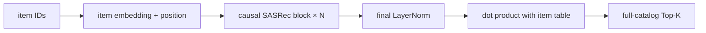

# SASRec

SASRec 是本仓库最重要的判别式序列推荐基线：它用带因果掩码的自注意力编码 item 历史，并直接对完整目录打分。所有生成式模型都应先与同协议、同序列长度、已训练到收敛的 SASRec 比较。

## 定位与状态

| 项目 | 内容 |
|---|---|
| 原论文 | [Self-Attentive Sequential Recommendation](https://arxiv.org/abs/1808.09781)，ICDM 2018 |
| 任务 | next-item prediction |
| 表示 | 唯一 item ID；0 为 padding |
| 输出 | 每个序列位置对 `num_items + 1` 个 ID 的 logits |
| 代码 | 完整链路 |
| 主评测 | item-level、full catalog、Recall/NDCG |
| 复现角色 | 判别式锚点；结果以 `BENCHMARKS.md` 为准 |
| 最近核验 | 2026-08-30 |

## 为什么它是必要基线

SASRec 不需要 tokenizer、SID 解析或 beam search，因此没有 codebook collapse、SID collision 和候选解码近似。若生成式模型只在 SID-level 指标上超过 SASRec，却在解析后的 item-level 指标上落后，不能得出“生成式检索更好”的结论。

## 模型

给定 item 序列 \((i_1,\ldots,i_L)\)，模型首先构造：

\[
X_t = E_{i_t} + P_t,
\]

其中 \(E\) 是共享的 item embedding，\(P\) 是可学习位置 embedding。每个 block 由因果多头自注意力和 point-wise FFN 组成：

\[
A=\operatorname{softmax}\!\left(\frac{QK^\top}{\sqrt{d_h}}+M_{\text{causal}}+M_{\text{pad}}\right)V,
\]

\[
H'=\operatorname{Residual}(A), \qquad
H=\operatorname{Residual}(\operatorname{FFN}(H')).
\]

最终用隐藏状态与同一张 item embedding 表点积：

\[
s_{t,j}=h_t^\top E_j.
\]

当前实现保留了官方 TensorFlow 版本的若干细节：Q 来自归一化输入，K/V 来自 block 原输入；key mask 在 softmax 前应用，query mask 在 softmax 后应用；残差连接位于 attention/FFN 模块内部。代码注释是判断行为的权威来源。



## 张量与 API

`SASRec.forward(input_ids, targets=None, negatives=None)`：

| 张量 | shape | 说明 |
|---|---|---|
| `input_ids` | `[B, L]` | 左 padding 的 item ID 序列 |
| `targets` | `[B, L]` | 每个位置的下一 item；0 被忽略 |
| `negatives` | `[B, L]` | 仅 BCE 训练需要，每个有效位置一个负样本 |
| `logits` | `[B, L, V+1]` | CE、无 target 或评测时返回 |
| `loss` | scalar 或 `None` | BCE 或 CE 损失 |

!!! note "BCE 返回值"
    BCE 训练为了避免不必要的全目录矩阵乘法返回 `(None, loss)`；不要在这条路径读取 logits。`predict(input_ids, top_k)` 使用最后一个位置并排除 padding ID 0。

## 两种训练目标

### Full-vocabulary CE

默认 Amazon 2014 配置使用全目录交叉熵：

\[
\mathcal{L}_{CE}=-\sum_{t\in\mathcal V}\log
\frac{\exp(h_t^\top E_{y_t})}
{\sum_{j=0}^{V}\exp(h_t^\top E_j)}.
\]

它为每个有效位置同时比较所有 item，且训练和 full-catalog 评测的 score function 一致。当前 CE 路径会把 item embedding 乘以 \(\sqrt d\)。

### 原论文式 BCE

`loss_type="bce"` 为每个有效位置随机抽一个非正例 item：

\[
\mathcal{L}_{BCE}=-\log\sigma(h_t^\top E_{y_t})
-\log\left(1-\sigma(h_t^\top E_{n_t})\right).
\]

这里的负采样只保证 `negative != positive`，不会排除用户历史中的其他 item。BCE 与 CE 是不同实验，不应把结果合并成一个 SASRec 数字。

## 数据流

`AmazonSASRecDataset` 按时间排序用户交互并生成样本。默认 `leave_one_out`：

- train：保留每位用户除最后两次交互外的序列；collate 将 `history + target` 右移，形成多位置监督；
- valid：倒数第二个 item 为目标；
- test：最后一个 item 为目标；
- 输入超过 `max_seq_len` 时只保留最近行为；batch 内左 padding。

也可把数据集的 `evaluation_protocol` 绑定为 `global_temporal`。两种协议的数据覆盖不同，输出目录与结果聚合必须分开。评测对目录直接取 Top-K，只排除 padding 0；当前实现**不额外屏蔽历史已交互 item**。

## 代码映射

| 层次 | 文件 | 关键对象 | 职责 |
|---|---|---|---|
| 模型 | `genrec/models/sasrec.py` | `SASRec` | 编码、BCE/CE、全目录打分 |
| block | 同上 | `SASRecBlock`, `MultiHeadAttention`, `PointWiseFeedForward` | 因果注意力与残差 FFN |
| 数据 | `genrec/data/amazon_sasrec.py` | `AmazonSASRecDataset` | 序列切分和 item 映射 |
| collate | 同上 | `sasrec_collate_fn`, `sasrec_eval_collate_fn` | 左 padding、shift target、负采样 |
| 训练 | `genrec/trainers/sasrec_trainer.py` | `train`, `evaluate` | Accelerate、早停、full-catalog 指标 |
| 配置 | `config/sasrec/amazon.gin` | — | Amazon 2014 默认实验 |
| 配置 | `config/sasrec/amazon2023.gin` | — | 预处理为兼容格式后的 Amazon 2023 |

## 运行

```bash
# 默认：Amazon 2014 Beauty，full-vocabulary CE
python genrec/trainers/sasrec_trainer.py \
  config/sasrec/amazon.gin --split beauty

# 原论文式单负例 BCE
python genrec/trainers/sasrec_trainer.py \
  config/sasrec/amazon.gin --split beauty \
  --gin 'train.loss_type="bce"'

# 去泄漏程度更高的全局时间切分；输出目录需单独设置
python genrec/trainers/sasrec_trainer.py \
  config/sasrec/amazon.gin --split beauty \
  --gin 'AmazonSASRecDataset.evaluation_protocol="global_temporal"' \
  --gin 'train.save_dir_root="out/sasrec/amazon/beauty/global_temporal/s42"'
```

Amazon 2023 必须先运行 `genrec.data.amazon2023` 的准备流程，把原始 JSONL 转换成适配器读取的兼容文件；仅更换 config 不会自动完成 5-core 预处理。

## 当前默认配置

Amazon 2014 的当前 Gin 配置为 `epochs=300`、`batch_size=128`、`embed_dim=64`、`num_heads=1`、`num_blocks=2`、`ffn_dim=256`、`dropout=0.5`、`loss_type="ce"`。Python 函数默认值与 Gin 实验值不同，复现实验时应以实际 config 和 `results.json` 为准。

训练器按 valid Recall@10 早停和保存 `best_model.pt`，最终加载最佳权重评测 test，并写 `results.json`。当前单卡路径已完整；多卡训练时 SASRec 早停分支仍应重点检查各 rank 是否同步退出，相关通用约束见[训练系统](../architecture/training-system.md)。

## 与论文的差异

| 方面 | 原论文/官方常见设置 | 本仓库默认 |
|---|---|---|
| 损失 | point-wise BCE + 负采样 | Amazon 2014 headline 使用 full-vocabulary CE |
| 评测 | 论文常见 sampled negatives | 完整目录 Top-K |
| 数据 | 论文自己的预处理 | Amazon 2014 5-core 兼容数据与本仓库切分 |
| 训练样本 | 多位置 next-item | 每用户一条序列样本，collate 内多位置监督 |
| seen-item mask | 视实现而定 | 只排除 padding，不屏蔽历史 item |

因此本仓库数字用于框架内公平比较，不应直接与论文表格作无条件数值等价。

## 常见问题

- **结果远低于 `BENCHMARKS.md`**：先确认没有被短跑/debug checkpoint 覆盖，训练到 valid Recall@10 收敛，并核对 CE/BCE。
- **CE 与 BCE 差距大**：它们比较的负例集合不同，是预期现象；不要只改 loss 名称却沿用旧实验标签。
- **不同 batch size 改变 BCE 结果**：负样本是 Python `random` 在线抽样；固定 seed，并保留完整 config/provenance。
- **Amazon 2023 找不到 `.json.gz`**：先用 `python -m genrec.data.amazon2023 ...` 生成兼容目录。
- **与生成式模型比较不公平**：核对 `max_seq_len`、目标切分、full catalog、seed 与 metric level，而不只看数据集名称。

## 参考

- [论文：Self-Attentive Sequential Recommendation](https://arxiv.org/abs/1808.09781)
- [作者官方 TensorFlow 实现](https://github.com/kang205/SASRec)
- [本仓库基准与 provenance](https://github.com/phonism/genrec/blob/main/BENCHMARKS.md)
