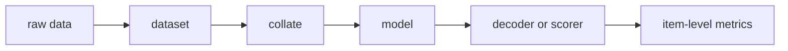

# 模型名（文档模板）

> 复制本页时删除所有说明文字。不要把尚未完成的段落留在正式导航中。

## 定位与状态

| 项目 | 内容 |
|---|---|
| 任务 | next-item / retrieval / ranking / tokenizer |
| 家族 | 判别式 / AR 生成 / 并行生成 / diffusion / LLM retrieval |
| 表示 | item ID / SID / text / dense vector |
| 代码 | 完整链路 / 组件 / 实验性 / 未实现 |
| 评测 | item-level full catalog / constrained approximation / diagnostic only |
| 复现 | 已复现 / 待重评 / 未复现 |
| 最近核验 | YYYY-MM-DD |

## 原始工作

- 论文：标题、作者、venue/year、链接
- 官方代码：链接或“未公开”
- 本仓库目标：复现范围或作为哪条对照轴

## 问题定义

写清输入、输出、候选目录和训练监督。至少给出关键 tensor shape。

## 核心思想

只保留帮助理解实现的公式。定义每个符号，并说明公式来自论文还是本仓库改写。

## 端到端数据流

## 代码映射

| 层次 | 文件 | 类 / 函数 | 职责 |
|---|---|---|---|
| model | `genrec/models/...py` | `...` | ... |
| data | `genrec/data/...py` | `...` | ... |
| trainer | `genrec/trainers/...py` | `train` | ... |
| config | `config/...gin` | — | ... |
| tests | `tests/test_...py` | `test_...` | ... |

## 训练

列前置产物、单卡/多卡命令、关键配置和输出目录。命令必须能从仓库根目录复制执行。

## 推理与评测

写清候选生成、约束、SID→item 解析、去重、Recall/NDCG 和已知近似。禁止只写指标名称。

## 与论文的差异

| 方面 | 论文 | 本仓库 | 影响 |
|---|---|---|---|
| backbone | ... | ... | ... |

## 已知限制与排错

按“现象 → 原因 → 检查命令/修复”写。区分已证实原因与假设。

## 扩展点

说明替换 tokenizer、backbone、loss 或 decoder 时要同时改哪些接口和测试。

## 参考文献

优先论文原文、官方仓库和官方项目页。关键实验数字应落到具体表格或章节。

