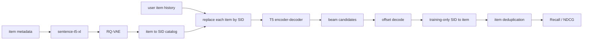

# TIGER

TIGER 把 next-item recommendation 改写为短 token 序列生成：先用 RQ-VAE 把每个 item 编成多层 Semantic ID，再让 T5 encoder–decoder 根据历史 SID 自回归生成目标 SID。

## 定位与状态

| 项目 | 内容 |
|---|---|
| 原论文 | [Recommender Systems with Generative Retrieval](https://arxiv.org/abs/2305.05065)，NeurIPS 2023 |
| 官方参考代码 | [google-research/google-research/tree/master/tiger](https://github.com/google-research/google-research/tree/master/tiger) |
| 任务 | next-item generative retrieval |
| 表示 | RQ-VAE Semantic ID，默认 3 × 256 codes |
| backbone | 仓库内纯 PyTorch T5 encoder–decoder |
| 解码 | 当前代码为普通 beam search；未硬接 Trie |
| 主评测 | training-only SID→item 解析、item 去重后的 Recall/NDCG |
| 复现 | 历史 SID-level checkpoint 需按当前 item-level 代码重评 |
| 最近核验 | 2026-08-30 |

## 两阶段流水线



第一阶段只看 item 内容 embedding；第二阶段才使用用户行为序列。两个阶段必须使用同一个 item 顺序、sentence encoder 和 RQ-VAE 几何。

## SID token 编码

原始 SID 的每层 code 都在 `[0,K-1]`，如果直接共用 token 范围，模型无法知道 code 属于哪一层。collate 使用位置偏移：

\[
\tilde c_j=c_j+jK+1,\qquad j=0,\ldots,C-1.
\]

0 保留给 padding / decoder start；词表大小为 `C*K+1`。例如 `K=256`、SID `[12,7,99]` 会变成 `[13,264,612]`。历史中每个 item 的 C 个 token 依次展平，最长输入 token 数是 `max_seq_len * C`。

!!! warning "层数必须同步"
    `AmazonSeqDataset` 生成的 SID 宽度、trainer 的 `sem_id_dim`、词表大小和 `max_length` 必须一致。若 dataset 追加第 4 个 disambiguation code，却仍用 `sem_id_dim=3`，会造成 token layer 错位。

## T5 目标

给定历史 token 序列 \(x\) 与目标 SID token \(y_{1:C}\)，模型优化 teacher-forcing 交叉熵：

\[
\mathcal L=-\sum_{j=1}^{C}
\log p_\theta(y_j\mid y_{<j},x).
\]

encoder 双向编码全部历史 token；decoder 用 causal self-attention 和 cross-attention 逐层生成目标 code。input/output embedding 与 LM head 按 T5 方式共享。

当前 `Tiger` 包装的是 `genrec/modules/t5.py` 中的纯 PyTorch 实现，不是运行时直接实例化 Hugging Face T5。该实现以 weight-compatible 为目标，并有 `verify_t5_equivalence.py` / `verify_pure_t5.py` 辅助检查；旧 trainer docstring 中的 “HF T5-based” 是历史描述。

## 当前模型配置

默认 Amazon Gin：

| 参数 | 值 |
|---|---:|
| encoder / decoder layers | 4 / 4 |
| `d_model` / `d_ff` | 128 / 1024 |
| heads / `d_kv` | 6 / 64 |
| dropout | 0.1 |
| SID | 3 × 256 |
| history | 50 items = 150 tokens |
| beam size | 30 |
| optimizer | Adam, lr `1e-4`, no scheduler |

注意 `num_heads * d_kv` 不要求等于 `d_model`；T5 会把 Q/K/V 投影到多头内部维度。

## 数据样本

`AmazonSeqDataset` 默认按用户时间排序，并在 leave-one-out 下：

- train：排除最后两个 item，使用 sliding window；每个剩余 item（首项除外）都做一次 target；
- valid：倒数第二项为 target；
- test：最后一项为 target；
- history 只保留最近 `max_seq_len` 个 item；
- `SeqData.item_ids` 是已经展平但尚未 offset 的历史 codes；
- `SeqData.target_ids` 是原始 target SID，`target_item` 保存真实 item ID。

训练样本策略与 SASRec 不同：TIGER 每个用户产生多条 prefix 样本，而当前 SASRec 每用户一条序列、在 collate 内做多位置监督。比较时需要意识到 I/O 和 sample count 不同。

### 碰撞处理选项

dataset 提供两个互斥策略：

- `add_disambiguation=True`：为同 SID item 追加组内序号，SID 从 C 层变 C+1 层；
- `dedup_sinkhorn=True`：保持层数，用 RQ-VAE 最后一层 Sinkhorn 重分配碰撞组。

默认配置两者都关闭，并在评测时诚实解析碰撞。若同时打开，代码优先 Sinkhorn 并忽略 suffix。使用 suffix 时必须同步 `sem_id_dim` 和 vocab；suffix 最大值还必须小于 `codebook_size`。

## 解码：代码事实与旧文档差异

`Tiger.generate()` 调用纯 PyTorch T5 的 beam search，设置：

```text
max_length = sem_id_dim + 1
num_beams = beam_size
num_return_sequences = beam_size
```

返回的第一个 decoder-start token 被移除，剩下 `[B,beam,C]`。

!!! danger "当前没有 Trie 约束"
    当前实现没有向 `generate()` 传 prefix callback，也没有 catalog Trie。模型可能在第 j 步生成属于其他 codebook offset 区间的 token，或产生目录中不存在的 SID。item mapper 会丢弃无法解析的候选，但这会降低有效候选数。项目概览中曾写“TIGER 使用 Trie 约束”，那描述的是预期/常见范式，不是当前代码事实。

若后续加入 Trie，应复用 `genrec/utils/generation_trie.py` 的接口思想，并同时增加“所有输出合法”“batch beam reorder 正确”“有效候选不足时补齐”的测试；不能只在文档中改状态。

## 诚实 item-level 评测

SID 可能碰撞。`SemanticIdItemMapper.from_sequences` 只根据训练前缀统计 item popularity，对每个 SID 选择一个确定代表 item，流行度相同时取较小 item ID：

\[
g(s)=\arg\max_{i:\operatorname{SID}(i)=s}
\operatorname{pop}_{train}(i).
\]

评测依次：

1. 把 offset token 还原成 raw SID；
2. 用 \(g\) 映射到唯一 item；目录外 SID 丢弃；
3. 同一 item 多次出现只保留第一次；
4. 从更深 beam 继续补候选，不足位置填 `-1`；
5. 对真实 `target_item` 计算 item-level Recall@5/10 与 NDCG@5/10。

trainer 仍记录 pre-dedup SID-level 指标，但日志明确标为 diagnostic，`results.json` 的主 `metrics`、valid 早停与 best checkpoint 选择均使用 item-level Recall@10。

## 代码映射

| 层次 | 文件 | 对象 | 职责 |
|---|---|---|---|
| wrapper | `genrec/models/tiger.py` | `Tiger` | T5 构造、forward、beam generate |
| T5 | `genrec/modules/t5.py` | `T5ForConditionalGeneration` | 纯 PyTorch encoder–decoder 与 generation |
| tokenizer | `genrec/models/rqvae.py` | `RqVae` | item embedding → SID |
| 数据 | `genrec/data/amazon.py` | `AmazonSeqDataset` | SID catalog、序列样本、碰撞策略 |
| collate | `genrec/trainers/tiger_trainer.py` | `t5_collate` | offset encoding、左 padding、raw targets |
| resolver | `genrec/modules/metrics.py` | `SemanticIdItemMapper` | training-only SID→item 与去重 |
| trainer | `genrec/trainers/tiger_trainer.py` | `train` | 单设备训练、早停、双口径日志 |
| config | `config/tiger/amazon/*.gin` | — | RQ-VAE 与 TIGER 两阶段参数 |

## 运行

```bash
# Stage 1：训练匹配几何的 RQ-VAE
python genrec/trainers/rqvae_trainer.py \
  config/tiger/amazon/rqvae.gin --split beauty

# Stage 2：训练 TIGER
python genrec/trainers/tiger_trainer.py \
  config/tiger/amazon/tiger.gin --split beauty
```

checkpoint 默认依赖：

```text
out/tiger/amazon/<split>/rqvae/checkpoint_epoch_4999.pt
```

覆盖路径时同时检查 encoder 和几何：

```bash
python genrec/trainers/tiger_trainer.py \
  config/tiger/amazon/tiger.gin --split beauty \
  --gin 'train.pretrained_rqvae_path="/abs/path/checkpoint.pt"'
```

训练器目前直接选择 `cuda` 或 `cpu`，没有用 Accelerate 包装 TIGER model/data loader；多 GPU 命令不能类推 OneRec 的 accelerate launch。W&B 可关闭：`--gin 'train.wandb_logging=False'`。

## checkpoint 与结果

- 最佳 item-level valid Recall@10 权重：`best_model.pt`（仅 model state dict）；
- `results.json`：主 item metrics、seed、config、best epoch、`sid_resolution=most_popular_training_only`；
- `sid_reference_metrics`：旧 SID-level 诊断，不能进入 headline 表格；
- RQ-VAE checkpoint 另存 optimizer/scheduler/model_config，与 TIGER checkpoint 格式不同。

## 与论文/参考实现的差异

| 方面 | TIGER 工作 | 本仓库当前实现 |
|---|---|---|
| item tokenizer | RQ-VAE semantic IDs | RQ-VAE，多种量化模式及碰撞诊断 |
| backbone | T5 类 encoder–decoder | 仓库内 pure-PyTorch T5 |
| candidate validity | 生成目录 SID 的范式 | 普通 beam；没有硬 Trie，非法 SID 后过滤 |
| collision | 论文协议不等同当前诚实解析 | training-only most-popular resolver + item dedup |
| model selection | 依原实验协议 | item-level valid Recall@10 |
| distributed | 参考环境不同 | 当前 trainer 为单进程设备路径 |

本仓库历史表中的 TIGER SID-tuple 数字不能与当前 item-level 数字混用。只有按新代码重评 checkpoint 后，结果才可重新进入主对比表。

## 常见问题

- **大量候选被丢弃**：统计每个 code position 的 offset 区间合法率和 catalog SID 命中率；当前无 Trie。
- **加载 RQ-VAE 后 SID 全变**：使用 `RqVae.from_pretrained` 或已修复的 `load_pretrained`，防止第一次前向重新 K-Means 初始化。
- **输入维度不匹配**：检查 parquet encoder、`rqvae_input_dim`、latent/hidden dims、codebook size/layers。
- **SID Recall 高而 item Recall 低**：报告 collision group、resolver retention 与去重前后候选；这是表示歧义，不是指标实现 bug。
- **设置 `add_disambiguation=True` 后训练异常**：同步将 `sem_id_dim` 改为 C+1，并确保 suffix 落在合法 code 范围。
- **评测很慢**：成本约随 test users、beam size 和自回归层数增长；当前没有批量 Trie/KV-cache 专项优化。
- **和 SASRec 比较时结果漂移**：确认两者使用同一目标切分、`max_seq_len=50` 和 item-level full-catalog 定义。

## 参考

- [TIGER 论文](https://arxiv.org/abs/2305.05065)
- [Google Research TIGER 参考目录](https://github.com/google-research/google-research/tree/master/tiger)
- [RQ-VAE 组件](rqvae.md)
- [SID 评测术语](../reference/terminology.md)
